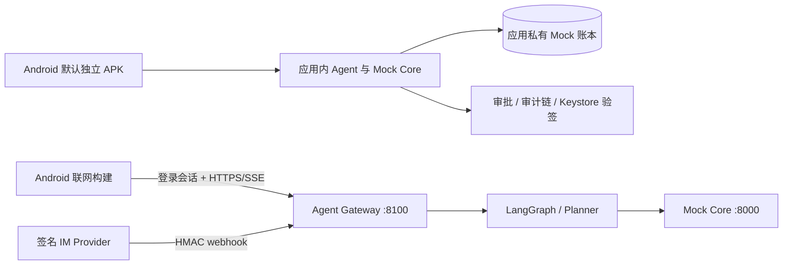

# 安言：AI 银行智能体（Android 独立应用 + IM 渠道）

> **GitHub 仓库地址**：<https://github.com/Zagadka-3906/ai-banking-agent>
>
> Android 默认产出**无需电脑后端**的独立演示 APK；签名 IM webhook 与 Android 联网联调模式继续使用 Agent 网关和 Mock Core。仓库使用虚构账户与 Mock 账本，不能连接真实银行账户或完成真实支付。

[](https://fastapi.tiangolo.com/)
[](https://github.com/langchain-ai/langgraph)
[](https://api-docs.deepseek.com/)
[](android/)
[](tests/)

“安言”让用户用一句话办理转账、账单分析、理财、卡片、订阅和跨场景任务。创作理念是**让大模型理解需求、让安全策略决定执行**：模型只负责理解与表达，所有账户事实、风险判定、授权和记账均由服务端重新校验。Agent 会处理模糊表达、省略上下文、多轮回指与隐含意图——例如“钱都花哪儿去了”进入账单分析，“再转一次”复用上一笔收款人和金额但重新授权，“把它取消掉”承接最近一次订阅查询；涉及写操作的歧义不会被猜测执行。

## 作品交付物索引

| 交付物 | 位置 |
| --- | --- |
| 作品简介（200 字） | [docs/作品简介.md](docs/作品简介.md) |
| 技术文档（架构图 / 核心算法 / 安全设计） | [docs/技术文档.md](docs/技术文档.md) |
| 答辩 PPT（≤10 分钟汇报） | [docs/答辩PPT.pptx](docs/答辩PPT.pptx) |
| 演示视频（≤5 分钟）与录制脚本 | [docs/演示视频.md](docs/演示视频.md) |
| 安全自评报告（权限分级 + 已知风险清单） | [docs/安全自评报告.md](docs/安全自评报告.md) |
| 模拟用户实测问题清单 | [docs/模拟用户测试问题清单.md](docs/模拟用户测试问题清单.md) |
| 演示操作脚本 | [docs/demo-script.md](docs/demo-script.md) |

## 支持的业务

- **智能转账**：按联系人姓名、别名或手机号转账，支持备注、定时转账和 AA 收款。
- **账单分析**：按日、月、上月、年过滤，输出分类统计、异常交易识别和可追溯报告。
- **理财操作**：风险测评、产品推荐与对比，以及需要红区授权的一键申购/赎回。
- **卡片管理**：申请虚拟卡、额度调整、交易限制/解锁、挂失/解挂和敏感卡信息查看。
- **订阅/代扣管理**：自动识别周期扣费、创建续费提醒、确认后一键取消订阅。
- **跨场景联动**：“我爱人生日”→ 当月锁定 1000 元活期 + 生日前 2 天提醒与鲜花/蛋糕订单，编译为带补偿的任务 DAG。

## 架构与安全边界



权限三级分级：**GREEN** 查询直接执行；**YELLOW**（转账/预约/AA/锁资/订阅取消/开卡）需明确确认；**RED**（申购/赎回/调额/冻结/挂失/改密等）还需 OTP 与已登记 Android 设备 Keystore P-256 签名。转账风险动态累计：当日 ≤1000 元为黄区、超即红区。等级由 Core 重算，客户端自报不能降级。

独立版和联网版使用同一套 Android API 契约与界面。独立版把确定性业务引擎、虚构账户事实和授权执行器放进 APK，状态保存在应用私有目录，拔掉电脑服务后仍可登录、对话和办理完整演示流程；它不连接真实银行、不调用在线模型、不提供公网 IM webhook。

联网 Android 与 IM 的服务端边界：

1. 客户端先 `POST /api/v1/auth/login`，之后以 `X-Session-Token` 访问网关；网关每次回 Core 校验会话，自报 `X-User-Id` 不能替代凭证。
2. 网关只发放不透明审批句柄；授权 nonce、MFA proof 和账本对象都不交给渠道端。
3. Core 在执行前再次校验主体、金额、收款人、余额、卡状态、风险级别、TTL、单次性和幂等键；Agent 文本不能构成授权。
4. IM 可以查询、澄清和发起流程；需要确认或 MFA 时必须回到 Android/API 完成。

完整设计见 [技术文档](docs/技术文档.md)、[架构说明](docs/architecture.md)、[独立 APK 说明](docs/standalone-apk.md) 与 [设备验收](docs/device-verification.md)。

## 部署说明

### 方式一：独立 APK（默认，零后端依赖）

Windows 下双击或执行：

```powershell
.\start-emulator.bat          # 构建 APK → 启动/复用 bankagent 模拟器 → 安装并打开
.\start-emulator.bat -Offline # 依赖已缓存时跳过联网步骤
```

首次需要 JDK 17+ 与 Android SDK 35，可用 `android/tools/install-android-toolchain.ps1` 免管理员安装。也可以分步构建：

```powershell
cd android
.\gradlew.bat --no-daemon :app:testDebugUnitTest :app:assembleDebug :app:assembleDebugAndroidTest
# 联网变体：.\gradlew.bat --no-daemon :app:assembleDebug -PbankStandalone=false
```

Debug APK 位于 `android/app/build/outputs/apk/debug/app-debug.apk`，可直接安装到任意 Android 8.0+ 设备。登录沙箱账户 `user_zhang` / `user_li` / `user_wife`，口令 `Bank@2026`，红区 OTP `888888`。

### 方式二：本地 Python 服务（联网 Android / IM 联调）

需要 Python 3.10–3.12：

```powershell
py -3.12 -m venv .venv
.\.venv\Scripts\python.exe -m pip install -r requirements-dev.txt
Copy-Item .env.example .env    # .env 只用于本机，不能提交
.\.venv\Scripts\python.exe -m uvicorn main:app --host 127.0.0.1 --port 8000      # Mock Core
.\.venv\Scripts\python.exe -m uvicorn agent_api:app --host 127.0.0.1 --port 8100 # Agent 网关
```

Android 联网变体默认指向 `http://10.0.2.2:8100/`（模拟器回环访问宿主机）。

### 方式三：Docker Compose

```powershell
docker compose up --build
```

编排 `core`(:8000) 与 `gateway`(:8100) 两个服务，带持久卷、健康检查与依赖顺序；CI 校验 compose 配置。

### IM 渠道

部署环境通过 `BANK_IM_PROVIDER_SECRETS` 配置允许的 provider（如本地测试 `demo=<随机值>`）。用户先在已登录会话调用 `POST /api/v1/im/bindings` 领取一次性绑定码，provider 发送签名 `bind` 事件完成绑定；后续 `message` 事件必须带 `X-IM-Provider / X-IM-Timestamp / X-IM-Event-Id / X-IM-Signature`（HMAC-SHA256，300s 时间窗 + 事件号防重放）。

### 关键配置

完整说明见 [`.env.example`](.env.example)：`BANK_AUTH_SECRET`（授权凭证密钥）、`BANK_REQUIRE_SESSION=1`（写接口要求会话）、`BANK_CONVERSATION_DB`（checkpoint）、`BANK_DEVICE_STORE_PATH`（设备公钥）、`BANK_LEDGER_STORE_PATH`（账本快照）、`BANK_AUDIT_LOG_PATH`（审计链落盘）、`BANK_IM_PROVIDER_SECRETS`、`BANK_FCM_CREDENTIALS`（可选推送）、`DEEPSEEK_API_KEY`（可选在线模型，缺失时确定性规则解析）。

## 测试用例

### 后端测试（pytest，685 项）

```powershell
.\.venv\Scripts\python.exe -m pytest -q
.\.venv\Scripts\python.exe -m ruff check . --ignore E402
```

| 测试域 | 代表文件 |
| --- | --- |
| Core API / 账本持久化 / 篡改拒载 | `tests/test_core_api.py`、`test_ledger_persistence.py` |
| 网关会话边界 / SSE / 审批 | `tests/test_agent_gateway.py`、`test_approval_store.py` |
| Agent 工作流 / 上下文回指 / 解析守卫 | `tests/test_agent_workflow.py`、`test_model_context_followups.py`、`test_model_parse_guards.py` |
| 自然语言场景回归（转账/账单/理财/卡片/订阅） | `tests/test_natural_transfers.py`、`test_natural_bills_subscriptions_events.py`、`test_natural_wealth_cards.py` |
| 安全：边界 / 业务 / 意图 / 沙箱 / 回归 | `tests/test_security_*.py`（5 组） |
| 设备信任 / 推送 / IM 签名 / 熔断 / 并发 | `tests/test_device_trust.py`、`test_push_notifications.py`、`test_im_webhook.py`、`test_concurrency.py` |
| 对话级安全案例数据 | `tests/data/security_conversation_cases.json`（24 案：注入、幻觉、审计、熔断、沙箱） |
| 对话级自然语言案例数据 | `tests/data/natural_conversation_cases.json`（57 案：转账 20 / 账单 6 / 理财 9 / 卡片 9 / 订阅 7 / 跨场景 6） |

### Android 测试

```powershell
cd android
.\gradlew.bat --no-daemon :app:testDebugUnitTest          # 单元测试
.\gradlew.bat --no-daemon :app:connectedDebugAndroidTest  # 插桩 UI 测试（需模拟器）
```

单元测试覆盖卡号解析、回复卡片解析、预测建议、独立引擎；插桩测试（`android/app/src/androidTest/`）覆盖登录对话、卡片、联系人、理财、反欺诈与回复卡片 UI。

### 端到端探针（scripts/）

| 脚本 | 用途 |
| --- | --- |
| `scripts/agent_gateway_e2e.py` | 三级授权 + 审计链连续性 + 审批防重放端到端验证 |
| `scripts/evaluate_agent_scenarios.py` | 将 Android UI 录制的 `observations.json` 与 57 条案例逐轮比对，产出 `evaluation.md` |
| `scripts/fcm_delivery_e2e.py` | 真实 FCM 投递探针（需服务账号凭据） |
| `scripts/smoke_test.py` | 部署后 `/healthz` 冒烟 |
| `scripts/device_signer.py` | E2E 探针的一次性签名设备（复刻 Android Keystore 签名格式） |

## 目录

```text
android/                    Android 原生客户端（Kotlin + Compose）、单元/插桩测试、工具脚本
docs/                       简介、技术文档、答辩与安全自评等交付文档
scripts/                    E2E、场景评测、推送探针和一次性设备签名器
tests/                      Core、网关、IM、安全和自然语言回归测试（685 项）
main.py                     Mock Core Banking API（唯一记账边界）
agent_api.py                Android/IM 渠道网关
im_webhook.py               签名 IM webhook
conversation.py             渠道会话、审批句柄与 checkpoint
agent.py / planner.py       意图解析、策略分级与 LangGraph 编排
security.py / sandbox.py    设备信任、审计、熔断与只读分析沙箱
scheduler.py / notifications.py / notification_outbox.py
                            任务调度、FCM 推送与 at-least-once 发件箱
docker-compose.yml          Core + Gateway 部署示例
start-emulator.bat          一键构建、安装并打开最新 Android 应用
```

## 生产化限制

当前实现是演示沙箱。上线前需要把内存/文件状态迁移到事务数据库与 Redis，接入 OIDC、真实 OTP/生物因子、KMS、TLS/WAF、分布式限流、消息队列、WORM 审计、真实支付与 IM provider，并完成隐私、合规、许可证和红队评审。详见[安全自评报告](docs/安全自评报告.md)中的已知风险清单。
