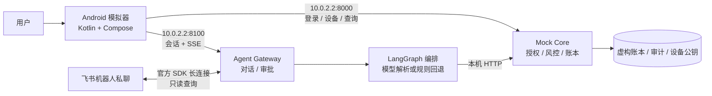

# 安言：本机银行智能体演示系统

**GitHub 仓库：** [Zagadka-3906/ai-banking-agent](https://github.com/Zagadka-3906/ai-banking-agent)

安言让用户在 Android 模拟器里用自然语言查询余额、分析账单、办理模拟转账、管理卡片与理财；可选飞书机器人私聊渠道提供只读查询。电脑运行两个本地 Python 服务：Mock Core 持有虚构账本和授权策略，Agent Gateway 处理对话、审批和飞书长连接。模拟器通过 `10.0.2.2` 访问电脑的 `127.0.0.1`。项目不连接真实银行或执行真实支付。

Agent 回执使用 `response.version=1` 协议，分别提供 `turn_status` 与 `business_status`。业务状态包括已核验、未完成、未通过核验、待补充、待确认、部分完成、待核对与已取消；旧 `status`、`reply`、`result` 字段保持兼容。普通请求及审批后的执行均支持 SSE，阶段事件包含 `phase`（started/completed/failed/waiting）、步骤编号与耗时。

明确且完整的请求先用本地规则解析，未识别的表达再调用模型；默认模型等待预算为 12 秒、重试为 0 次，可通过 `.env.example` 中的 `BANK_MODEL_*` 调整。本地解析通过 `parse_meta` 记录来源、歧义原因和快路径资格，不给规则匹配伪造概率。多个金额、收款人或业务对象，以及“一百五”等省略位数的金额先追问；模型不能替用户消除这些冲突。备注与附言保留为数据，不参与业务、对象、金额或日期识别。

最多拆分 8 项请求：支持“然后/同时”、逗号分隔的完整业务和“余额和账单”等自然连接；联系人列表、产品比较和金额千位分隔符保留原义。独立只读查询最多 4 项并行，明确“然后/再”的请求按顺序执行，失败项不会掩盖其他已核验结果。包含变更或风险测评的复合任务按原文顺序推进，例如“查询余额，然后给李四转 10 元，然后给王美转 20 元”；每笔变更分别预检、审批、验证，不复用上一笔授权。测评结束后恢复剩余任务；取消或失败停止后续步骤，已完成的账务保留。未识别的子任务会要求澄清。

账单支持最近 N 天/周、上周、昨天、指定月份及明确起止日期。自定义范围用 `date_scope=CUSTOM` 和 `date_range={start,end}` 表示，开始日和结束日均包含在内，按业务时区筛选 UTC 或本地时间记录。分类追问沿用当前范围，新的日期请求覆盖原范围；无效、倒置或尚不支持的时间表达要求补充起止日期，不退化为全部历史记录。

资金操作丢失回执时返回操作编号，Android 自动进行最多 10 次只读核对，之后可点“核对结果”。Gateway 根据会话所有者向 Core 的 `/api/v1/operations/{operation_id}` 查询原幂等记录，通过原回执验证后才推进任务；查询不会再次提交资金操作。操作回执随账本持久化，保留期默认 24 小时；无法找到有效回执时继续显示待核对，不推断失败或回滚。

设计原则是**模型理解需求，Core 决定能否执行**。服务端对意图、金额、对象、会话和风险等级再次校验；黄区要求明确确认，红区还要求演示 OTP 与已登记 Android Keystore 设备签名。审批卡可获取绑定本次授权、最长 60 秒的一次性本机演示码，推荐设置 `BANK_MFA_DYNAMIC_OTP=1`；不发送真实短信。没有模型密钥时使用确定性规则解析，仍可本地演示。

Android 增加端侧语音入口：有端侧识别服务的 API 31+ 设备可将语音转为可编辑文字，不自动发送；不支持时继续文字输入。任务页展示依赖、状态与原因，可请求人工处理并暂停关联待执行步骤；已完成操作和锁资保留，没有在线客服。完整变更、模型对比、飞书平台限制及真人测试入口见[参赛完善与验收](docs/参赛完善与验收-2026-10-15.md)。

## 交付材料

| 内容 | 文件 |
| --- | --- |
| 200 字内作品简介 | [作品简介](docs/作品简介.md) |
| 系统架构图、核心算法、安全设计 | [技术文档](docs/技术文档.md) |
| 10 分钟内答辩 PPT 逐页大纲 | [答辩提纲](docs/答辩提纲.md) |
| 5 分钟内演示视频分镜、动效、转场 | [演示视频方案](docs/演示视频.md) |
| 权限分级与已知风险 | [安全自评报告](docs/安全自评报告.md) |
| 可复现测试步骤 | [测试用例](docs/测试用例.md) |
| 已执行验证结果与限制 | [验证记录](docs/验证记录.md) |
| 赛题逐项覆盖、评测与验收工具 | [参赛完善与验收](docs/参赛完善与验收-2026-10-15.md) |
| 项目检查、修复与后续项 | [项目检查与完善（2026-10-14）](docs/项目检查与完善-2026-10-14.md) |
| 飞书机器人创建、配置与接入状态 | [接入说明](docs/飞书IM接入.md) |

仓库保留本机 Core/Gateway、Android 模拟器客户端、可选飞书机器人及测试和运行脚本。旧独立 APK、Docker/Compose、FCM 推送和过时的成片与截图已移除。AA 请求由发起人创建，各参与人须登录自己的账户并确认付款；待付款项在应用任务页展示。飞书自建应用已经发布，私聊文本查询已由用户实测收到回复；余额、账单、理财、卡片与订阅查询现在使用飞书原生只读消息卡片，详见[接入说明](docs/飞书IM接入.md)。

## 系统架构



## 本机部署

### 环境与安装

Windows 电脑需 Python 3.10–3.12、JDK 17 或 21、Android SDK API 37（平台包 `platforms;android-37.0`、Build Tools 36.0.0）与 Android Emulator。首次可运行 `android/tools/install-android-toolchain.ps1` 安装构建工具链，再通过 Android Studio 安装 Emulator 和系统镜像、创建名为 `bankagent` 的 AVD。

Android 项目使用 AGP 9.4.1、Gradle Wrapper 9.8.1；保留 AGP 内置 Kotlin 集成，通过官方支持的 runtime dependency 将 Kotlin / Compose 编译器同步升级至 2.4.21。`compileSdk` / `targetSdk` 为 37，最低运行版本仍为 Android 8.0（API 26）；构建使用仓库中的 `gradlew.bat`，无需手动切换全局 Gradle。Compose 界面测试使用 v2 Rule，迁移记录见 [测试 Rule 迁移与 Gradle 兼容检查](docs/Android测试Rule迁移与Gradle兼容检查-2026-10-15.md)；剩余 AGP 弃用警告的稳定方案评估见 [AGP 上游警告审计](docs/AGP上游警告稳定方案审计-2026-10-15.md)。

安装脚本与 CI 使用 Android Command-line Tools 23.0（构建号 `16111833`）以识别 SDK 37.0 的包信息；本机脚本将它安装到独立的 `cmdline-tools/23.0` 目录并优先加入 PATH，保留已有旧版本。

脚本通过新版 `android sdk install` 安装并核对平台、Build Tools 的实际文件和版本；CLI 包路径使用 `platforms/android-37.0`、`build-tools/36.0.0`，避免 Windows 兼容版 `sdkmanager.bat` 错误拆分旧分号参数。

```powershell
py -3.12 -m venv .venv
.\.venv\Scripts\python.exe -m pip install -r requirements-dev.txt
if (-not (Test-Path .env)) { Copy-Item .env.example .env }
```

`.env` 是本机配置，已被 Git 忽略。默认 `BANK_DEMO_MODE=1`、`BANK_REQUIRE_SESSION=1`。可选填入 `DEEPSEEK_API_KEY` 调用在线模型；留空时使用规则解析。建议把 `BANK_AUTH_SECRET` 换成本机随机长密钥。账本、设备和审计路径可分别通过 `BANK_LEDGER_STORE_PATH`、`BANK_DEVICE_STORE_PATH`、`BANK_AUDIT_LOG_PATH` 设置为仓库外的绝对路径。完整变量见 [`.env.example`](.env.example)。

配置账本持久化后，任务队列及其依赖、取消／接管状态、任务结算回执也随账本恢复。旧快照仍可加载，但此前未保存的任务无法自动找回；需要人工核对原有预约与锁资记录。

启用飞书时另安装 `requirements-feishu.txt`，创建企业自建应用并在 `.env` 设置 `BANK_FEISHU_ENABLED=1`、`FEISHU_APP_ID`、`FEISHU_APP_SECRET`；完整配置见[飞书接入说明](docs/飞书IM接入.md)。Android 登录后在设备管理面板获取一次性绑定码，于机器人私聊发送 `/绑定 <绑定码>`。飞书仅支持查询，不能用于转账、确认或强验证。

### 一键启动

在仓库根目录执行：

```powershell
.\start-emulator.bat
```

脚本检查并启动本机 Core `:8000` 与 Gateway `:8100`，构建最新 Debug APK，启动或复用 `bankagent` 模拟器，安装并打开应用。服务只监听电脑 `127.0.0.1`。已有 Gradle 缓存时可用 `.\start-emulator.bat -Offline`。日志在 `build/quick-start/`，APK 在 `android/app/build/outputs/apk/debug/app-debug.apk`。

也可在两个 PowerShell 窗口分别运行：

```powershell
.\.venv\Scripts\python.exe -m uvicorn main:app --host 127.0.0.1 --port 8000
.\.venv\Scripts\python.exe -m uvicorn agent_api:app --host 127.0.0.1 --port 8100
```

健康检查：`http://127.0.0.1:8000/healthz`、`http://127.0.0.1:8100/healthz`。模拟器经 Android 宿主机映射 `10.0.2.2` 连接服务，无需暴露到局域网。修改端口时同步设置 Gradle 参数 `-PbankCoreUrl=...` 与 `-PbankGatewayUrl=...`。

Android 17 起，连接本地服务前会按配置地址请求附近设备权限；仅访问公网或 `127.0.0.1` / `localhost` 时不请求。如果 HTTPS 域名由内网 DNS 解析到局域网地址，构建时补充 `-PbankLocalNetwork=true`。默认按私有 IP、链路本地 IP、`.local` 或单段主机名判断，不发起 DNS 查询；该参数不会在 Android 16 及更早系统请求新权限。

### 演示账户

| 项目 | 值 |
| --- | --- |
| 用户 | `user_zhang`、`user_li`、`user_wife` |
| 登录口令 | `Bank@2026` |
| 红区演示 OTP | 审批卡获取一次性演示码；旧测试兼容码为 `888888`，动态模式禁用固定码回退 |

红区还需要模拟器设置屏幕锁或生物识别，并让应用登记 Keystore 公钥。以上凭据仅用于虚构账户。

## 功能与权限

| 功能 | 典型输入 | 要求 |
| --- | --- | --- |
| 余额、账单、理财查询 | “查余额”“上月钱花哪儿了” | 登录会话，GREEN |
| 模拟转账、AA、预约 | “给李四转 300 元” | 转账预检 + 确认；AA 先发请求，各参与人独立授权付款；当日转账累计超过 1000 元升 RED |
| 理财申赎、卡片敏感变更 | “申购 200 元”“挂失卡片” | RED，OTP + 设备签名 |
| 订阅识别、取消、生日锁资 | “识别周期扣费”“取消订阅”“锁定 1000 元” | 检测只产生待核实候选；取消已登记代扣与锁资为 YELLOW；模拟商户下单到期后再次确认 |

模型只输出受约束的意图 JSON；`planner.py` 校验意图和槽位。Core 以短期、单次凭证重新核对主体、金额、对象、余额与风险等级。审批仅向 Android 返回不透明句柄。完整调用链见[技术文档](docs/技术文档.md)。

## 测试

```powershell
.\.venv\Scripts\python.exe -m pytest -q
.\.venv\Scripts\python.exe -m ruff check . --ignore E402
cd android
.\gradlew.bat --no-daemon :app:testDebugUnitTest :app:lintDebug :app:assembleDebug :app:assembleRelease :app:assembleDebugAndroidTest
# 启动本机服务和模拟器后；Android 17 首次需先打开应用并允许附近设备：
.\gradlew.bat --no-daemon :app:connectedDebugAndroidTest
```

默认 Debug 端点 `10.0.2.2` 属于本地网络，因此 API 37 首次运行会先显示授权入口；普通 `connectedDebugAndroidTest` 应在完成该授权后执行。专门验证系统拒绝与允许的 `LocalNetworkPermissionSystemTest` 则要求专用模拟器从未授权状态启动，以 `networkPermissionTest=true` 显式启用，并将 Debug 的 Core/Gateway 端点分别设为 `10.0.2.2:18800` / `10.0.2.2:18810`，连接隔离测试服务。

隔离环境的 68 项主要回归使用 `BankingRegression` 标记：选择 `-PbankScenarioTests=true` 和 `-Pandroid.testInstrumentationRunnerArguments.annotation=com.aibanking.agent.BankingRegression`，运行 `connectedScenarioAndroidTest`。同时传入本轮隔离服务的 `controlToken` 和专用模拟器的 `devicePin`；核对报告中实际执行 68 项，且没有失败或跳过。系统权限测试单独运行。可使用 `scripts/run_android_regression.py` 自动创建隔离服务、检查专用模拟器和核对 XML / protobuf 结果；手动及每周设备 CI 见 `.github/workflows/android-regression.yml`。

Python 测试覆盖账本持久化、会话边界、授权防重放、并发幂等、自然语言场景；Android JVM 测试覆盖解析与建议，插桩测试覆盖登录、对话、卡片等 UI。步骤与预期结果见[测试用例](docs/测试用例.md)。端到端授权探针：`python scripts/agent_gateway_e2e.py`；健康探针：`python scripts/smoke_test.py`。

健康探针会先登录、查询本人余额，再退出本次探针会话，支持默认严格会话模式。可通过环境变量 `BANK_DEMO_USER_ID`、`BANK_DEMO_PASSWORD` 指定演示账户；启用登录短信验证时，另设置 `BANK_LOGIN_OTP`。这些变量由探针进程环境读取，请勿把真实凭据写进命令参数或提交到仓库。

## 源码索引

| 路径 | 作用 |
| --- | --- |
| `main.py`、`security.py`、`mock_merchant.py`、`subscription_detector.py` | Core、授权、虚构账本与商户、周期扣费候选识别 |
| `agent_api.py`、`conversation.py`、`feishu_im.py` | Android 对话网关、SSE、审批句柄和飞书只读私聊接入 |
| `agent.py`、`planner.py`、`sandbox.py` | LangGraph、意图与任务规划、只读分析沙箱 |
| `scheduler.py`、`notification_outbox.py` | 本机任务状态与 AA 事件记录 |
| `android/app/src/main/` | Android 客户端 |
| `tests/`、`android/app/src/test/`、`android/app/src/androidTest/` | 后端、JVM 与模拟器 UI 测试 |
| `.github/workflows/ci.yml` | Python 与 Android 构建检查 |

这是单机 Mock 演示。进程内状态与本地文件不具备跨机器事务能力；演示 OTP 为固定值；审计链不等于外部不可抵赖存储；可选在线模型会把输入发送给模型服务。详见[安全自评报告](docs/安全自评报告.md)。
