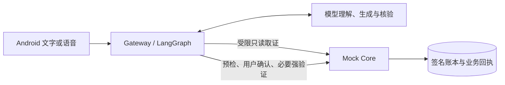

<p align="center"></p>

# 安言：银行 AI 智能体演示

用文字或语音查询账户、分析账单、发起模拟转账，管理卡片、理财和订阅。安言把自然语言对话与资金执行分开：模型理解需求、规划只读取证并生成回答，Mock Core 独立核对权限和业务条件，持久提交后返回回执。

这是一个可运行的 Android 与 Python 演示项目，账户、资金、产品和商户均为虚构数据。

[运行方式选择](docs/运行与部署.md) · [本地开发](docs/本地开发.md) · [技术架构](docs/技术文档.md) · [文档索引](docs/README.md) · [赛事评审指南](docs/评审指南.md)

## 能做什么

| 场景 | 当前实现 |
| --- | --- |
| 对话查询 | 余额、流水、消费分析、持仓和卡片；多个问题分别取证、计算和核验 |
| 模拟办理 | 转账、预约、AA、资金预留、理财申赎、卡片变更及订阅；按业务要求确认和强验证 |
| 多轮讨论 | 补充信息、插问、暂停、更正与恢复；恢复讨论后重新预检，不沿用旧授权 |
| 理财浏览 | 五类 25 款虚构产品，支持搜索、期限与策略筛选、净值和申赎规则详情 |
| Android 交互 | 长按说话、松开转写、上滑取消；识别文字核对后发送；联系人删除前确认并同步服务器 |
| 演示管理 | 本地与服务器面板配置账户、保存初始状态、备份和恢复 |
| 可选飞书 | 绑定 Android 登录会话后私聊查询；资金办理回到 App 确认 |

语音、理财与反馈动画的实现分别见[语音输入](docs/语音输入界面.md)、[理财频道](docs/理财界面.md)和[交互细节](docs/交互细节.md)。

## 怎么保证操作有据可查



查询回答基于当前规则与本人记录，金额由程序计算，生成后再核对引用、字段和操作声明。资金成功结果以 Core 回执为准。绿区为本人只读；黄区要求核对确认；红区另需一次性演示验证码和登记设备签名。Core 按业务、金额及累计行为定级，订阅查询也保留黄区确认。

技术栈：Python 3.10–3.12、FastAPI、LangGraph、可配置 DeepSeek 模型；Android 使用 Kotlin、Jetpack Compose 和 Keystore。详细边界见[安全设计](docs/安全设计文档.md)。

## 快速开始（Windows）

准备 Python 3.12；运行 Android 另需 JDK 17/21、Android SDK API 37、Build Tools 36.0.0 和名为 `bankagent` 的 AVD。工具链安装脚本及完整配置见[本地开发](docs/本地开发.md)。

```powershell
py -3.12 -m venv .venv
.\.venv\Scripts\python.exe -m pip install -r requirements-dev.txt
if (-not (Test-Path .env)) { Copy-Item .env.example .env }
.\start-local-panel.bat
```

打开 `http://127.0.0.1:9100` 管理本机演示数据。启动 Android 模拟器、构建并安装应用用 `start-emulator.bat`。演示账户 `user_zhang`、`user_li`、`user_wife` 共用公开口令 `Bank@2026`；红区演示还需屏幕锁及设备登记。

在首次启动前填写 `.env` 中的 `DEEPSEEK_API_KEY` 可启用模型链路；未配置时只能演示规则与固定结果。默认模型为 `deepseek-flash`，思考模式为 `disabled`。可选 `DASHSCOPE_API_KEY` 用于经用户同意的云端转写，`BANK_AUTH_SECRET` 应换成随机长密钥。变量见[配置示例](.env.example)。首次启动后，本地面板使用独立数据目录内的 `local.env`，后续修改位置见[本地开发](docs/本地开发.md)。

云端 HTTPS 和 APK 构建见[部署说明](deploy/README.md)，飞书见[接入说明](docs/飞书IM接入.md)。

## 验证与版本

截至 2026-11-02，已记录的后端历史全量为 **3147 passed、1 skipped**。本轮闲置代码清理后，客户端 JVM **139 项通过**，Android Lint、应用及设备测试包构建通过，相关工具回归 **23 项通过**。历史客户端 140 项中的一项只测试已删除的数字动画状态，随组件一并移除；本轮未重跑后端全量或设备专项。完整范围、部署提交和测试限制见[验证记录](docs/验证记录.md)。

```powershell
.\.venv\Scripts\python.exe -m pytest -q
.\.venv\Scripts\python.exe -m ruff check .
.\.venv\Scripts\python.exe -m mypy
.\.venv\Scripts\python.exe scripts/export_banking_rules.py --check
.\.venv\Scripts\python.exe scripts/check_repository_docs.py
```

普通回归使用隔离数据与受控模型替身。联网模型评测、实际语音准确率和完整真机验收另行执行；参赛演示和源码打包不代表通过[稳定发布门槛](docs/稳定验收标准.md)。历史设计稿、截图和答辩文件已从当前版本移除，Git 历史仍可追溯；本地 APK、录制素材、交付材料与运行数据保持忽略，参赛材料说明见[评审指南](docs/评审指南.md)。

## 目录

| 路径 | 内容 |
| --- | --- |
| `bank_agent/`、`bank_planning/` | 对话、取证、计算、审批与回答核验 |
| `bank_core/`、`bank_security/` | 模拟核心、账本、授权、签名和安全组件 |
| `android/` | 客户端、JVM 与设备测试、工具链脚本 |
| `deploy/` | Linux 服务、Nginx 和本地／服务器管理面板 |
| [scripts/](scripts/README.md) | 启动、评测、验证与打包工具 |
| [tests/](tests/README.md) | 后端回归、版本化数据和共享契约 |
| [docs/](docs/README.md) | 技术说明、评审材料、版本证据与品牌原稿 |
| `tools/usability/` | 配合可用性评估脚本的观察页面 |

根目录 Python 模块保留运行入口及共享业务接口。`build/`、`submission/` 和虚拟环境是忽略的本地产物，目录整理及保留依据见[整理说明](docs/整理说明.md)。

## 使用边界

项目不接入真实银行、短信或商户履约。演示 OTP 可由 App 获取，设备登记未达到真实银行认证强度；模型核验可能误判。账本面向单进程演示，公网演示使用私有 CA。已知风险与生产化缺口见[安全自评](docs/安全自评报告.md)。

## 许可证

[MIT](LICENSE)。思考动画移植自 thinking-orbs，其 MIT 许可证随应用提供，来源见[交互细节](docs/交互细节.md)。
