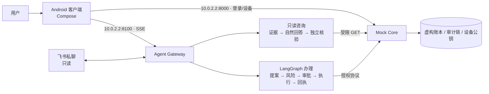

# 安言 · 言出即办的银行智能体

> 用一句话办银行业务：查余额、看账单、核对已保存联系人、转账、理财、管卡片和订阅。
> **模型理解需求，核心决定执行。** 所有账户与交易均为本机虚构数据，不连接真实银行、不发生真实支付。

安言由三部分组成：

- **Android 客户端**（Kotlin + Jetpack Compose）：Gemini 风格对话界面，支持端侧语音输入。
- **Agent Gateway**（`:8100`）：以结构化讨论命令处理暂停、纠正、补充和恢复；按本轮多个目标取证，程序计算保留来源，核验反馈区分补查与改写；LangGraph 管理办理、审批和流式进度。
- **Mock Core**（`:8000`）：持有虚构账本，独立执行授权、风控、设备签名与审计。

历史用于理解指代，答复依据本轮记录与版本化规则；询问对象引用、通用政策和个人事实分别核验。批量读取后仍按每个目标的对象和时间范围分析。生成与核验将稳定条款前置以复用模型缓存，账户记录仍每轮读取。当前稳定验收进度与未通过项见[验证记录](docs/验证记录.md)，不能用本机测试通过替代完整验收。

回答区分未请求的投影字段与真正缺失的必答数据，不从“本轮没读取金额”推断账本没有金额。任务评测按每轮当时的独立环境快照评分，后续问题和最终余额不回流到早先阶段；普通办理请求与确认授权分开检查。

卡片等只读对象绑定容忍显示空格与全半角差异，仍核验编号边界和本人记录。公共产品货架不作为持仓证据；追问只承接实际展示的记录编号，多候选和空结果不能扩大到旧整批数据。

另外可选接入飞书机器人私聊，仅支持只读查询。

使用 GLM-5.3-Flash、Qwen3.8-Max、Gemini 3.8 Flash（`gemini-3.8-flash`）或其他开发助手接手续做，先读[开发助手交接指南](docs/开发助手交接指南.md)：包含最终交付目标、接手提示词、当前阻断、后续工作顺序、验证命令和完整验收门槛。开发模型与银行运行模型分别配置；恢复业务开发和评测须遵循用户最新的暂停或恢复指令。

## 功能一览

| 场景 | 说一句话 | 安全要求 |
| --- | --- | --- |
| 余额、账单、消费分析 | “查余额”“上个月钱花哪儿了”“最近转给谁了”“哪个月花得最多” | 🟢 登录即可；开放式问题由生成的表达式在受限沙箱中计算 |
| 转账、预约转账、AA 收款 | “给李四转 300 元”“明天给王美转 50” | 🟡 确认；当日累计超 1000 元升为 🔴 |
| 理财：风险测评、推荐、申购、赎回、持仓 | “推荐理财”“申购 LX00118 500 元”“我的持仓” | 测评、推荐、持仓 🟢；申购赎回 🔴（验证码 + 设备签名） |
| 卡片：开卡、限额、冻结、挂失、交易渠道 | “把限额调到 20000”“关闭境外交易” | 开卡、关闭渠道 🟡；限额、冻结、挂失、开通渠道 🔴 |
| 订阅识别与取消、生日资金锁定 | “我有哪些订阅”“锁定 1000 元给老婆过生日” | 🟡 确认 |
| 撤销未执行的安排 | “撤销刚才那笔预约”“撤回 AA 请求” | 🟡；已完成的转账不能撤销 |
| 复合请求 | “查余额，然后给李四转 10 元，再给王美转 20 元” | 每一步单独预检、审批 |

界面和交互特点：

- 对话采用原生 Compose 组件：输入区与语音、发送操作分行，聚焦时描边反馈；请求处理中仍可编辑下一条草稿，发送与语音录制等当前请求结束后恢复。
- 消息默认跟随最新内容；手动拖动翻看历史时暂停跟随，可点“回到最新消息”或“查看待确认操作”返回，发送新消息后恢复跟随。
- 处理进度按服务端事件显示为时间线，区分进行中、待确认、完成和失败；耗时仅在回复详情中展示，步骤完成不代表资金操作成功。
- 余额、卡包和回执中的金额直接显示精确值；审批卡片固定展示服务端完整摘要，确认、取消及超时状态清晰可达，进入时仅淡入。结果页提示条单独占位，避免遮住业务按钮。系统关闭动画时，输入反馈与详情展开也直接切换。
- 联系人删除先移出列表，提供 5 秒撤销窗口；撤销保留原编号，窗口结束后才提交删除。窗口内退出账号或进程结束会取消待删除。表单错误就地保留，任务人工处理在同一底部面板内确认。
- 张三、李四和王美这些演示账户默认互为联系人，排除本人。个人转账成功后自动保存收付款方，预约及 AA 在实际付款后保存；旧账本加载时补齐可核实的历史转账对象。同一账户或手机号不重复添加，保留已有备注关系；删除后读取和重启不会重新添加，之后再次转账会重新保存。商户消费不加入联系人，联系人已满时不再新增。
- 黄区、红区确认期间出现屏幕边缘光效，从两侧中部向上下延伸、交汇，再原地缓慢呼吸；确认或取消后淡出。
- 语音采用按住说话、松开转文字、上滑取消；识别结果先填入输入框，由用户核对后发送。
- 办理完成后自动弹出结果页，带对勾和波纹动画；查询类回复不弹出。
- 咨询按当前问题给出解释；聚焦余额保留正文并省略重复卡片，流水、回执、产品与持仓按需展示结构化详情。
- 风险测评卡片逐题切换，答完 8 题后依次显示风险等级和匹配产品。
- 输入框上方的推荐从已登记、可回答的问题中结合当前对话选择和排序，经独立核验后最多显示 3 条；未准备的方向不能成为按钮，允许留空。不重复已回答问题，不替用户选择金额或发起新变更。保留点击即发送，输入时暂时隐藏，避免误点覆盖草稿。
- 收款人或金额被拒后，任务保留，换人或改金额即可继续。
- 预约转账、续费提醒和生日订单到期后由 Core 后台调度推进；涉及扣款的步骤仍等用户再次确认。

## 工作原理



1. **意图识别**：模型结合能力说明、最近 6 轮脱敏对话及最近 4 类已核验业务观察，分别判断“查事实、问解释、实际办理、补信息、能力不支持、需要澄清或礼貌回应”和业务类型。查询与解释不能变成写操作；“查这笔转账记录”不会重新转账，“那5笔交易”只回指已核验的一组编号，找不到时追问，不用全量流水替代。金额、日期、收款人仍取规则从原文抽出的值，变更须单独确认；模型超时或出错时退回规则。
2. **风险分级**：Core 对意图、金额、对象重新校验并定级。绿区直接执行，黄区要求确认，红区还要求一次性验证码和 Android Keystore 设备签名。
3. **一次性授权**：预检签发单次使用的凭证，执行时 Core 重新核对主体、金额、对象、余额与风险等级，防止重放和篡改。
4. **回执与核对**：回执使用 `response.version=1` 协议，区分对话状态与业务状态。资金操作丢失回执时，按操作编号只读核对，不会重复提交。配置账本文件时，账本、任务和支持持久回执的操作编号一起保存后才返回成功；写盘失败返回 503 并回滚本次业务变更，需重新确认办理。
5. **按问题回答**：只读咨询可组合版本化业务知识与授权账户证据，自然解释步骤、原因、影响和能力边界。金额使用服务端绑定值，回答发出前独立检查事实、范围及是否回答当前问题；写操作回执由 Core 校验结果生成。待审批期间可先咨询或查询，原审批保持不变。设计与限制见 [Agent 架构](docs/Agent架构.md)。

业务规则提供[人读说明](docs/银行业务规则说明.md)和[机器 JSON](docs/银行业务规则.json)，覆盖 30 项能力及数据源、对象绑定、确认、时效与失败语义。模型在理解前检索相关条款，咨询可继续按自然语言查询；规则与本人实时记录分别取证。两份文件从同源目录生成，CI 检查与代码是否一致。

详细设计见[技术文档](docs/技术文档.md)，安全边界见[安全自评报告](docs/安全自评报告.md)。

理财货架上是 5 款虚构产品，从低到高覆盖 R1–R5 五个风险等级，产品、管理人、托管行和持仓名称都是编造的：

| 编号 | 名称 | 类型 | 风险 | 起购 |
| --- | --- | --- | --- | --- |
| LX00118 | 零星宝·活钱管家 | 现金管理类 | R1 | 1 元 |
| HQ30060 | 恒泉稳利·60天持有 | 固定收益类 | R2 | 1,000 元 |
| SG20270 | 双桂平衡·股债270天 | 固收+混合类 | R3 | 10,000 元 |
| YH50365 | 远航智造·产业精选1年 | 权益类 | R4 | 50,000 元 |
| XH70730 | 星汉·全球多策略2年 | 另类投资类 | R5 | 100,000 元 |

风险测评结果 C1–C5 分别对应可购买的最高等级 R1–R5。

## 快速开始（Windows）

**环境要求：**

- Python 3.10–3.12
- JDK 17 或 21
- Android SDK API 37（Build Tools 36.0.0）与 Android Emulator，并建立名为 `bankagent` 的 AVD

首次可运行 `android/tools/install-android-toolchain.ps1` 安装构建工具链。

```powershell
py -3.12 -m venv .venv
.\.venv\Scripts\python.exe -m pip install -r requirements-dev.txt
if (-not (Test-Path .env)) { Copy-Item .env.example .env }
```

`.env` 只在本机使用，不入库。可选填写：

- `DEEPSEEK_API_KEY`：启用对话理解、只读咨询规划、自然回答、独立核验及“猜你想问”。未配置或调用失败时使用规则与已验证结果，复杂理解和解释能力会下降。
- `BANK_LLM_MODEL`：默认 `deepseek-flash`；本机 Agent、核验、模拟用户与评分器均使用 Flash。`BANK_MODEL_THINKING` 选择 `disabled/enabled`，空值跟随服务商默认；当前候选为 `disabled`，与 12 秒单次期限一同评测。
  初始理解等待 4 秒且模型池仅有当前调用时，最多追加一次相同输入请求，共用原 12 秒期限；两次真实调用均计量，运行中未采用的调用保留占位。评测记录推理策略及 SDK 完成计量证明，晚到输出不参与改答或评分。
- `BANK_ANSWER_PLANNING`：默认 `1`，启用有依据的自然回答和独立核验；`0` 保留固定结果，咨询取证与规划仍可运行。`BANK_ANSWER_MODE=shadow` 生成核验但不替换可见回复；`BANK_REVIEW_MODEL` 可配置同一模型服务上的核验模型。详见 [Agent 架构](docs/Agent架构.md)。
- `DASHSCOPE_API_KEY`：没有端侧识别时，经百炼转写语音。

建议把 `BANK_AUTH_SECRET` 换成随机长密钥。全部变量见 [`.env.example`](.env.example)。

**一键启动**会启动 Core、Gateway 和本地管理面板，构建并安装 Debug APK，再打开模拟器：

```powershell
.\start-emulator.bat
```

只启动电脑后端和管理面板，可双击根目录的 `start-local-panel.bat`，或运行：

```powershell
.\.venv\Scripts\python.exe scripts\serve_local_panel.py start
```

浏览器打开 `http://127.0.0.1:9100`，无需登录令牌，直接进入后台。进入“账户管理”即可新增账户、编辑账户和关联业务数据、重新保存初始状态，或将单个账户恢复到创建／首次保存时的状态。保存前自动备份，保存后自动重载本机银行服务；修改或重置后 App 需重新登录。该面板只管理电脑上的数据，与云服务器分开；服务器面板仍需令牌登录。

首次启动会将根目录 `.env` 复制为独立的 `local.env`，并保留签名密钥；若原先配置了本地账本，则复制其文件，同时复制已有设备登记、通过 SQLite 备份导入会话，原文件保留。管理数据保存在 `%LOCALAPPDATA%\bank-agent\local-panel\<仓库标识>`，不进入 Git。已有账户在首次启用时保存初始状态；新账户在创建时保存。本机默认关闭飞书事件接收，避免与云端重复接收。

后续模型等配置请修改该目录的 `local.env`，再在面板中重启对应服务。不要随意更换账本签名密钥或管理数据路径。查看状态、停止这套本机服务：

```powershell
.\.venv\Scripts\python.exe scripts\serve_local_panel.py status
.\.venv\Scripts\python.exe scripts\serve_local_panel.py stop
```

启动器只管理自己创建的进程。若端口被原先手动启动的服务占用，会提示占用并退出；请先正常结束原服务，再重新启动面板。Core、Gateway、面板和内部控制均只监听 `127.0.0.1`；面板限制本机 Host，写操作保留操作确认头。内部进程控制的随机令牌由启动器自动管理，无需用户输入。电脑关闭后重新运行启动入口即可恢复。

仅调试原始服务时，也可分别运行（此方式不提供本地面板的服务管理和数据导入）：

```powershell
.\.venv\Scripts\python.exe -m uvicorn main:app --host 127.0.0.1 --port 8000
.\.venv\Scripts\python.exe -m uvicorn agent_api:app --host 127.0.0.1 --port 8100
```

健康检查：`http://127.0.0.1:8000/healthz`、`http://127.0.0.1:8100/healthz`。模拟器通过 `10.0.2.2` 访问电脑。

**演示账户**（仅限虚构数据）：

| 用户 | 登录口令 |
| --- | --- |
| `user_zhang`（张三）、`user_li`（李四）、`user_wife` | `Bank@2026` |

红区操作还需要：

- 模拟器设置屏幕锁，应用会登记设备公钥。
- 一次性演示验证码，普通 App 在红区审批时自动获取并填入；隔离回归包关闭自动填码，供测试分别验证正确码和错误码。

飞书接入步骤见[飞书接入说明](docs/飞书IM接入.md)。

## 测试

```powershell
.\.venv\Scripts\python.exe scripts/export_banking_rules.py --check
.\.venv\Scripts\python.exe -m pytest -q --cov        # 后端全量，分支覆盖率低于 82% 失败
.\.venv\Scripts\python.exe -m ruff check . --ignore E402
.\.venv\Scripts\python.exe -m mypy
cd android
.\gradlew.bat :app:testDebugUnitTest :app:lintDebug :app:assembleDebug :app:assembleDebugAndroidTest :app:assembleRelease
cd ..
# 专用测试 AVD 已启动，BANK_TEST_DEVICE_PIN 已设为其屏幕锁 PIN：
.\.venv\Scripts\python.exe scripts/run_android_regression.py --serial emulator-5580 --output-dir build/device-acceptance
```

最新后端、设备、真实模型与服务器验收见[验证记录](docs/验证记录.md)顶部，按实际运行版本分别记录。任务命令、计算来源、定向修复和离线 GEPA 的实现边界见[对话可靠性改造](docs/对话可靠性改造.md)；原审批与 Core 的确认、强验证和持久提交边界保持独立。

70 项设备回归用 `scripts/run_android_regression.py` 运行：它会创建隔离服务和账本文件，同时核对 JUnit XML 与两份 protobuf 的实际执行数量及持久化健康状态。普通 Debug 包可加 `--variant debug --test-class <类名> --minimum-tests 1` 单独验证自动填码。

可复现步骤见[测试用例](docs/测试用例.md)，历次结果见[验证记录](docs/验证记录.md)。

多轮质量评测另提供[任务模拟工具](docs/多轮任务评测.md)：自适应模型用户或固定用户对照，模拟提问先核对阶段目标，再交给 Agent，逐轮核对状态与审批并事后评分；重复试验报告 pass^k。目标偏移记评测错误并停止，正式验收要求完整的模型用户与目标核对记录。每项使用隔离子进程与临时账本，显式 `--live` 才调用模型；不是官方 τ²-bench 排行榜结果。

## 目录结构

```text
├─ android/              Android 客户端（app/src/main）与 JVM、插桩测试
├─ bank_agent/           Gateway：对话状态、只读咨询、生成与核验、LangGraph 办理、风险测评、回执渲染
├─ banking_knowledge.py  共用版本化业务知识与能力目录
├─ bank_core/            Core：账本、卡片、理财、支付风控、幂等、routes/ 接口
├─ bank_security/        共用安全边界：输入清洗、审计哈希链、熔断、授权、会话、设备
├─ bank_planning/        意图白名单、风险分级、任务计划、账单分析
├─ main.py               Core 应用入口
├─ agent_api.py          Gateway 应用入口（会话、SSE、审批、语音转写）
├─ agent.py · conversation.py · planner.py · security.py   编排与兼容入口
├─ feishu_*.py           飞书只读私聊、消息卡片、访问诊断
├─ scheduler.py · sandbox*.py · subscription_detector.py · mock_merchant.py · …   任务队列、只读分析沙箱等
├─ scripts/              端到端探针、场景评测、设备回归、交付打包
├─ tools/usability/      可用性测试记录页
├─ tests/                后端测试
├─ deploy/               云服务器部署及本地后台：安装脚本、systemd、Nginx、安言运维台（deploy/panel）
├─ docs/                 参赛文档；docs/过程记录/ 为历次检查与升级记录
└─ start-emulator.bat    一键启动
```

## 文档

| 内容 | 文件 |
| --- | --- |
| 作品简介（200 字） | [作品简介](docs/作品简介.md) |
| 文档导航与当前版本口径 | [文档索引](docs/README.md) |
| 对话、咨询与办理分工 | [Agent 架构](docs/Agent架构.md) |
| 架构、核心算法、安全设计 | [技术文档](docs/技术文档.md) |
| 权限分级与已知风险 | [安全自评报告](docs/安全自评报告.md) |
| 测试步骤与验证结果 | [测试用例](docs/测试用例.md) · [验证记录](docs/验证记录.md) |
| 自适应用户、任务评测与费用控制 | [多轮任务评测](docs/多轮任务评测.md) |
| 答辩 PPT 与演示视频大纲 | [答辩提纲](docs/答辩提纲.md) · [演示视频](docs/演示视频.md) |
| 赛题覆盖与验收 | [参赛完善与验收](docs/参赛完善与验收-2026-10-15.md) |
| 飞书机器人接入 | [飞书接入说明](docs/飞书IM接入.md) |
| 部署到云服务器 | [云服务器部署](deploy/README.md) |
| 稳定验收与发布门槛 | [冻结候选、重复评测和阻断条件](docs/稳定验收标准.md) |
| 工具链升级、回归测试等历史记录 | [docs/过程记录](docs/过程记录/) |

## 限制

- 这是单机演示，状态保存在进程内存和本地文件中，不具备跨机器事务能力。
- 不发送真实短信。未开启 `BANK_MFA_DYNAMIC_OTP=1` 时，演示验证码是固定值。
- 审计哈希链不等于外部不可抵赖存储。
- 启用在线模型时，当前输入、脱敏的近期对话及经会话授权的事实目录会发送给模型服务。

## 许可证

[MIT](LICENSE)
