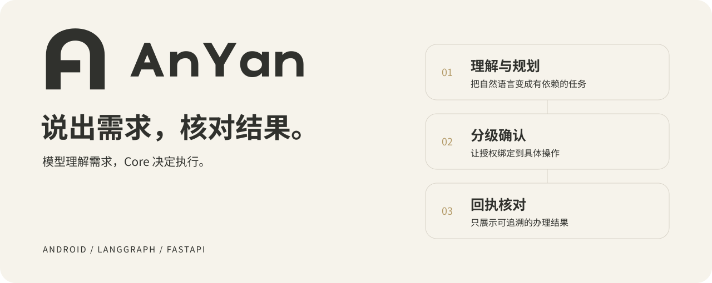
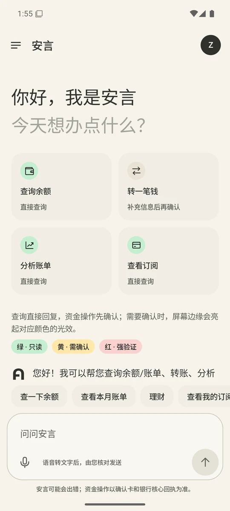
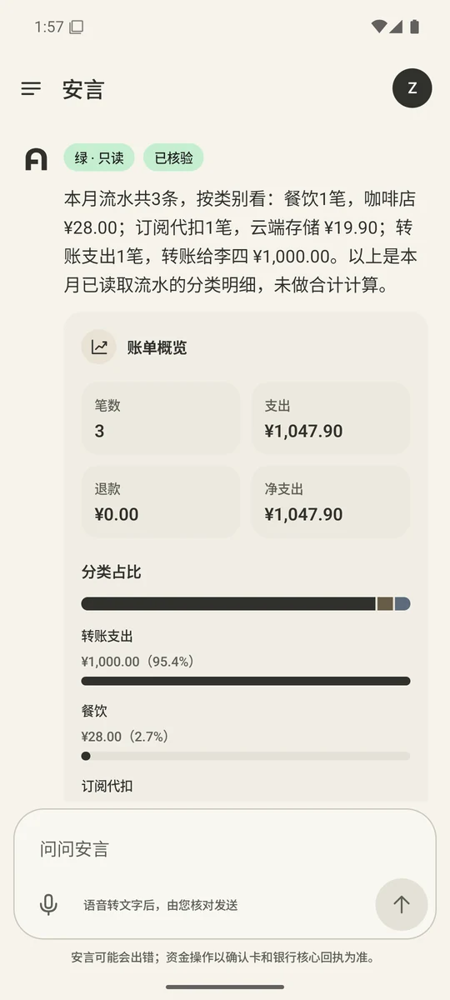
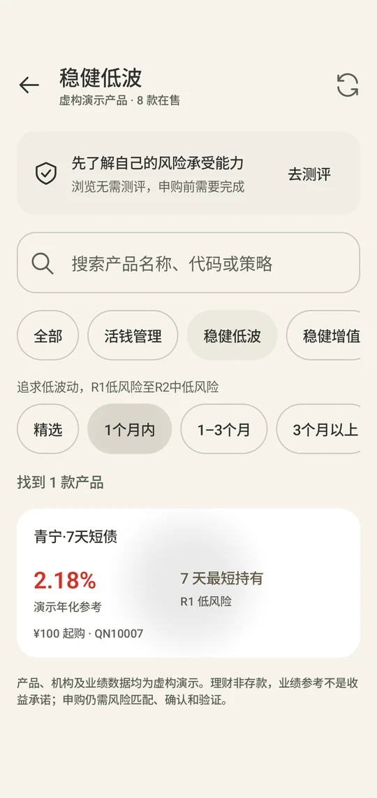
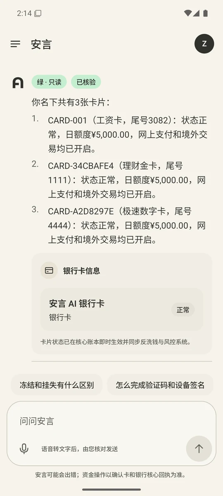
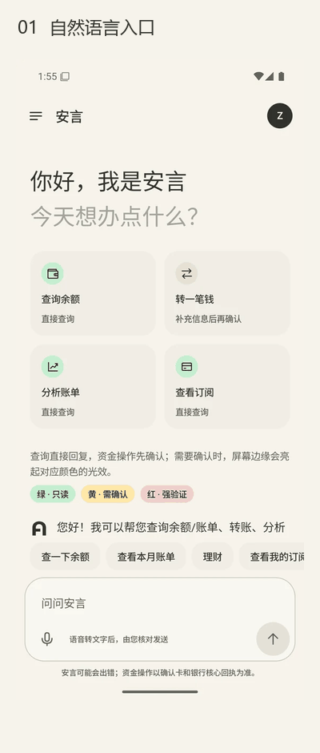
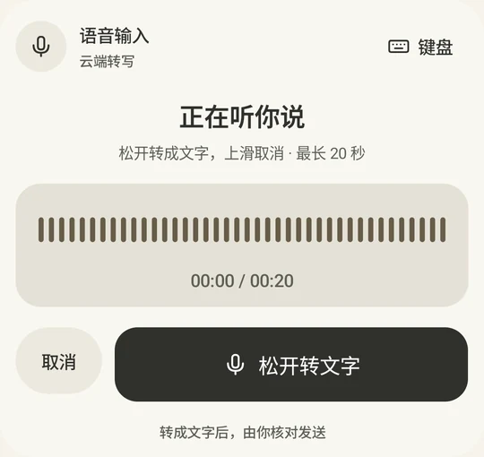
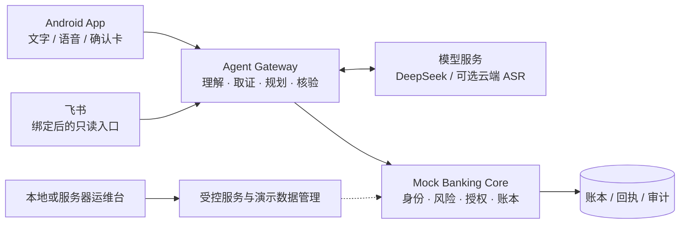

<picture>
  <source media="(prefers-color-scheme: dark)" srcset="docs/assets/readme-hero-dark.svg">
  
</picture>

# 安言 AnYan · 银行 AI 智能体

**用自然语言查询、规划和办理模拟银行业务，把每一次执行留在可核对的授权与回执之间。**

[](https://github.com/Zagadka-3906/ai-banking-agent/actions/workflows/ci.yml) [](LICENSE)  

[本地版下载](https://github.com/Zagadka-3906/ai-banking-agent/releases/tag/v2.0.0-beta.1) · [界面预览](#界面预览) · [可以做什么](#可以做什么) · [系统如何工作](#系统如何工作) · [快速开始](#快速开始) · [文档中心](docs/README.md) · [参与开发](CONTRIBUTING.md)

传统银行 App 把业务分散在不同入口。安言尝试让用户直接表达目标：查清一笔消费、给联系人转账，或把生日安排拆成几个有先后关系的任务。模型负责理解、补问和规划，独立的银行核心负责身份、权限、资金与最终结果。

这是一套可以从源码运行的完整演示系统：Android 客户端、Agent Gateway、Mock Banking Core、本地与服务器运维台，以及自动化测试和多轮任务评测工具。适合学习 Agent 工程、研究有状态的金融交互，或作为自己的受控业务助手原型。

> [!IMPORTANT]
> 所有账户、银行卡、交易、产品和订单均为虚构演示数据。项目不连接真实银行、支付清算或电商履约系统，不提供真实金融服务或投资建议。

## 界面预览

米白、暖石墨与浅金构成主要界面。聊天承接目标与解释，独立卡片承接待确认操作和回执，理财频道承接产品筛选；风险提示保留自己的语义色。

| 对话入口 | 账单分析 | 理财频道 | 卡片查询 |
| :---: | :---: | :---: | :---: |
|  |  |  |  |

截图来自实际应用，展示某次演示账本状态；金额与结果不代表当前在线服务。点击图片可查看原图。

<details>
<summary>查看动态界面导览</summary>

<p align="center"></p>

这是一组真实截图组成的循环导览，用于浏览界面，不表示实时响应速度。静态版本见上表。[界面与录制说明](docs/演示视频.md)

</details>

<details>
<summary>语音如何进入对话</summary>



点击麦克风先打开面板，**长按录音，松开转写，上滑取消**。文字进入草稿后，由用户核对并发送；转写不会自动发起办理。识别优先使用可用的端侧能力，云端回退需要用户同意。[语音交互说明](docs/语音输入界面.md)

</details>

## 可以做什么

| 场景 | 你可以这样说 | 系统如何处理 |
| --- | --- | --- |
| 转账与 AA | “给李四转 200 元”“这笔饭钱三个人平摊” | 解析对象与金额，缺信息先补问；按风险展示确认或强验证，再保存模拟回执 |
| 账单分析 | “这个月都花在哪了？”“这笔扣款是什么？” | 读取本人交易，分类、汇总和计算；可疑交易进入核对与争议处理流程 |
| 理财与测评 | “看看一个月以内、风险低一些的产品” | 筛选虚构产品，展示期限与风险；申购受测评、适当性和授权约束 |
| 卡片管理 | “我有哪些卡？”“这张卡丢了” | 脱敏查询、多卡澄清；挂失、解挂与额度等写操作重新定级 |
| 订阅与代扣 | “看看我的订阅”“取消这个续费” | 读取实际订阅记录；查询与取消遵守订阅业务的确认要求 |
| 跨场景安排 | “帮我安排爱人生日的预算和提醒” | 将锁资、提醒与模拟订单草稿拆成有依赖的任务，分别检查执行条件 |

支持上下文补充、更正、暂停、恢复和取消；“换成另一张卡”会改变待办参数，旧授权不能继续沿用。已完成的资金操作不支持通过一句“撤销”抹去账本。

### 三个贯穿全程的设计

- **回答有来源。** 查询先取当前账户证据，数值由结构化计算产生；生成后独立核验，缺数据时保留缺口，不编造余额或成功结果。
- **确认有对象。** 授权绑定主体、业务、对象、金额及其他关键参数，核心在执行时再次校验。界面显示确认卡不等于已经获得授权。
- **完成有回执。** 业务和回执持久提交成功后才返回成功。结果不明时查询原回执，不自动再发起一次付款。

## 系统如何工作



| 层 | 主要职责 | 不能替代的边界 |
| --- | --- | --- |
| Android · Kotlin / Compose | 对话、语音草稿、产品界面、确认卡、设备签名 | 客户端不能自行决定交易已完成 |
| Gateway · FastAPI / LangGraph | 意图理解、DAG 规划、只读取证、回答生成与核验 | 模型输出不能授予权限或直接改账本 |
| Core · FastAPI | 身份会话、风险定级、参数绑定、MFA、幂等与持久化 | 不信任网关传来的风险标签或自然语言承诺 |
| 运维台 | 服务状态、虚构账户配置、备份与恢复、审计观察 | 管理权限与普通用户会话分离 |

查询与咨询使用固定只读工具；模拟办理走审批与执行链。任务规划中的 DAG 是有依赖的子任务图，只有前置任务成功后，后续节点才能进入执行检查。`human_review` 表示等待用户确认或外部接管，不表示已接入真实银行客服。

更多细节：[系统设计](docs/技术文档.md) · [Agent 架构](docs/Agent架构.md) · [核心算法](docs/核心算法说明.md)

## 安全机制与边界

| 权限等级 | 策略 | 典型操作 |
| --- | --- | --- |
| 🟢 绿色 | 已登录且有权访问时自动执行 | 余额、交易记录、账单分析等普通查询 |
| 🟡 黄色 | 展示详情，等待明确确认 | 日累计不超过 1,000 元的小额转账；订阅查询与取消等业务 |
| 🔴 红色 | 确认后完成相应强验证 | 日累计超过 1,000 元的转账、挂失、理财申购等 |

风险由 Core 按当前业务与账户状态计算；待执行授权也参与转账累计判断。订阅查询遵守专门确认规则，不能因为使用 GET 请求就视为绿色。

参数绑定的一次性授权、设备签名、幂等键、回执核对、提示词注入拦截、异常熔断与哈希链审计共同约束执行。受限表达式在单独进程中运行，但这不是容器或操作系统级沙箱。

> [!WARNING]
> 当前 MFA 使用演示 OTP 与登记设备的签名，不是真实银行短信或支付认证。审计链可检测部分篡改，不能抵御掌握服务器和密钥的管理员整体替换记录。完整威胁边界见[安全设计](docs/安全设计文档.md)和[安全自评](docs/安全自评报告.md)。

## 快速开始

> [!TIP]
> [下载 v2.0.0-beta.1 本地运行版](https://github.com/Zagadka-3906/ai-banking-agent/releases/tag/v2.0.0-beta.1)：提供模拟器 APK、USB 手机 APK 和中文运行指南，无需自行编译 App。APK 仍需连接你电脑上的后端，并使用你自己的模型 Key；这次发布不提供作者云端体验版。

推荐 Windows + Python 3.12。后端支持的 Python 范围为 3.10–3.12；Android 构建另需 JDK 17 或 21、Android SDK API 37 与 Build Tools 36.0.0，App 最低支持 Android 8.0。

### 1. 克隆与配置

在 **ASCII 路径**下克隆，例如 `C:\AnYan\ai-banking-agent`，避免 Android Gradle 因中文父目录报错。

```powershell
git clone https://github.com/Zagadka-3906/ai-banking-agent.git C:\AnYan\ai-banking-agent
Set-Location C:\AnYan\ai-banking-agent
py -3.12 -m venv .venv
.\.venv\Scripts\python.exe -m pip install -r requirements-dev.txt
if (-not (Test-Path .env)) { Copy-Item .env.example .env }
```

在 `.env` 中配置自己的凭据，**首次启动前**将 `BANK_AUTH_SECRET` 占位符换成随机长密钥：

| 变量 | 用途 |
| --- | --- |
| `BANK_AUTH_SECRET` | 服务端签名与完整性保护；保密并保持稳定，不在已有账本上随意更换 |
| `DEEPSEEK_API_KEY` | 模型理解、规划、生成与核验；默认模型为 `deepseek-flash` |
| `DASHSCOPE_API_KEY` | 可选云端语音转写；端侧不可用且用户同意时使用 |
| `BANK_REQUIRE_SESSION=1` | 保持私有账户资源的会话校验开启 |

仓库提供[配置样例](.env.example)，不提供作者 API Key。未配置模型密钥仍可启动和使用部分固定规则路径，不能等效体验完整模型能力。本地部署仍可能调用外部模型服务。

### 2. 启动后端与运维台

```powershell
.\.venv\Scripts\python.exe scripts/serve_local_panel.py start
.\.venv\Scripts\python.exe scripts/serve_local_panel.py status
```

打开 `http://127.0.0.1:9100`。Core 默认端口为 `8000`，Gateway 为 `8100`；本地面板只监听回环地址，无需服务器管理令牌。也可双击 `start-local-panel.bat`。

> [!NOTE]
> 启动器首次把 `.env` 复制到独立数据目录。此后请修改启动输出所示目录内的 `local.env` 并重启服务；只修改仓库 `.env` 不会覆盖已有本地配置。

### 3. 运行 Android 客户端

已安装工具链并创建名为 `bankagent` 的 Android AVD 后：

```powershell
.\start-emulator.bat
```

启动器构建、安装本地 Debug APK，连接模拟器宿主机 `10.0.2.2` 上的 Core 与 Gateway。登录 `user_zhang`，密码 `Bank@2026`，从“查询余额”开始。

没有模拟器时可用 USB 手机及 `adb reverse`。工具链安装、手动构建、端口和手机连接步骤见[本地开发](docs/本地开发.md)。查看虚构银行卡号的演示密码是 `24681012`，只用于安全查看卡号，不代替交易强验证。

```powershell
# 停止本地服务，保留数据
.\.venv\Scripts\python.exe scripts/serve_local_panel.py stop
```

<details>
<summary>部署到自己的服务器，或接入飞书</summary>

- [服务器部署](deploy/README.md)：Ubuntu、systemd、Nginx、HTTPS、自有模型凭据及服务器运维台。
- [运行与部署](docs/运行与部署.md)：区分本地后端、自己的云后端与固定地址 APK，排查配置、连接和数据隔离问题。
- [飞书接入](docs/飞书IM接入.md)：可选企业应用长连接，绑定 App 会话后提供只读查询，资金操作返回 App。

APK 的后端地址在构建时确定。当前没有运行时地址切换入口，仓库推送也不会自动更新服务器或已安装 App。

</details>

## 开发、测试与评测

```powershell
.\.venv\Scripts\python.exe -m pytest -q
.\.venv\Scripts\python.exe scripts/export_banking_rules.py --check
.\.venv\Scripts\python.exe scripts/check_repository_docs.py
```

CI 执行后端测试、覆盖率、静态检查、规则导出校验，以及 Android 单元测试、Lint 和构建。设备 UI 测试需要独立运行；构建了测试 APK 不代表设备测试已通过。

多轮任务工具使用隔离账本、模拟用户、硬状态检查和独立评分器，另行记录费用和未完成项。先用 `--dry-run` 查看计划；联网运行需要自己的模型额度和显式预算。**单元测试、联网任务分数、设备体验分别报告。**

[测试与复现](docs/测试用例.md) · [多轮任务评测](docs/多轮任务评测.md) · [稳定性门槛](docs/稳定验收标准.md) · [验证范围](docs/验证记录.md)

## 仓库导航

| 路径 | 内容 |
| --- | --- |
| [`android/`](android/) | Compose 客户端、JVM 与设备 UI 测试 |
| [`agent_api.py`](agent_api.py)、[`bank_agent/`](bank_agent/) | 网关入口与 Agent 实现 |
| [`main.py`](main.py)、[`bank_core/`](bank_core/) | Mock 核心入口与业务实现 |
| [`deploy/`](deploy/) | 服务器安装、HTTPS 与共享运维台 |
| [`scripts/`](scripts/README.md) | 本地启动、回归、评测、诊断与维护工具 |
| [`tests/`](tests/README.md) | 后端回归与版本化任务数据 |
| [`docs/`](docs/README.md) | 产品、架构、安全、交互、部署与评测文档 |

部分文件保留早期中文文件名以兼容已有链接与工具，内容按面向公众的主题组织。规则说明由实现导出，更新方式见[文档维护](docs/文档核对.md)。

## 参与与许可

欢迎通过 [Issues](https://github.com/Zagadka-3906/ai-banking-agent/issues) 提交可复现问题，通过 Pull Request 改进代码与文档。请使用虚构数据，移除密钥、令牌和日志中的个人信息。[贡献指南](CONTRIBUTING.md)

项目采用 [MIT License](LICENSE)。依赖与第三方资源按各自许可证使用；品牌原稿与接入规范见[品牌目录](docs/brand/anyan-20261102/README.md)。
