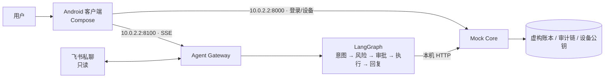

# 安言 · 言出即办的银行智能体

> 用一句话办银行业务：查余额、看账单、转账、理财、管卡片和订阅。
> **模型理解需求，核心决定执行。** 所有账户与交易均为本机虚构数据，不连接真实银行、不发生真实支付。

安言由三部分组成：

- **Android 客户端**（Kotlin + Jetpack Compose）：Gemini 风格对话界面，支持端侧语音输入。
- **Agent Gateway**（`:8100`）：LangGraph 编排对话、多轮澄清、审批和流式进度。
- **Mock Core**（`:8000`）：持有虚构账本，独立执行授权、风控、设备签名与审计。

另外可选接入飞书机器人私聊，仅支持只读查询。

## 功能一览

| 场景 | 说一句话 | 安全要求 |
| --- | --- | --- |
| 余额、账单、消费分析 | “查余额”“上个月钱花哪儿了”“最近转给谁了” | 🟢 登录即可 |
| 转账、预约转账、AA 收款 | “给李四转 300 元”“明天给王美转 50” | 🟡 确认；当日累计超 1000 元升为 🔴 |
| 理财：风险测评、推荐、申购、赎回、持仓 | “推荐理财”“申购 CJ01002 500 元”“我的持仓” | 测评、推荐、持仓 🟢；申购赎回 🔴（验证码 + 设备签名） |
| 卡片：开卡、限额、冻结、挂失、交易渠道 | “把限额调到 20000”“关闭境外交易” | 开卡、关闭渠道 🟡；限额、冻结、挂失、开通渠道 🔴 |
| 订阅识别与取消、生日资金锁定 | “我有哪些订阅”“锁定 1000 元给老婆过生日” | 🟡 确认 |
| 撤销未执行的安排 | “撤销刚才那笔预约”“撤回 AA 请求” | 🟡；已完成的转账不能撤销 |
| 复合请求 | “查余额，然后给李四转 10 元，再给王美转 20 元” | 每一步单独预检、审批 |

界面和交互特点：

- 黄区、红区操作出现屏幕边缘光效，光效从屏幕两侧中部向上下延伸、交汇。
- 办理完成后自动弹出结果页，带对勾和波纹动画；查询类回复不弹出。
- 回复文字只做简短说明，余额、回执、产品、持仓、风险等级等细节放在卡片里，不重复。
- 风险测评卡片逐题切换，答完 8 题后依次显示风险等级和匹配产品。
- 输入框上方的“猜你想问”不用固定规则：回复里给出的示例说法（如“可以说‘有哪些理财产品’”）立即变成按钮，其余由模型根据上下文生成。
- 收款人或金额被拒后，任务保留，换人或改金额即可继续。

## 工作原理



1. **意图识别**：配置了 DeepSeek 时，每句话都由模型理解，判断用户要办什么。规则同时解析一遍做校验：金额、日期、收款人只取规则从原文里抽出的值，模型不能编造；两者对“要不要动钱”的理解不一致时（如“我的卡好像找不到了”是查卡还是挂失），先问用户。模型超时或出错时退回规则。没有模型密钥时全程使用规则，仍可完整演示。
2. **风险分级**：Core 对意图、金额、对象重新校验并定级。绿区直接执行，黄区要求确认，红区还要求一次性验证码和 Android Keystore 设备签名。
3. **一次性授权**：预检签发单次使用的凭证，执行时 Core 重新核对主体、金额、对象、余额与风险等级，防止重放和篡改。
4. **回执与核对**：回执使用 `response.version=1` 协议，区分对话状态与业务状态。资金操作丢失回执时，按操作编号只读核对，不会重复提交。

详细设计见[技术文档](docs/技术文档.md)，安全边界见[安全自评报告](docs/安全自评报告.md)。

## 快速开始（Windows）

**环境要求：**

- Python 3.10–3.12
- JDK 17 或 21
- Android SDK API 37（Build Tools 36.0.0）与 Android Emulator，并建立名为 `bankagent` 的 AVD

首次可运行 `android/tools/install-android-toolchain.ps1` 安装构建工具链。

```powershell
py -3.12 -m venv .venv
.\.venv\Scripts\python.exe -m pip install -r requirements-dev.txt
if (-not (Test-Path .env)) { Copy-Item .env.example .env }
```

`.env` 只在本机使用，不入库。可选填写：

- `DEEPSEEK_API_KEY`：启用模型解析与“猜你想问”。
- `DASHSCOPE_API_KEY`：没有端侧识别时，经百炼转写语音。

建议把 `BANK_AUTH_SECRET` 换成随机长密钥。全部变量见 [`.env.example`](.env.example)。

**一键启动**会启动 Core 与 Gateway，构建并安装 Debug APK，再打开模拟器：

```powershell
.\start-emulator.bat
```

也可以分别启动两个服务（只监听 `127.0.0.1`）：

```powershell
.\.venv\Scripts\python.exe -m uvicorn main:app --host 127.0.0.1 --port 8000
.\.venv\Scripts\python.exe -m uvicorn agent_api:app --host 127.0.0.1 --port 8100
```

健康检查：`http://127.0.0.1:8000/healthz`、`http://127.0.0.1:8100/healthz`。模拟器通过 `10.0.2.2` 访问电脑。

**演示账户**（仅限虚构数据）：

| 用户 | 登录口令 |
| --- | --- |
| `user_zhang`（张三）、`user_li`（李四）、`user_wife` | `Bank@2026` |

红区操作还需要：

- 模拟器设置屏幕锁，应用会登记设备公钥。
- 一次性演示验证码，在审批卡上获取。

飞书接入步骤见[飞书接入说明](docs/飞书IM接入.md)。

## 测试

```powershell
.\.venv\Scripts\python.exe -m pytest -q --cov        # 后端全量，分支覆盖率低于 82% 失败
.\.venv\Scripts\python.exe -m ruff check . --ignore E402
.\.venv\Scripts\python.exe -m mypy
cd android
.\gradlew.bat :app:testDebugUnitTest :app:lintDebug :app:assembleDebug :app:assembleDebugAndroidTest
.\gradlew.bat :app:connectedDebugAndroidTest           # 需先启动服务与模拟器
```

当前结果为后端 1038 项测试通过、Android JVM 99 项通过。

68 项设备回归用 `scripts/run_android_regression.py` 运行：它会创建隔离服务，并核对实际执行数量。

可复现步骤见[测试用例](docs/测试用例.md)，历次结果见[验证记录](docs/验证记录.md)。

## 目录结构

```text
├─ android/              Android 客户端（app/src/main）与 JVM、插桩测试
├─ bank_agent/           Gateway：LangGraph 节点、意图解析、多轮对话、风险测评、回执渲染
├─ bank_core/            Core：账本、卡片、理财、支付风控、幂等、routes/ 接口
├─ bank_security/        共用安全边界：输入清洗、审计哈希链、熔断、授权、会话、设备
├─ bank_planning/        意图白名单、风险分级、任务计划、账单分析
├─ main.py               Core 应用入口
├─ agent_api.py          Gateway 应用入口（会话、SSE、审批、语音转写）
├─ agent.py · conversation.py · planner.py · security.py   编排与兼容入口
├─ feishu_*.py           飞书只读私聊、消息卡片、访问诊断
├─ scheduler.py · sandbox*.py · subscription_detector.py · mock_merchant.py · …   任务队列、只读分析沙箱等
├─ scripts/              端到端探针、场景评测、设备回归、交付打包
├─ tools/usability/      可用性测试记录页
├─ tests/                后端测试
├─ docs/                 参赛文档；docs/过程记录/ 为历次检查与升级记录
└─ start-emulator.bat    一键启动
```

## 文档

| 内容 | 文件 |
| --- | --- |
| 作品简介（200 字） | [作品简介](docs/作品简介.md) |
| 架构、核心算法、安全设计 | [技术文档](docs/技术文档.md) |
| 权限分级与已知风险 | [安全自评报告](docs/安全自评报告.md) |
| 测试步骤与验证结果 | [测试用例](docs/测试用例.md) · [验证记录](docs/验证记录.md) |
| 答辩 PPT 与演示视频大纲 | [答辩提纲](docs/答辩提纲.md) · [演示视频](docs/演示视频.md) |
| 赛题覆盖与验收 | [参赛完善与验收](docs/参赛完善与验收-2026-10-15.md) |
| 飞书机器人接入 | [飞书接入说明](docs/飞书IM接入.md) |
| 工具链升级、回归测试等历史记录 | [docs/过程记录](docs/过程记录/) |

## 限制

- 这是单机演示，状态保存在进程内存和本地文件中，不具备跨机器事务能力。
- 不发送真实短信。未开启 `BANK_MFA_DYNAMIC_OTP=1` 时，演示验证码是固定值。
- 审计哈希链不等于外部不可抵赖存储。
- 启用在线模型时，输入会发送给模型服务。

## 许可证

[MIT](LICENSE)
