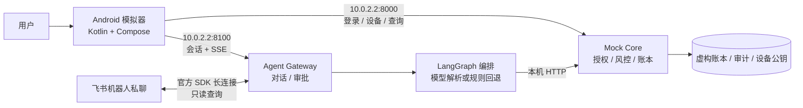

# 安言：本机银行智能体演示系统

**GitHub 仓库：** [Zagadka-3906/ai-banking-agent](https://github.com/Zagadka-3906/ai-banking-agent)

安言让用户在 Android 模拟器里用自然语言查询余额、分析账单、办理模拟转账、管理卡片与理财；可选飞书机器人私聊渠道提供只读查询。电脑运行两个本地 Python 服务：Mock Core 持有虚构账本和授权策略，Agent Gateway 处理对话、审批和飞书长连接。模拟器通过 `10.0.2.2` 访问电脑的 `127.0.0.1`。项目不连接真实银行或执行真实支付。

设计原则是**模型理解需求，Core 决定能否执行**。服务端对意图、金额、对象、会话和风险等级再次校验；黄区要求明确确认，红区还要求演示 OTP 与已登记 Android Keystore 设备签名。没有模型密钥时使用确定性规则解析，仍可本地演示。

## 交付材料

| 内容 | 文件 |
| --- | --- |
| 200 字内作品简介 | [作品简介](docs/作品简介.md) |
| 系统架构图、核心算法、安全设计 | [技术文档](docs/技术文档.md) |
| 10 分钟内答辩 PPT 逐页大纲 | [答辩提纲](docs/答辩提纲.md) |
| 5 分钟内演示视频分镜、动效、转场 | [演示视频方案](docs/演示视频.md) |
| 权限分级与已知风险 | [安全自评报告](docs/安全自评报告.md) |
| 可复现测试步骤 | [测试用例](docs/测试用例.md) |
| 已执行验证结果与限制 | [验证记录](docs/验证记录.md) |
| 飞书机器人创建、配置与接入状态 | [接入说明](docs/飞书IM接入.md) |

仓库保留本机 Core/Gateway、Android 模拟器客户端、可选飞书机器人及测试和运行脚本。旧独立 APK、Docker/Compose、FCM 推送和过时的成片与截图已移除。AA 请求由发起人创建，各参与人须登录自己的账户并确认付款；待付款项在应用任务页展示。飞书 SDK 长连接与机器人回复代码已实现；因尚未创建飞书应用，真实平台收发仍待联调，步骤见[接入说明](docs/飞书IM接入.md)。

## 系统架构



## 本机部署

### 环境与安装

Windows 电脑需 Python 3.10–3.12、JDK 17 或 21、Android SDK 35 与 Android Emulator。默认虚拟设备名为 `bankagent`；首次可运行 `android/tools/install-android-toolchain.ps1` 安装工具链，并创建同名 AVD。

```powershell
py -3.12 -m venv .venv
.\.venv\Scripts\python.exe -m pip install -r requirements-dev.txt
if (-not (Test-Path .env)) { Copy-Item .env.example .env }
```

`.env` 是本机配置，已被 Git 忽略。默认 `BANK_DEMO_MODE=1`、`BANK_REQUIRE_SESSION=1`。可选填入 `DEEPSEEK_API_KEY` 调用在线模型；留空时使用规则解析。建议把 `BANK_AUTH_SECRET` 换成本机随机长密钥。账本、设备和审计路径可分别通过 `BANK_LEDGER_STORE_PATH`、`BANK_DEVICE_STORE_PATH`、`BANK_AUDIT_LOG_PATH` 设置为仓库外的绝对路径。完整变量见 [`.env.example`](.env.example)。

启用飞书时另安装 `requirements-feishu.txt`，创建企业自建应用并在 `.env` 设置 `BANK_FEISHU_ENABLED=1`、`FEISHU_APP_ID`、`FEISHU_APP_SECRET`；完整配置见[飞书接入说明](docs/飞书IM接入.md)。Android 登录后在设备管理面板获取一次性绑定码，于机器人私聊发送 `/绑定 <绑定码>`。飞书仅支持查询，不能用于转账、确认或强验证。

### 一键启动

在仓库根目录执行：

```powershell
.\start-emulator.bat
```

脚本检查并启动本机 Core `:8000` 与 Gateway `:8100`，构建最新 Debug APK，启动或复用 `bankagent` 模拟器，安装并打开应用。服务只监听电脑 `127.0.0.1`。已有 Gradle 缓存时可用 `.\start-emulator.bat -Offline`。日志在 `build/quick-start/`，APK 在 `android/app/build/outputs/apk/debug/app-debug.apk`。

也可在两个 PowerShell 窗口分别运行：

```powershell
.\.venv\Scripts\python.exe -m uvicorn main:app --host 127.0.0.1 --port 8000
.\.venv\Scripts\python.exe -m uvicorn agent_api:app --host 127.0.0.1 --port 8100
```

健康检查：`http://127.0.0.1:8000/healthz`、`http://127.0.0.1:8100/healthz`。模拟器经 Android 宿主机映射 `10.0.2.2` 连接服务，无需暴露到局域网。修改端口时同步设置 Gradle 参数 `-PbankCoreUrl=...` 与 `-PbankGatewayUrl=...`。

### 演示账户

| 项目 | 值 |
| --- | --- |
| 用户 | `user_zhang`、`user_li`、`user_wife` |
| 登录口令 | `Bank@2026` |
| 红区演示 OTP | `888888` |

红区还需要模拟器设置屏幕锁或生物识别，并让应用登记 Keystore 公钥。以上凭据仅用于虚构账户。

## 功能与权限

| 功能 | 典型输入 | 要求 |
| --- | --- | --- |
| 余额、账单、理财查询 | “查余额”“上月钱花哪儿了” | 登录会话，GREEN |
| 模拟转账、AA、预约 | “给李四转 300 元” | 转账预检 + 确认；AA 先发请求，各参与人独立授权付款；当日转账累计超过 1000 元升 RED |
| 理财申赎、卡片敏感变更 | “申购 200 元”“挂失卡片” | RED，OTP + 设备签名 |
| 订阅识别、取消、生日锁资 | “识别周期扣费”“取消订阅”“锁定 1000 元” | 检测只产生待核实候选；取消已登记代扣与锁资为 YELLOW；模拟商户下单到期后再次确认 |

模型只输出受约束的意图 JSON；`planner.py` 校验意图和槽位。Core 以短期、单次凭证重新核对主体、金额、对象、余额与风险等级。审批仅向 Android 返回不透明句柄。完整调用链见[技术文档](docs/技术文档.md)。

## 测试

```powershell
.\.venv\Scripts\python.exe -m pytest -q
.\.venv\Scripts\python.exe -m ruff check . --ignore E402
cd android
.\gradlew.bat --no-daemon :app:testDebugUnitTest :app:assembleDebug :app:assembleDebugAndroidTest
# 启动本机服务和模拟器后：
.\gradlew.bat --no-daemon :app:connectedDebugAndroidTest
```

Python 测试覆盖账本持久化、会话边界、授权防重放、并发幂等、自然语言场景；Android JVM 测试覆盖解析与建议，插桩测试覆盖登录、对话、卡片等 UI。步骤与预期结果见[测试用例](docs/测试用例.md)。端到端授权探针：`python scripts/agent_gateway_e2e.py`；健康探针：`python scripts/smoke_test.py`。

## 源码索引

| 路径 | 作用 |
| --- | --- |
| `main.py`、`security.py`、`mock_merchant.py`、`subscription_detector.py` | Core、授权、虚构账本与商户、周期扣费候选识别 |
| `agent_api.py`、`conversation.py`、`feishu_im.py` | Android 对话网关、SSE、审批句柄和飞书只读私聊接入 |
| `agent.py`、`planner.py`、`sandbox.py` | LangGraph、意图与任务规划、只读分析沙箱 |
| `scheduler.py`、`notification_outbox.py` | 本机任务状态与 AA 事件记录 |
| `android/app/src/main/` | Android 客户端 |
| `tests/`、`android/app/src/test/`、`android/app/src/androidTest/` | 后端、JVM 与模拟器 UI 测试 |
| `.github/workflows/ci.yml` | Python 与 Android 构建检查 |

这是单机 Mock 演示。进程内状态与本地文件不具备跨机器事务能力；演示 OTP 为固定值；审计链不等于外部不可抵赖存储；可选在线模型会把输入发送给模型服务。详见[安全自评报告](docs/安全自评报告.md)。
