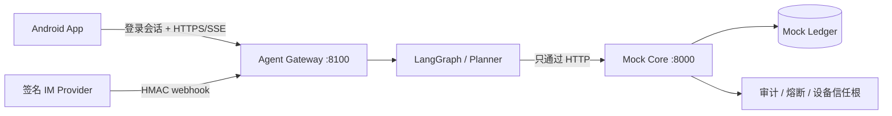

# 安言：Android 与 IM 银行智能体沙箱

> 当前仓库只交付 Android 原生客户端和签名 IM webhook。两条渠道共享同一个 Agent 网关、同一套业务编排与同一个 Mock Core 记账边界。

[](https://fastapi.tiangolo.com/)
[](https://github.com/langchain-ai/langgraph)
[](android/)

“安言”支持自然语言转账、账单分析、理财、卡片、订阅和跨场景任务。模型只负责理解与编排，所有账户事实、风险判定、授权和记账均由服务端重新校验。仓库使用虚构账户与 Mock 账本，不能连接真实银行账户或完成真实支付。

## 交付范围

| 层 | 主要文件 | 职责 |
| --- | --- | --- |
| Android 客户端 | `android/` | 登录、SSE 对话、快捷建议、确认卡、OTP、BiometricPrompt、Android Keystore P-256 签名、结果页与推送 |
| IM 渠道 | `im_webhook.py` | 已登录会话签发绑定码；校验 provider HMAC、时间戳和事件编号；拒绝过期与重放事件 |
| Agent 网关 | `agent_api.py`、`conversation.py` | 校验 Core 会话、隔离渠道会话、持久化 checkpoint、审批句柄、SSE 终态协议 |
| 编排与策略 | `agent.py`、`planner.py`、`scheduler.py` | 意图白名单、槽位回填、风险路由、LangGraph 中断恢复、任务 DAG 与到期执行 |
| Core Banking | `main.py`、`security.py` | 唯一记账边界、登录与会话、预检、一次性凭证、设备验签、审计、熔断、幂等与持久化 |
| 分析沙箱 | `sandbox.py` | 只读 AST 白名单、输入输出限制、超时和可观测执行模式 |

其他客户端入口不属于当前产品范围，已从源码、依赖、容器和文档中移除。

## 支持的业务

- 智能转账：按联系人姓名、别名或手机号转账，支持备注、预约转账和 AA 收款。
- 账单分析：按日、月、上月、年过滤，输出分类统计、异常流水和可追溯报告。
- 理财操作：风险测评、产品推荐与对比，以及需要红区授权的申购和赎回。
- 卡片管理：申请虚拟卡、调额、冻结、解冻、挂失、解挂和敏感卡信息查看。
- 订阅管理：识别周期扣费、创建续费提醒，并在确认后取消订阅。
- 跨场景联动：把生日预算、锁资、提醒和订单草稿编译为有依赖关系的任务 DAG。

Agent 会处理模糊表达、省略上下文和多轮回指。例如“钱都花哪儿去了”会进入账单分析；“再转一次”会复用上一笔的收款人和金额，但重新发起授权；“把它取消掉”会承接最近一次订阅查询。涉及写操作的歧义不会被猜测执行。

## 架构与安全边界



1. 客户端先调用 `POST /api/v1/auth/login`，之后以 `X-Session-Token` 访问网关。网关每次都回 Core 校验会话，客户端自报的 `X-User-Id` 不能替代凭证。
2. Green 查询可直接执行；Yellow 操作需要明确确认；Red 操作还需要 OTP 与已登记 Android 设备对一次性 challenge 的 P-256 签名。
3. 网关只向客户端发放不透明审批句柄。Core 的授权 nonce、MFA proof 和账本对象都不会交给渠道端。
4. Core 在执行前再次校验主体、金额、收款人、余额、卡状态、风险级别、TTL、单次性和幂等键。Agent 文本不能构成授权，也不能作为交易成功证据。
5. IM 可以查询、澄清和发起流程；需要确认或 MFA 时必须回到 Android/API 完成，IM webhook 不能代替用户授权。

更完整的设计见 [架构说明](docs/architecture.md)、[安全自评](docs/security-self-assessment.md) 和 [设备验收](docs/device-verification.md)。

## 本地运行

需要 Python 3.10–3.12、JDK 17 或 21，以及 Android SDK 35。Windows 下创建环境：

```powershell
py -3.12 -m venv .venv
.\.venv\Scripts\python.exe -m pip install -r requirements-dev.txt
Copy-Item .env.example .env
```

`.env` 只用于本机，不能提交。Android/网关必须通过口令登录取得会话。内置沙箱账户 `user_zhang`、`user_li`、`user_wife` 的本地测试口令为 `Bank@2026`；它们只用于虚构数据演示。

分别启动 Core 与网关：

```powershell
.\.venv\Scripts\python.exe -m uvicorn main:app --host 127.0.0.1 --port 8000
.\.venv\Scripts\python.exe -m uvicorn agent_api:app --host 127.0.0.1 --port 8100
```

也可以启动容器：

```powershell
docker compose up --build
```

Compose 只包含 `core` 与 `gateway` 两个服务，并默认要求登录会话。

## 构建并打开最新 Android 版本

项目根目录的一键脚本每次都会先从当前源码重新构建 APK，再检查后端、启动或复用 `bankagent` 模拟器、覆盖安装并打开应用。构建或安装失败时不会继续打开旧 APK。

```powershell
.\start-emulator.bat
# 依赖已经缓存时：
.\start-emulator.bat -Offline
```

分步构建：

```powershell
cd android
.\gradlew.bat --no-daemon :app:testDebugUnitTest :app:assembleDebug :app:assembleDebugAndroidTest
```

Debug APK 位于 `android/app/build/outputs/apk/debug/app-debug.apk`。设备密钥由 Android Keystore 生成，私钥不会离开设备；服务端仅保存公钥。

## IM 渠道

部署环境通过 `BANK_IM_PROVIDER_SECRETS` 配置允许的 provider，例如本地测试可临时设置 `demo=<随机值>`。不要把真实 secret 写入仓库、命令录屏或日志。

1. Android/API 登录后调用 `POST /api/v1/im/bindings` 获取短时一次性绑定码。
2. Provider 向 `POST /api/v1/im/webhook` 发送 `bind` 事件完成外部身份绑定。
3. 后续 `message` 事件必须带 `X-IM-Provider`、`X-IM-Timestamp`、`X-IM-Event-Id` 和 `X-IM-Signature`。
4. 签名内容为 `timestamp.event_id.` 与原始请求体的拼接，算法为 HMAC-SHA256。时间窗和事件编号共同防止重放。

绑定、会话和 webhook 防重放表当前仍是演示级运行时状态；生产接入需要持久化存储、真实 provider 身份体系与密钥托管。

## 关键配置

完整说明见 [`.env.example`](.env.example)。常用配置包括：

- `BANK_AUTH_SECRET`：授权凭证与持久化摘要密钥；共享环境必须使用随机值。
- `BANK_REQUIRE_SESSION=1`：写接口要求由 `/auth/login` 签发的会话。
- `BANK_CONVERSATION_DB`：网关 checkpoint 数据库。
- `BANK_DEVICE_STORE_PATH`：设备公钥与推送令牌持久化。
- `BANK_LEDGER_STORE_PATH`：Mock 账本快照持久化。
- `BANK_AUDIT_LOG_PATH`：追加式审计链文件。
- `BANK_IM_PROVIDER_SECRETS`：IM provider 与 HMAC secret 映射。
- `BANK_FCM_CREDENTIALS`：可选 FCM HTTP v1 服务账户路径。
- `DEEPSEEK_API_KEY`：可选在线模型；缺失时使用确定性规则解析。

## 验证

```powershell
.\.venv\Scripts\python.exe -m compileall -q main.py agent_api.py agent.py conversation.py planner.py security.py sandbox.py scripts tests
.\.venv\Scripts\python.exe -m ruff check . --ignore E402
.\.venv\Scripts\python.exe -m pytest -q
docker compose config --quiet
cd android
.\gradlew.bat --no-daemon :app:testDebugUnitTest :app:assembleDebug :app:assembleDebugAndroidTest
```

`tests/` 覆盖 Android/网关共用的会话边界、签名 IM、自然语言场景、MFA 设备验签、Prompt 注入、幻觉防护、审计链、熔断、沙箱、幂等、并发和持久化篡改。涉及真实 FCM 的端到端投递需要额外凭据，可使用 `scripts/fcm_delivery_e2e.py` 单独验证。

## 目录

```text
android/                    Android 原生客户端、单元测试、插桩测试与工具脚本
docs/                       架构、安全、评测、演示与验收文档
scripts/                    E2E、场景评测、推送探针和一次性设备签名器
tests/                      Core、网关、IM、安全和自然语言回归测试
main.py                     Mock Core Banking API
agent_api.py                Android/IM 渠道网关
im_webhook.py               签名 IM webhook
conversation.py             渠道会话与审批句柄
agent.py / planner.py       意图、策略与 LangGraph 编排
security.py / sandbox.py    授权、设备信任、审计、熔断与分析沙箱
docker-compose.yml          Core + Gateway 部署示例
start-emulator.bat          构建、安装并打开最新 Android 应用
```

## 生产化限制

当前实现是演示沙箱。上线前需要把内存/文件状态迁移到事务数据库与 Redis，接入 OIDC、真实 OTP/生物因子、KMS、TLS/WAF、分布式限流、消息队列、WORM 审计、真实支付与 IM provider，并完成隐私、合规、许可证和红队评审。
