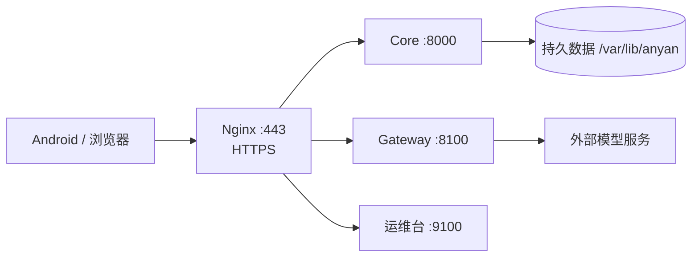

# 部署自己的安言服务器

本手册面向能管理 Linux 主机的开发者，使用仓库脚本在 Ubuntu 24.04 上部署单机演示服务。需要自己的主机、SSH 身份、模型凭据和 Android 构建环境。全部金融数据仍为虚构，脚本不将系统变成生产银行服务。

## 部署结构



Core、Gateway 和运维台只回环监听，Nginx 暴露 `/core/`、`/gateway/`、`/panel/`。systemd 负责服务生命周期。配置在 `/etc/anyan/anyan.env`，项目 TLS 文件在 `/etc/anyan/tls`，面板令牌在 `/etc/anyan/panel.token`。

## 前置条件

目标服务器需要管理员权限。脚本默认以 `root` 使用 `~/.ssh/id_anyan_deploy`，可配置 `ANYAN_SSH_USER` 和 `ANYAN_SSH_KEY`；安装涉及系统目录和服务，普通非特权账户不能直接替代。

在本机生成专用 SSH 密钥，通过既有管理通道把公钥追加到服务器授权列表，保留原记录。云安全组放行 HTTPS 443 和受限的 SSH 入口，不公开 8000、8100、9100。

以下命令在仓库根目录的 Git Bash 执行，`203.0.113.10` 是文档示例，必须换成自己的地址：

```bash
ssh-keygen -t ed25519 -f ~/.ssh/id_anyan_deploy -C anyan-deploy
export ANYAN_HOST=203.0.113.10
```

首次连接核对主机指纹。使用仓库脚本前，备份目标主机上已有的应用、证书与数据，确认它是你要维护的演示环境。

## 安装、配置与构建

```bash
deploy/deploy.sh server "$ANYAN_HOST"
deploy/deploy.sh keys "$ANYAN_HOST"
deploy/deploy.sh app "$ANYAN_HOST"
deploy/deploy.sh status "$ANYAN_HOST"
```

| 子命令 | 行为 |
| --- | --- |
| `server` | 从当前 Git HEAD 导出已提交源码并安装或更新；未提交修改不会部署 |
| `keys` | 从本机 `.env` 通过 SSH 标准输入传递 DeepSeek 与 DashScope Key，重启 Gateway |
| `app` | 获取项目公共 CA，构建连接指定服务器的 Debug APK |
| `status` | 核对服务及本机健康接口，不等同模型或完整业务验收 |
| `panel` | 显示管理令牌并建立本地面板隧道，关闭终端即断开 |
| `feishu` | 显式同步飞书应用凭据并启用长连接，可选 |

仓库不包含作者密钥，部署前须准备自己的 `.env`。`keys` 只传 `DEEPSEEK_API_KEY`、`DASHSCOPE_API_KEY`；其他配置在服务器配置文件中维护。未配置模型仍能运行部分固定路径，不代表完整模型体验。

APK 输出为 `build/deploy/anyan-<服务器地址>.apk`，使用 Debug 签名，适用于演示。构建时固定 `/core/` 与 `/gateway/` 地址并包含对应项目 CA。地址或 CA 改变后重新构建，App 没有运行时后端切换入口。

## HTTPS 与面板访问

脚本使用自建 CA 签发项目证书。App 的定向构建信任指定 CA；浏览器不会自动信任，需要核对并安装**公共 CA 证书**，或自行维护可信证书方案。不要分发 CA 私钥，不通过关闭 TLS 校验解决连接问题。

运维台入口为 `https://<服务器地址>/panel/`，独立令牌登录。若不开放浏览器公网入口，也可：

```bash
deploy/deploy.sh panel "$ANYAN_HOST"
```

保持终端打开，访问 `http://localhost:9100` 并输入令牌。若该本地端口被占用，使用自己的 SSH 本地转发端口。令牌属于管理凭据，不能写入 README、Issue 或截图。

## 运维与数据恢复

运维台提供总览、业务数据、账户管理、流量、审计、日志和运维操作。密钥只显示配置状态，账户编辑仅在 `BANK_DEMO_MODE=1` 下开放。

新账户保存初始状态；现有账户首次启用管理时保存当前状态。单账户恢复前会备份，停止银行服务，校验、写入再重启。它不会撤销已完成的跨账户转账，其他账户资金不随之回滚。全局恢复演示数据会影响所有自建账户和初始状态，使用前确认范围。

账户、卡片、联系人和业务编号需满足唯一性与依赖，旧编辑页遇到数据变化须刷新。密码、登录会话、设备私钥和授权材料不是普通场景编辑字段。修改或恢复后重新登录，Core 重启也使旧会话失效。

服务器上常用只读检查：

```bash
systemctl status anyan-core anyan-gateway nginx
journalctl -u anyan-gateway -n 100 --no-pager
```

修改 `/etc/anyan/anyan.env` 后重启相应服务。普通更新保留配置、证书、账本和设备库；备份位于 `/var/lib/anyan/backup/`。不要靠删除账本“修复”故障，损坏原文件也应保留。

写盘失败返回 503 / `LEDGER_PERSISTENCE_FAILED`，检查磁盘、目录权限和健康详情的 `ledger_persistence`。加载校验失败冻结写入并返回 `LEDGER_STORE_BLOCKED`，先核对备份来源。结果未知时查询原回执，不能自动重复付款。

## 发布后核对

1. 核对服务器提交、模型和配置，检查 Core 与 Gateway 健康。
2. 安装对应地址的 APK，登录后查询本人数据。
3. 取消一次待确认操作，验证未扣款；再用新提案完成一笔小额模拟转账，核对回执和账本。
4. 检查红区设备条件、TLS、退出登录、服务重启和持久化恢复。
5. 另行检查模型额度、日志、备份和并发，不把健康 200 视为全部通过。

GitHub push 不自动更新服务器。下一次更新先验证并提交，再运行 `server`，按需重建 App。飞书同一应用只保留一个监听实例，详见[接入说明](../docs/飞书IM接入.md)。本地启动不需要 systemd 或 Nginx，见[本地开发](../docs/本地开发.md)。

## 其他管理入口

安装脚本还提供仅回环的 Cockpit。需要时先由管理员设置 `panel` 用户密码，再运行 `deploy/deploy.sh cockpit "$ANYAN_HOST"`，通过 `https://localhost:9090` 访问并核对证书。该高权限管理入口不属于普通 App 用户流程。

公网演示应限制暴露面和模型消费，使用专用虚构账户。限流、签名账本和审计不能替代真实身份、生产密钥管理、独立安全评估或高可用架构。[安全边界](../docs/安全自评报告.md)
