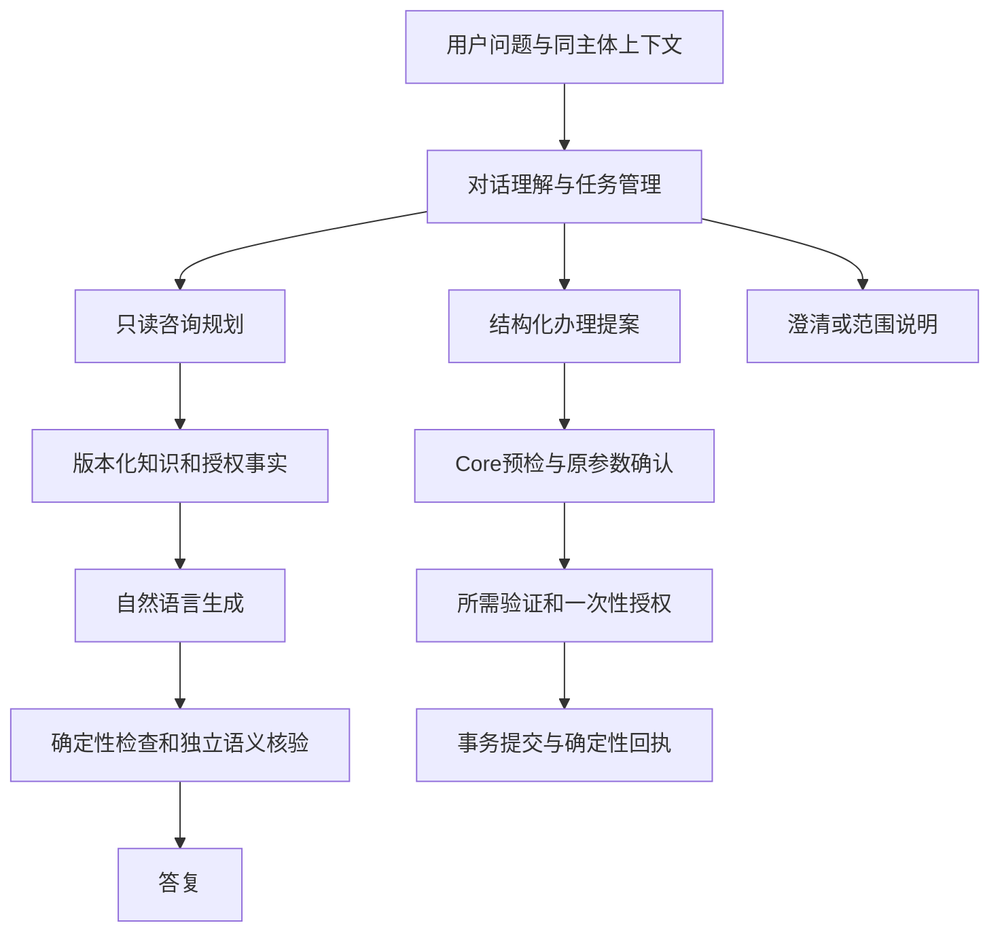

# Agent 对话、咨询与交易架构

2026-10-27 共享链路修订：本轮最多五项目标分别取证、生成、逐项核验和补查；参数歧义不再拦截只读比较。当前验收与已知限制见[验证记录](验证记录.md)顶部。

讨论任务支持暂停、更正、补充和恢复，问卷可被当前咨询打断，计算证据保留原始操作数，核验反馈区分改写和补查。放弃或否定办理还须通过确定性执行约束；不能因提到操作名称就创建审批。模型理解、任务命令和这些约束均不提供执行授权，详细机制见[对话可靠性改造](对话可靠性改造.md)。

2026-10-25 线上链路修订：执行语言约束不再跳过理解，咨询主题优先依据问题焦点，金额补槽与对象绑定独立于模型分类；完整验收、回退统计、CI 和设备版本边界见[验证记录](验证记录.md)顶部。文档导航见[索引](README.md)。

2026-10-25 服务器真实会话暴露了咨询没有具体步骤、生日能力误拒绝、主题切换错误和小额风控说明缺失。原话验收集保存在 `tests/fixtures/conversation_architecture.json`，姓名和交易标识不入库。

## 职责与边界

模型负责理解、寻求证据和综合解释。否定、引用、条件和纯流程问题限制可执行动作，仍允许只读理解与回答；风险节点按本轮原文再次检查，不能靠模型给出的 ACTION 绕过。Core 独立负责主体、金额、风险、确认、MFA、幂等和持久提交。生成器与核验器没有执行工具，模型核验不承担资金授权。

常规回合先理解完整原话，再决定是否拆成办理步骤，避免“生日先放一放，接着转账”被分词规则截成背景片段。明确续办且只有一个原任务、原对象在本轮明示、缺失金额可独立解析且无歧义时，可补齐该已存任务；问规则、条件句或金额歧义仍不自动续办。恢复讨论只产生新的预检和待确认提案，不复用旧审批授权。

## 能力、知识与状态

`banking_knowledge.py` 统一版本化能力与独立知识章节，当前知识版本为 `2026-10-27.2`。能力目录覆盖 `planner.ALL_INTENTS` 的 30 项意图，关联必填字段和读取、工作流、对话类型。知识包含办理步骤、前提和限制，章节具有稳定 ID 和版本来源。修改知识须与可执行实现、UI、验证保持一致。

`banking_rules.py` 从知识章节和能力目录生成 101 条可检索记录（71 条业务规则、30 项能力），同时导出[人读说明](银行业务规则说明.md)与[JSON](银行业务规则.json)。理解模型调用前本地检索四条相关记录；咨询初次按当前问题检索并读取主题，规划器还可使用 `rules(query, topic可选)` 继续查询。检索结果用于选择数据源和综合解释，不作为本人记录或执行授权。相邻主题记录仅作为推理上下文，不自动拼接到固定回复。

Core 提供会话鉴权的 `GET /api/v1/assistant/capabilities`、`GET /api/v1/service-guide?topic=` 和 `GET /api/v1/assistant/context`。上下文快照提供当前登录者卡片状态、有限额度政策、当日转出及当前行为升级原因；不会预检、签发授权、消费凭证或清理行为历史。静态知识版本或内容不匹配时，Agent 拒绝该结果。规则检索调用 `GET /api/v1/service-guide?rule_ids=`：自然语言问题仅在本地匹配，HTTP 只传稳定编号；返回条款、能力和引用代码摘要必须与本机版本完全一致。`RULES_QUERY` 审计只记数量和版本，不记录问题正文。生成器不向用户转述内部意图名、API 或代码路径，除非用户明确询问实现。

`dialogue_act` 分开表示查询、解释、办理、补信息、社交、澄清与不支持；`scope` 区分业务内、混合与范围外；`topic_relation` 区分新主题与省略追问，`questions` 描述本轮有界问题。混合请求只回答业务部分，不能因附带无关任务而整条丢弃。

`dialogue_state` 按主体保存当前主题和最多四类未完成缺槽任务。显式恢复只能引用已存任务 ID，参数来自原始校验结果；恢复讨论须重新预检和审批。取消任务后移出恢复清单。有限额度咨询可留下主体绑定的 `next_input`，紧接的明确数值形成新调额提案；指定卡片保留用户原文的卡片编号，尾号或多卡歧义须另行说明，不能改选主卡。换话题或处理新一轮后清除该输入。待补金额的“李四那笔转账”绑定原收款人，不把“李四那笔”当新人名；金额只取本轮原文，改对象与歧义仍需重新核对。复杂复合业务与问卷继续使用专用状态机。新话题不从任意旧观察中猜类型，明确承接的省略问题才沿用主题。

待审批操作仍由独立审批存储管理。只读插问不恢复写图，不改变句柄、对象、金额和有效期；社交与澄清也有独立答复。插问缓存始终保持自己的查询结果，不会在审批后变成写操作回执。

## 咨询、生成与核验

`consultation.py` 的工具共十二类，包括 `rules`、`knowledge`、`account_context`、`balance`、`cards`、`disputes`、`transactions`、`contacts`、`wealth_products`、`wealth_holdings`、`risk_profile`、`tasks`。工具不接受任意 URL、身份、HTTP 方法、SQL 或执行参数。主题选择保留模型对当前问题焦点的理解，明确的产品边界仍作约束，不因出现“卡片”等背景词把验证原因改成解冻教程。消费核对优先使用争议知识并刷新本人流水，具体步骤只来自版本化产品知识。有目标协议时，初读与修复共用 `min(10, 4 + 2 × 目标数)` 次读取、最多三轮规划；无目标的兼容路径仍为五次读取、两轮规划。去除重复读取；传输层另加 GET 限制。账户型读取复用 Core 所有者过滤和原回执验证。

生成器可自然解释、归纳和比较，返回 `answer`、`evidence_ids`、`unanswered`，新协议另含逐项目标 `coverage`。所有金额使用绑定证据的 `{{value.N}}` 引用，由服务端填入；原始金额、未知值、未知数字/编号、无依据操作声明与外部链接会被拒绝。余额引用另检查可用、总额和锁定标签。明确只问可用余额时仅提供该字段。完整流水和重要限制由服务端保留。

独立核验调用分别判断范围、事实支持、是否回答当前问题与安全性。新协议最多尝试三次草稿，逐目标记录 ANSWERED、NEEDS_DATA、NEEDS_CLARIFICATION、NEEDS_CONFIRMATION、UNSUPPORTED 或 TOOL_FAILED，缺证据反馈给同一读取会话；兼容路径仍最多修正一次。未通过草稿不下发；咨询可回退到相关已验证知识，并明确完整解释未通过核验，其他查询保留原回执。资金成功回执、失败结果与问卷不由生成器改写。

成功自然答复保留 `answer_presentation.version=1` 和 `source=VERIFIED_FACTS`，增加 `mode=GENERATED_REVIEWED`，兼容现有 Android 聚焦展示。仅问某项余额时，固定回退与生成层采用同一字段选择，模型不可用时也不额外展示其他分项。已验证的固定余额答复也保留该展示标记，使用 `mode=CANONICAL`，避免客户端把有用正文替换成介绍语。该标记不代表绝对正确，也不用于授权。

## 目标与证据闭环

本轮新增的任务命令、计算及其来源、审核反馈分类与离线优化边界详见[对话可靠性改造](对话可靠性改造.md)。讨论状态升级为 v2，目标协议保持 v1 并新增可选计算描述；Core 的确认、验证、执行和持久提交协议不变。

`bank_planning.requests` 为每轮保存最多五项 `goals`，每项包含行为、资源、问题、字段、最多五个已绑定对象及是否需要记录。QUERY 需要对应记录；EXPLAIN 默认只解释规则，解释本人实际状态时显式要求记录。多对象各自必须有证据，查询空集合与读取失败分别记录。本人身份来自服务端会话，不能由目标或工具参数指定。

`EvidenceSession` 在刷新同一资源时合并原字段和对象，并更换证据编号，防止补查丢失另一问题或引用旧值。明确承接前文的解释可重读上一轮的固定读取描述，只在同主体内进行，不把历史答复或金额直接升级为当前证据。公开产品字段即使被识别为解释，也读取实际货架。金额差额仅从同批已核验数值由服务器计算后供引用。模型直接写出的金额，只有精确匹配已引用的证据值后才由服务端编码为原有金额引用；余额字段标签仍独立检查。未知数字和未经绑定金额仍拒绝。

解释与前轮资源相关时也可刷新前轮读取，即使模型把话题关系标成 NEW。没有明确新日期时保留此前读取的统计区间，明确的新日期优先；区间描述随读取元数据保存，金额与状态仍重新取数。审批插问将当前原审批的摘要、尚未执行状态与实际验证要求作为 `approval://current` 证据，不签发或消费授权。原生查询返回较大集合时，先按本轮目标的对象和字段投影，再交给回答模型，避免只问视频会员却把 Apple 等无关对象带入生成。

参数按类型核验：卡片续补输入只接收明确卡片编号，不把“给我看看”解析出的通用收款人当卡片；模型提供的产品编号须符合编号格式，产品名称不能直接当编号发给 Core。金额后的逗号或句号可作为句子分隔符，但后接数字的不规范分隔如 `300,00` 仍拒绝，不能截断成 300 元。

`goal_answering` 要求草稿与核验器分别覆盖每个目标；规则不能冒充本人记录。全部目标回答才返回完整成功，部分有据回答标 PARTIAL_SUCCESS，未答标 NEEDS_INPUT。字段回退与生成回答分开统计；解释回退只展示当前主题下检索到的相关规则，并明确完整解释未通过核验。语义理解与核验仍可能共同误判，协议不能保证所有新表达正确。

理解输出统一使用 `request_protocol=1` 与 `goals`。声明该协议但漏掉目标列表时，只补全一次目标，补全结果不得改变原业务参数；未声明该协议的旧格式保留兼容路径。内部取数、覆盖与修复规则标为 `audience=model`，可供模型检索约束，不进入固定客户答复或规则回退；用户明确询问技术实现时，生成层才可解释。

## 数据源与当前问题

联系人簿已作为 `contacts` 工具接入，只通过当前会话 GET 本人的联系人簿；姓名是否保存不能用流水推断。联系人问题必须有 `read.contacts` 证据，缺失或回执无效时不能标为成功。只向回答链投影所问姓名及是否保存，不传入完整手机号和账户链接；列表查询明确范围及截断。App 的实际入口为侧边栏 → 联系人。

`SUBSCRIPTION_QUERY` 是需确认的只读查询，其理解与数据语义属于读取，权限仍为 YELLOW。通用询问规则及风险节点不再把它改成说明或拦为办理；续费提醒、取消仍保留原协议。明确的订阅字面对象在意图分类后独立绑定，模型漏填不能退成查询全部；确认后先校验完整 Core 集合，再按原问题中明确的商户名/编号和字段投影，字面实体优先于模型对象，名称前缀不作另一个对象；金额、登记状态及日期以已核验字段为依据，新目标协议允许自然组织并逐项核验，兼容路径保留固定字段展示；联系人保存状态同样必须来自通讯录，避免重复追加或自由扩写不存在的 UI。过期计划日期只标原记录，不推进到下月，不推断已扣款或真实会员权益。

流程咨询继续自然生成和独立核验；回退只使用与当前问题相关的章节，不因关键词全不匹配而返回通用能力或取消订阅说明。模型核验仍非绝对正确，读取源缺失与回执错误先由确定性检查拒绝。

## 推荐下一句

推荐独立于办理图运行，只读会话检查点。`banking_knowledge.followup_catalog()` 登记 19 个可回答方向、29 个基础问题及对应规则，随人读说明和 JSON 一起生成检查。服务端按当前主题提供问题集合，模型使用本人最近四轮脱敏上下文、待补字段和具体规则选择排序，不能自行改写按钮。独立核验还须引用有效方向和该方向规则，检查可回答性、相关性、未答性与下一步适当性；同一方向最多一项，总计最多三项，可以全部留空。双模型同时放行的集合外文字也会被服务端拒绝，自由输入仍走完整理解链路。立即展示的回复示例和结构化建议也必须匹配已登记问题或原任务的结构化补槽选项；普通生成文本中的“例如”不能绕过。订阅只从成功且已确认的单商户记录绑定金额、登记状态、原计划日期追问；待补收款人来自 Core 返回的选项并排除本人，不能凭推荐文字造人。基础检查同时约束所有入口，不将余额或举例金额填入待办，也不在咨询后主动推荐冻结、争议或投资操作。已知字段的用户主动任务可以继续补充。App 保留一键发送，编辑时隐藏推荐，拒绝过期按钮；服务端明确返回空列表时清除旧示例。此链路不签发授权，也不能保证模型评分始终正确。

## 配置与验收

- `BANK_ANSWER_PLANNING=1` 默认启用生成与核验；`0` 保留已验证的固定结果，但不会关闭咨询取证与规划。需要减少意图理解调用时另看 `BANK_MODEL_FAST_PATH`，两者都不是资金授权开关。
- `BANK_ANSWER_MODE=enforce` 默认采用核验回答；`shadow` 生成核验但保持原可见回复，记录差异计数。
- `BANK_REVIEW_MODEL` 可指定同一已配置模型服务上的核验模型；未指定时使用主模型的独立核验调用。提示不同不等于错误来源完全独立。
- `CONSULTATION_PLAN` 记录读取、失败、证据数量和主题；`ANSWER_REVIEW` 记录通过/拒绝、次数与规则原因；`ANSWER_SHADOW` 记录影子差异，不记录原问题、正文或凭证。

验收分别报告回答有用性、误拒绝、范围外内容、事实准确性、重复、任务恢复与非预期写入。安全回退不计为自然回答通过；模型语义核验仍可能误判，话题检查不能保证阻止所有诱导，资金权限必须依靠独立协议。

开发回归另加入[多轮任务评测](多轮任务评测.md)：模拟用户按当前阶段和实际答复自然追问，任务标准只供事后评测器使用；真实 Core 状态与审批检查独立于沟通评分。重复试验报告 pass^k，模拟用户偏移与评分器错误单列，不把脚本化问答计作自适应模拟，也不以模型自述替代执行结果。

设计参考 [Rasa CALM](https://rasa.com/docs/learn/concepts/calm/) 的对话与流程分工、[NeMo Guardrails](https://docs.nvidia.com/nemo/guardrails/latest/about-nemo-guardrails-library/rail-types) 的分层检查、[LangGraph](https://docs.langchain.com/oss/python/langgraph/workflows-agents) 的动态 Agent 与工作流组合，以及 [τ-bench](https://github.com/sierra-research/tau2-bench) 的用户模拟和任务评测。此实现不依赖 Rasa Pro，也未把演示代码直接用于生产。
