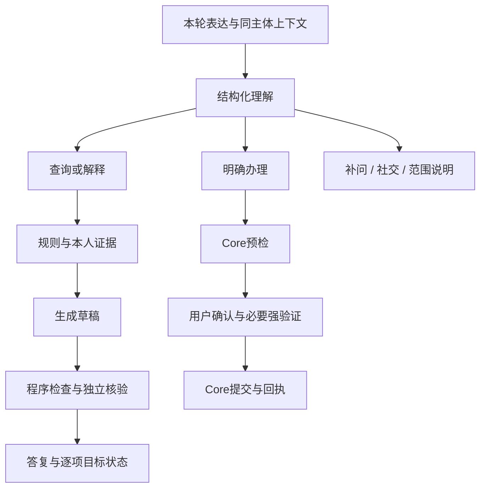

# Agent 架构

安言的 Agent 不是一个可自由调用所有银行接口的聊天模型。它围绕同主体状态，分别处理理解、只读咨询和模拟办理，Core 始终独立决定执行权限。[系统设计](技术文档.md)提供整体视图，[核心算法](核心算法说明.md)解释具体协议。

## 一次对话如何分流

否定、引用、假设和流程问题限制动作。模型输出 `ACTION` 只是候选，程序还会检查原文与字段；“取消转账需要什么条件”不能变成真的取消。“这个先放一下，继续李四那笔”先理解完整回合，再绑定唯一未完成任务。

## 状态分别存放

| 状态 | 内容 | 生存边界 |
| --- | --- | --- |
| 本轮目标 | 最多五项行为、资源、对象、字段与证据需求 | 不作为长期事实缓存 |
| 讨论任务 | 同主体最多四项缺槽、暂停或待输入意向 | 不保存确认权，不跨主体恢复 |
| 审批 | 原参数、短期授权、不透明句柄与期限 | 改参数、失效或退出后重新预检 |
| 业务 | Core 余额、交易、持仓、任务、回执 | 不由删除聊天或取消讨论回滚 |

`dialogue_act` 区分查询、解释、办理、补充、社交、澄清与不支持；`scope` 区分业务内、混合与范围外；`topic_relation` 帮助判断省略追问。混合请求保留可处理的业务部分，新话题不套用任意旧主题。

明确的单任务承接可补齐缺槽，但金额须来自本轮原文，多卡或对象歧义先澄清。风险问卷保留用户答案，模型不能代答。讨论恢复只产生新的预检机会，不继承旧授权。

## 知识与能力

`banking_knowledge.py` 维护 30 项意图与知识章节，`banking_rules.py` 导出 105 条记录，包括 75 条规则和 30 项能力。知识快照 `2026-11-01.2` 与实现摘要一起校验，见[规则说明](银行业务规则说明.md)及[JSON](银行业务规则.json)。

理解前本地检索相关规则，咨询中可继续检索。Core 的能力、服务指南和上下文接口要求会话；自然语言只在本地匹配，回源只发送稳定规则编号。规则描述权限与限制，不证明本人余额、订阅、联系人或完成状态。

当前接口包括 `GET /api/v1/assistant/capabilities`、`GET /api/v1/service-guide` 与 `GET /api/v1/assistant/context`。版本或内容不匹配时拒绝结果；普通上下文读取不签发资金授权。

## 咨询与证据闭环

十二类固定只读工具覆盖规则、账户、余额、卡片、争议、交易、联系人、产品、持仓、测评和待办。主体由会话给出，不能通过工具参数改用户、方法或 URL。订阅没有免确认工具，仍走黄区流程。

每项目标记录需要的字段和范围。取证预算为 `min(10, 4 + 2 × 目标数)`，最多三轮规划和三次草稿；失败重试与修复共享预算。同一记录刷新后旧证据退出当前事实集合，空结果、读取失败和字段未投影分别表示。

金额计算绑定资源字段和来源，由程序生成结果编号。生成器综合目标与证据，确定性检查和独立语义调用再核对切题、事实支持与覆盖。核验可驱动补查或改写，预算耗尽则保留缺口，不把回退答复记作完整自然回答通过。

## 办理与任务图

LangGraph 负责 `intent_parser`、`risk_checker`、`human_review`、`executor`、`responder` 和 `workflow_next` 编排。复杂任务通过 `depends_on` 表达先后约束，前置节点成功后才检查后继节点。用户中断后不继续隐式付款，部分失败保留逐节点状态。

`human_review` 是用户确认或等待接管的节点，不是实际银行坐席。Core 决定风险、绑定参数、确认、MFA、幂等及持久提交。工作流完成前置步骤不授予后续资金权限；模拟订单草稿也不代表商户已经接单。

## 推荐问题

推荐从服务端登记的问题和有依据的对象字段中选择。模型负责选择、排序与核验，不能自由编出按钮文案或把缺槽金额代填。过期按钮清除，已有输入草稿受保护；推荐排除的方向不会主动提示，用户自由输入仍可咨询。

## 配置与扩展

`BANK_MODEL_FAST_PATH` 控制规则快路径，`BANK_ANSWER_PLANNING` 控制自然回答生成与核验，`BANK_ANSWER_MODE` 区分 enforce 与 shadow；以[配置样例](../.env.example)和源码默认值为准。没有密钥的固定结果是降级行为。

新增业务要同时补充能力、资源字段、Core 规则与授权、客户端展示、导出知识和回归。新增工具不能绕过主体或确认，新增模型核验不能替代 Core。改动后的测试范围见[测试说明](测试用例.md)。
