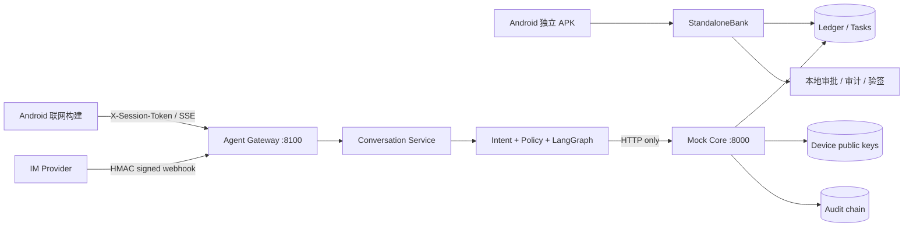
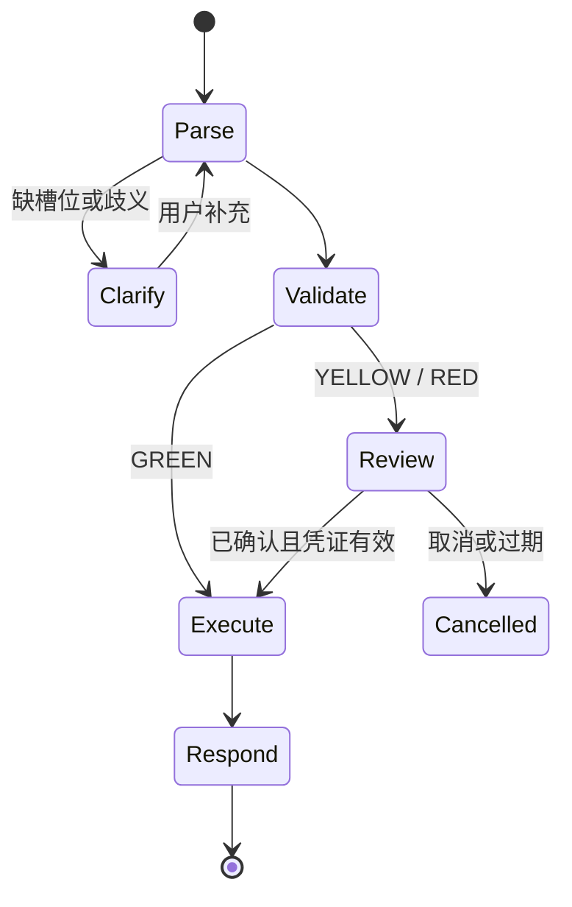

# Android 与 IM 渠道架构

> Android 默认以独立 APK 运行；签名 IM webhook 与 Android 联网构建共享渠道网关、Agent 编排和 Mock Core。

## 1. 分层

| 层 | 实现 | 边界 |
| --- | --- | --- |
| Android | Kotlin、Jetpack Compose、Retrofit/OkHttp、Android Keystore | 展示与采集确认；不持有服务端授权 nonce，不判断交易成功 |
| IM | `im_webhook.py` | 只接受允许 provider 的签名 webhook；外部账号必须先绑定已登录银行会话 |
| 渠道网关 | `agent_api.py`、`conversation.py` | 会话校验、限流、会话隔离、SSE、审批句柄与 checkpoint；不读写账本 |
| 编排层 | `agent.py`、`planner.py`、`scheduler.py` | 意图与槽位、风险路由、LangGraph 中断恢复、任务 DAG；不能直接修改余额 |
| Core | `main.py`、`security.py` | 唯一记账边界；登录、对象鉴权、预检、授权、MFA、执行、审计、熔断、幂等 |
| 受限分析 | `sandbox.py` | 只读 AST 白名单、大小和超时限制；生产仍需容器或 microVM 隔离 |



默认构建的 `BuildConfig.STANDALONE_MODE=true`。各 Repository 仍依赖 `AgentApi`、`SessionApi`、`CardsApi` 等接口，但实现改由 `StandaloneBank` 提供；联网构建把同一接口交给 Retrofit。这个边界让 Compose 页面、审批 UI 和结果渲染在两种模式下保持一致。

独立引擎只处理仓库内定义的虚构数据：会话、Mock 余额、联系人、银行卡、订阅、持仓与任务写入应用私有 SharedPreferences；短时审批和一次性 challenge 只保留在进程内。红区仍要求 OTP、BiometricPrompt 和已登记 Android Keystore 公钥的 ECDSA 签名。清除应用数据会重置整个演示沙箱。

Docker Compose 只启动 Core 和 Gateway。

## 2. 身份与会话

Android 先调用 Core 的 `POST /api/v1/auth/login`。Core 使用 argon2id 校验口令，可按配置增加登录 OTP，然后签发短时会话令牌。客户端把 `X-Session-Token` 传给网关；网关调用 Core 的 `GET /api/v1/auth/session` 校验并取得权威主体。

`X-User-Id` 只用于对象选择和兼容 Core 内部调用，不能在网关替代会话凭证。客户端同时提交冲突主体时，以已验证会话为准。`POST /api/v1/auth/logout` 只吊销当前会话，并使该会话签发的在途授权失效。

IM 外部身份不能自行成为银行身份。用户必须先在已登录会话调用 `POST /api/v1/im/bindings` 取得短时一次性绑定码，再由 provider 发送签名 `bind` 事件。绑定完成后的 `message` 事件才能映射到该主体。

## 3. 对话编排



编排层只输出白名单 `Intent` 和结构化槽位。确定性规则保留用户明确说出的金额、日期、收款人和卡片，模型输出不能覆盖这些事实。澄清状态保存缺失槽位及快照，因此“300”“下周六”“李四”这样的省略回答会补入上一轮请求；完整的新请求则开启新意图。

回指表达根据会话上下文解析，但不会继承授权。“再转一次”可以复用上一笔业务参数，却必须重新预检、确认和 MFA。“把它取消掉”可承接最近订阅查询。混合请求中的只读子任务可编译为顺序 DAG；包含资金或状态变更的多诉求会拆开确认，避免静默执行一部分。

## 4. 风险与执行协议

| 等级 | 示例 | 必要条件 |
| --- | --- | --- |
| GREEN | 余额、流水、账单分析、产品和订阅查询 | 有效会话，Core 返回可验证事实 |
| YELLOW | 阈值内转账、取消订阅、小额锁资、预约或 AA 创建 | Core 预检 + 用户明确确认 + 一次性授权 token |
| RED | 大额/累计超阈值转账、理财申赎、卡片高风险变更、改密 | Yellow 全部条件 + OTP + 已登记设备签名产生的 MFA proof |

资金和状态变更遵循三段式协议：

```text
POST /api/v1/risk/precheck[/operation|/lock|/unlock]
POST /api/v1/auth/confirm
POST /api/v1/auth/mfa/face/challenge + /auth/mfa/verify   # RED
POST /api/v1/transfers/execute 或 /api/v1/operations/execute
```

预检结果只是一张短时授权候选。执行端仍重新校验主体、会话、账户/卡状态、目标、金额、余额、风险级别、上下文摘要、TTL、单次性和幂等键。只有 Core 的成功响应可以生成成功回执；网络异常、字段缺失或校验失败必须返回未完成状态。

网关把 Core nonce 与 MFA proof 保存在服务端审批注册表，只把 `APR…` 不透明句柄返回 Android。句柄 TTL 必须短于 Core nonce TTL。SSE 每轮先发送阶段事件，最后只发送一个 `result`、`approval` 或 `error` 终态帧。

## 5. Android 设备信任根

Android 登录后在 Keystore 生成不可导出的 P-256 私钥，把公钥登记到 Core。红区流程如下：

1. Core 签发绑定会话授权 jti、主体和到期时间的一次性 challenge。
2. Android 通过 BiometricPrompt 完成本机用户验证。
3. Keystore 私钥对规范化 payload 做 ECDSA-SHA256 签名。
4. Core 用已登记公钥校验设备、主体、challenge、授权 jti、签名和单次性。
5. 验证通过后 Core 签发绑定父授权的短时 MFA proof。

服务端不接受 `face_verified=true` 等布尔自证，也不保留可复制到多个客户端的共享人脸 HMAC 密钥。测试与 E2E 探针使用一次性 P-256 测试设备，测试签名器位于 `tests/support.py` 和 `scripts/device_signer.py`，不进入生产安全模块。

## 6. IM 安全协议

允许的 provider 与 secret 由 `BANK_IM_PROVIDER_SECRETS` 注入。Webhook 签名输入为：

```text
HMAC-SHA256(provider_secret, timestamp + "." + event_id + "." + raw_body)
```

网关验证 provider 白名单、时间窗、原始 body 签名和事件编号防重放。事件内的 `user_id` 不可信且会被忽略。IM 可以取得事实回复或澄清提示；遇到 Yellow/Red 审批时只提示用户回 Android/API 完成，不通过聊天文本代替确认或生物验证。

当前绑定表、provider 会话和 webhook 重放表为演示级进程状态。生产需要事务持久化、跨实例去重、provider 账号生命周期同步、密钥轮换与 KMS。

## 7. 审计、熔断与沙箱

- 关键决策写入带前序摘要的审计事件，可按 `request_id` 聚合 Core 与 Agent 来源并报告缺失来源。
- 授权失败、异常操作组合和连续可疑行为会计分；超过阈值后账户锁定，窗口到期后自动恢复。
- 输入先经长度、Unicode 和 Prompt 注入规则处理；模型只能选择白名单意图和工具。
- 账单聚合使用 `sandbox.py` 的只读表达式执行器，限制 AST 节点、整数规模、输入输出大小和超时，并在健康接口报告实际执行模式。
- 账本、设备注册表、审批表和审计链可配置落盘及完整性摘要；配置 `BANK_AUTH_SECRET` 时使用 HMAC，篡改后拒绝载入并冻结写入。

## 8. 持久化与任务

`BANK_CONVERSATION_DB` 保存网关 checkpoint，审批句柄默认持久化在同目录。`BANK_LEDGER_STORE_PATH`、`BANK_DEVICE_STORE_PATH` 和 `BANK_AUDIT_LOG_PATH` 分别保存 Mock 账本、设备公钥/推送令牌和追加审计链。

生日联动、预约转账和订单草稿通过依赖 DAG 执行。到期任务只进入 `WAITING_USER` 并通知用户，结算时重新预检和授权。取消、失败或人工接管会停止后继节点；补偿解锁也走独立风险流程。

## 9. 运行与验证

```powershell
.\.venv\Scripts\python.exe -m uvicorn main:app --host 127.0.0.1 --port 8000
.\.venv\Scripts\python.exe -m uvicorn agent_api:app --host 127.0.0.1 --port 8100
.\start-emulator.bat
```

```powershell
.\.venv\Scripts\python.exe -m pytest -q
.\.venv\Scripts\python.exe -m ruff check . --ignore E402
docker compose config --quiet
cd android
.\gradlew.bat --no-daemon :app:testDebugUnitTest :app:assembleDebug :app:assembleDebugAndroidTest
```

## 10. 生产化边界

本仓库是虚构数据沙箱，不是生产银行系统。上线前必须接入事务数据库、Redis、OIDC、真实 OTP/生物认证、KMS、TLS/WAF、分布式限流、消息队列、WORM 审计、真实支付与 IM provider，并完成隐私、合规和红队评审。
