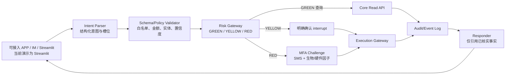

# AI Banking Agent 架构说明

## 1. 目标与边界

本项目是一个可演示、可测试的银行智能体沙箱：自然语言只负责提出业务意图，账户余额、流水和资金变更由确定性的 Mock Core Banking API 完成。所有写操作都必须经过策略判定和人机协同；模型不能直接修改账户状态。

当前仓库的可运行实现由三部分组成：

| 层 | 文件 | 职责 | 当前状态 |
| --- | --- | --- | --- |
| 交互层 | `web_app.py` | Streamlit 对话、确认卡、看板和账单图表 | 已实现（演示级） |
| 编排/策略层 | `agent.py` + `planner.py` | LangGraph 状态机、离线/LLM 意图槽位、风险路由、暂停/恢复、DAG | 已实现；生产需接入持久化任务执行器 |
| 核心执行层 | `main.py` + `security.py` | 余额/流水、风险预检、一次性凭证、转账/锁资/解锁及扩展场景 | 已实现服务端策略、MFA、审计、幂等；账本仍为内存 Mock |
| 安全组件 | `security.py` | 签名凭证、MFA proof、注入检测、审计链和熔断 | 已实现进程内控制；密钥托管和持久化待补强 |
| 规划/分析组件 | `planner.py`、`sandbox.py` | 白名单意图、任务 DAG、账单事实聚合、受限只读表达式 | 已接入 Agent；沙箱仅允许分析，不得写账 |

`bank_tools.py` 是供编排层复用的 HTTP 客户端，目前保留为薄适配层；生产实现应统一超时、重试、错误模型和追踪 ID。

## 2. 请求与状态流



### 2.1 现有 LangGraph 节点

`agent.py` 中的图目前为：

```text
intent_parser -> risk_checker -> (executor | human_review -> executor) -> responder -> END
```

`human_review` 使用 `interrupt()` 暂停图；Streamlit 先调用 Core 的确认/MFA 接口，再用 `Command(resume=...)` 恢复。核心只接受服务端签发的 proof，前端布尔字段不能越权。

### 2.2 复杂任务 DAG 的目标模型

跨场景请求（例如“生日预留资金并在两天前订花”）应编译成带依赖的任务图，而不是单个固定回复：

```text
parse_event
  ├─> validate_date_and_budget
  ├─> reserve_funds (YELLOW approval)
          └─> schedule_orders (depends_on: reserve_funds)
                  ├─> REMINDER
                  └─> ORDER_DRAFT(鲜花/蛋糕) → WAITING_USER at due time
```

每个节点应具备 `task_id`、状态（PENDING/RUNNING/WAITING_USER/SUCCEEDED/FAILED/CANCELLED）、幂等键和补偿动作。当前演示在定时转账/订单到期时停在 `WAITING_USER`，不自动扣款；生产版需接入任务级重新授权与结算 worker。

## 3. 核心数据与接口

### 3.1 账户与流水

演示版使用 `ACCOUNTS`、`TRANSACTIONS`、`DAILY_TRANSFERS` 全局内存字典/列表。可用余额定义为：

```text
available_balance = total_balance - locked_amount
```

重启会丢失状态；正式版本应迁移到带事务和唯一约束的数据库，并为余额变更使用数据库事务或等价的原子操作。

### 3.2 现有 HTTP API

| 方法与路径 | 用途 | 风险区 |
| --- | --- | --- |
| `GET /api/v1/accounts/{user_id}/balance` | 余额与锁定资金 | GREEN |
| `GET /api/v1/accounts/{user_id}/transactions` | 流水查询（TODAY/MONTH/LAST_MONTH/YEAR/ALL） | GREEN |
| `POST /api/v1/wealth/risk-assessment` | 风险评估并保存演示风险档案 | GREEN |
| `GET /api/v1/wealth/compare` | 多产品事实对比 | GREEN |
| `POST /api/v1/risk/precheck` | 计算日累计并发放临时凭证 | 策略网关 |
| `POST /api/v1/risk/precheck/lock` | 为锁资操作发放凭证（≤1000 黄区，较大金额红区） | 策略网关 |
| `POST /api/v1/risk/precheck/unlock` | 为解锁/补偿发放凭证（≤1000 黄区，较大金额红区） | 策略网关 |
| `POST /api/v1/risk/precheck/operation` | 理财、卡片、订阅、预约/AA 操作预检 | 策略网关 |
| `POST /api/v1/auth/confirm` | 记录用户明确确认（`/auth/confirmation` 为兼容别名） | YELLOW |
| `POST /api/v1/auth/mfa/verify` | 服务端校验 OTP + 人脸断言并签发 proof | RED |
| `POST /api/v1/transfers/execute` | 结算转账 | YELLOW/RED |
| `POST /api/v1/accounts/lock_fund` | 资金隔离 | YELLOW/RED |
| `POST /api/v1/accounts/unlock_fund` | 解锁/补偿资金 | YELLOW/RED |
| `POST /api/v1/operations/execute` | 扩展场景统一执行网关 | YELLOW/RED |
| `POST /api/v1/auth/password/change` | 演示凭证版本轮换 | RED |
| `GET/POST /api/v1/tasks...` | 任务查询、取消、人工接管 | GREEN/YELLOW |
| `GET /api/v1/security/health` | 安全组件健康摘要 | 运维 |
| `GET /api/v1/security/circuit/{user_id}` | 查询指定主体熔断状态 | 运维 |
| `GET /api/v1/security/audit` | 管理员凭证保护的审计查询 | 管理员 |

执行接口必须重新在服务端校验：调用者身份、凭证与目标/金额绑定、凭证有效期、账户状态、余额、幂等键和所需 MFA。前端展示的“确认”不能作为安全边界。`security.py` 的签名 token、一次性消费和 proof 绑定属于核心控制；调用方应通过 `bank_tools.py` 使用与 API 契约一致的路径。

## 4. 权限策略

| 级别 | 自动化策略 | 演示覆盖 | 完善要求 |
| --- | --- | --- | --- |
| GREEN | 只读查询直接执行 | 余额、流水、账单分析、理财/卡片/订阅查询 | 生产接入真实身份和字段脱敏 |
| YELLOW | 展示详情并取得明确确认 | 小额转账、预约/AA、生日锁资、订阅取消、虚拟卡申请 | 生产接入真实审批渠道 |
| RED | 强制多因子认证 | 超额转账、理财申购赎回、额度/挂失/解挂/冻结、密码修改 | 演示 OTP/人脸为模拟因子，生产接真实供应商 |

风险策略必须集中在一个可审计的 Policy Engine 中；模型输出只能选择白名单动作，不能自行提升权限。

## 5. 部署拓扑（演示）

```text
可接入渠道（APP / IM / Web） ──HTTP──>  Streamlit 演示前端（web_app.py）
                                      │
                                      └──HTTP──>  FastAPI Mock Core :8000 (main.py)

当前仓库实际提供的是 Streamlit 文本渠道；APP 原生 SDK、IM webhook、OIDC
登录回调属于接入层扩展，不能把示意图当作已上线渠道。
```

启动命令：

```powershell
python -m uvicorn main:app --reload --port 8000
python -m streamlit run web_app.py
```

演示环境建议增加 `/healthz`、配置化 `BANK_API_BASE`、超时/重试、Docker Compose 和反向代理 TLS。不要把 `127.0.0.1`、测试 OTP 或真实密钥写死在代码中。

## 6. 可观测性与交付物

所有请求应携带 `request_id`/`trace_id`，并记录结构化审计事件：解析结果摘要、策略版本、审批者、MFA challenge、执行前后余额摘要、核心返回码和错误原因（禁止记录完整密钥/验证码）。建议提供只读审计查询接口和指标：成功率、拒绝率、连续失败次数、P95 延迟、待人工任务数。

架构图、接口契约、威胁模型和演示步骤分别见本目录的文档；自动化测试入口为 `tests/test_core_api.py`。
