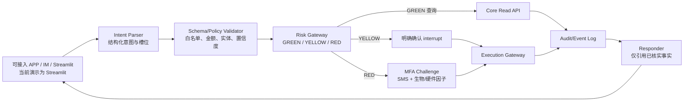

# AI Banking Agent 架构说明

## 1. 目标与边界

本项目是一个可演示、可测试的银行智能体沙箱：自然语言只负责提出业务意图，账户余额、流水和资金变更由确定性的 Mock Core Banking API 完成。所有写操作都必须经过策略判定和人机协同；模型不能直接修改账户状态。

当前仓库的可运行实现由三部分组成：

| 层 | 文件 | 职责 | 当前状态 |
| --- | --- | --- | --- |
| 交互层 | `web_app.py` | Streamlit 对话、确认卡、看板和账单图表 | 已实现（演示级） |
| 编排/策略层 | `agent.py` + `planner.py` | LangGraph 状态机、离线/LLM 意图槽位、风险路由、暂停/恢复、DAG | 已实现；生产需接入持久化任务执行器 |
| 核心执行层 | `main.py` + `security.py` | 余额/流水、风险预检、一次性凭证、转账/锁资/解锁及扩展场景 | 已实现服务端策略、MFA、审计、幂等；账本仍为内存 Mock |
| 安全组件 | `security.py` | 签名凭证、MFA proof、注入检测、审计链和熔断 | 已实现进程内控制；密钥托管和持久化待补强 |
| 规划/分析组件 | `planner.py`、`sandbox.py` | 白名单意图、任务 DAG、账单事实聚合、受限只读表达式 | 已接入 Agent；沙箱仅允许分析，不得写账 |

`bank_tools.py` 是薄传输适配层（供外部集成方、CLI 与旧静态调用复用），Agent 运行时使用 `agent.py` 自持的 `_http`；生产实现应统一超时、重试、错误模型和追踪 ID。

## 2. 请求与状态流



### 2.1 现有 LangGraph 节点

`agent.py` 中的图目前为：

```text
intent_parser -> risk_checker -> (executor | human_review -> executor) -> responder -> END
```

`human_review` 使用 `interrupt()` 暂停图；Streamlit 先调用 Core 的确认/MFA 接口，再用 `Command(resume=...)` 恢复。核心只接受服务端签发的 proof，前端布尔字段不能越权。

**意图解析的两条确定性护栏**（`agent._model_parse`）：

1. **用户明确说出的事实优先于模型输出**：本地规则解析器提取到的日期（"下周六"/"下周"/显式日期）、金额与收款人是策略事实；模型若把这些字段返回为 null、返回冲突日期或把复合请求（生日锁定 + 提醒）简化成单一意图，本地事实会覆盖模型结果；仅当模型输出**完整**而本地输出不完整时才采用模型结果。
2. **多轮槽位回填**：澄清时把 `missing_slots` 与当时的槽位快照写入 `context.pending_clarification`；用户下一轮只回答一个值时，该答案**按缺失槽位的类型解释**（日期槽 ← “下周六”；金额槽 ← “3000”/“三千”/“¥3,000”；收款人槽 ← 姓名或手机号），并合并回待澄清的意图，而不是被当作全新请求（此前会返回 UNKNOWN 的能力清单）。若用户改说一个**完整的新请求**，则新意图优先；数字答案不会误填日期槽。面向用户的确认卡与回执统一走业务语言（`_human_readable_action` / `_completion_label`），不出现内部意图编码。

3. **模糊 / 省略 / 隐含表达**（`_implicit_intent` / `_resolve_ellipsis`）：
   - *隐含意图*：一张确定性映射表把口语说法接到白名单意图上——保护性规则先于关键词链执行（“卡被盗刷/被盗用”→冻结卡片，绝不回一张卡片清单），其余作为关键词未命中时的兜底（“钱都花哪儿去了”→上月深度账单分析；“乱扣费”→订阅清单；“不想再被扣会员费”→取消订阅；“放着也是放着/买点理财”→理财推荐；“取不出钱来了”→卡片状态查询；“转点钱给老婆”→转账并追问金额）。
   - *省略与回指*：`再转一次 / 再来一笔 / 和上次一样` 复用上一轮的意图与槽位，但**重新申请 nonce 并再次弹出确认卡**（绝不静默重复执行）；`还是上次那个` 回填上次的对象；`把它取消掉` 承接上一次订阅查询变成取消订阅并要求指明具体订阅；无法解析的回指会明确说“没有找到可以沿用的上一次操作”，而不是给能力清单。

4. **一句话多个诉求 → 有序子任务 DAG**（`_split_read_requests` / `_build_multi_read_plan`）：按“然后/再/并且/同时/；”等显式连接词切分，若每个子请求都是**完整且只读**的白名单意图，则编译成一张带依赖的 DAG（各子计划的任务 id 加序号前缀并串联 `depends_on`），执行阶段按序调用只读接口、逐条走同一套字段校验后合并作答（任一条不可核验则整体不声称成功）。若复合请求中含**变更类**子请求，则不拆解、不半做，而是提示用户逐条办理。

执行阶段由 `planner.PlanExecutor` 按 DAG 依赖顺序推进计划账本：本回合真实执行的步骤（校验/风控/MFA/结算）标记 SUCCEEDED；由核心任务中心接管的后续步骤（提醒、订单草稿、参与人通知）保持 PENDING 并记录去向；结算失败时把该步骤标记 FAILED 并执行补偿动作（核心账本原子回滚确认，核对异常则升级人工接管）。所有结算请求携带 `Idempotency-Key`（`plan_id:task_id`），传输层失败只重试一次且复用同一键，避免重复记账。

### 2.2 复杂任务 DAG 的目标模型

跨场景请求（例如“生日预留资金并在两天前订花”）应编译成带依赖的任务图，而不是单个固定回复：

```text
parse_event
  ├─> validate_date_and_budget
  ├─> reserve_funds (YELLOW approval)
          └─> schedule_orders (depends_on: reserve_funds)
                  ├─> REMINDER
                  └─> ORDER_DRAFT(鲜花/蛋糕) → WAITING_USER at due time
```

每个节点应具备 `task_id`、状态（PENDING/RUNNING/WAITING_USER/SUCCEEDED/FAILED/CANCELLED）、幂等键和补偿动作。当前演示在定时转账/订单到期时停在 `WAITING_USER`，不自动扣款；生产版需接入任务级重新授权与结算 worker。

## 3. 核心数据与接口

### 3.1 账户与流水

演示版使用 `ACCOUNTS`、`TRANSACTIONS`、`DAILY_TRANSFERS` 全局内存字典/列表。可用余额定义为：

```text
available_balance = total_balance - locked_amount
```

重启会丢失状态；正式版本应迁移到带事务和唯一约束的数据库，并为余额变更使用数据库事务或等价的原子操作。

### 3.2 现有 HTTP API

| 方法与路径 | 用途 | 风险区 |
| --- | --- | --- |
| `GET /api/v1/accounts/{user_id}/balance` | 余额与锁定资金 | GREEN |
| `GET /api/v1/accounts/{user_id}/transactions` | 流水查询（TODAY/MONTH/LAST_MONTH/YEAR/ALL） | GREEN |
| `GET /api/v1/accounts/{user_id}/bill-analysis` | 服务端账单事实聚合（沙箱执行，含退款与异常标记） | GREEN |
| `GET /api/v1/contacts/{user_id}` | 联系人别名（手机号脱敏） | GREEN |
| `GET /api/v1/wealth/products` | 理财产品查询 | GREEN |
| `GET /api/v1/wealth/holdings/{user_id}` | 持仓查询 | GREEN |
| `GET /api/v1/wealth/recommend` | 按风险档案推荐（带免责声明） | GREEN |
| `POST /api/v1/wealth/risk-assessment` | 风险评估并保存演示风险档案 | GREEN |
| `GET /api/v1/wealth/compare` | 多产品事实对比 | GREEN |
| `GET /api/v1/subscriptions/{user_id}` | 订阅/代扣列表 | GREEN |
| `GET /api/v1/subscriptions/{user_id}/detect` | 活跃代扣与续费提醒识别 | GREEN |
| `POST /api/v1/subscriptions/{user_id}/reminders` | 把识别到的续费物化为任务中心提醒（扣款前 2 天、幂等） | GREEN（可审计写） |
| `GET /api/v1/cards/{user_id}` | 卡片列表与状态 | GREEN |
| `POST /api/v1/risk/precheck` | 计算日累计并发放临时凭证 | 策略网关 |
| `POST /api/v1/risk/precheck/lock` | 为锁资操作发放凭证（≤1000 黄区，较大金额红区） | 策略网关 |
| `POST /api/v1/risk/precheck/unlock` | 为解锁/补偿发放凭证（≤1000 黄区，较大金额红区） | 策略网关 |
| `POST /api/v1/risk/precheck/operation` | 理财、卡片、订阅、预约/AA 操作预检 | 策略网关 |
| `POST /api/v1/auth/confirm` | 记录用户明确确认（`/auth/confirmation` 为兼容别名） | YELLOW |
| `POST /api/v1/auth/session` | 签发会话令牌（绑定主体、短时效、可复用），写操作可用其替代自称身份 | 登录/渠道 |
| `POST /api/v1/auth/mfa/verify` | 服务端校验 OTP + 签名人脸票据并签发 proof | RED |
| `POST /api/v1/auth/mfa/face/challenge` | 签发绑定交易 jti 的一次性活体挑战，供模拟设备 SDK 签名 | RED |
| `POST /api/v1/transfers/execute` | 结算转账 | YELLOW/RED |
| `POST /api/v1/accounts/lock_fund` | 资金隔离 | YELLOW/RED |
| `POST /api/v1/accounts/unlock_fund` | 解锁/补偿资金 | YELLOW/RED |
| `POST /api/v1/operations/execute` | 扩展场景统一执行网关 | YELLOW/RED |
| `POST /api/v1/auth/password/change` | 演示凭证版本轮换 | RED |
| 便捷别名 | `/risk/confirm`、`/auth/confirmation`、`/auth/mfa`、`/risk/mfa/verify`、`/accounts/rollback_lock`，以及 `/transfers/schedule`、`/transfers/split`、`/subscriptions/cancel`、`/cards/{apply,limit,freeze,unfreeze,report-lost,unreport-lost}`、`/wealth/{purchase,redeem}`；路径与请求体操作名不一致时返回 `OPERATION_ROUTE_MISMATCH` | 同主端点 |
| `GET /api/v1/tasks` | 任务查询（仅本人） | GREEN |
| `GET /api/v1/tasks/{task_id}` | 任务详情（owner 作用域） | GREEN |
| `POST /api/v1/tasks/{task_id}/cancel` | 取消任务并级联取消依赖项 | YELLOW |
| `POST /api/v1/tasks/{task_id}/takeover` | 人工接管（owner 作用域，记录理由） | YELLOW |
| `POST /api/v1/tasks/run-due` | 推进到期任务（定时转账/订单草稿进入 `WAITING_USER`）。配置 `BANK_ADMIN_AUDIT_TOKEN` 时必须带 `X-Admin-Token` 全局推进；未配置时按 `X-User-Id` 仅推进本人任务 | 运维/本人 |
| `GET /healthz` | 存活探针（不泄露账户信息） | 公开 |
| `GET/POST /api/v1/tasks...` | 任务查询、取消、人工接管（明细见上表） | GREEN/YELLOW |
| `GET /api/v1/security/health` | 安全组件健康摘要（含沙箱与审计持久化状态） | 运维 |
| `GET /api/v1/security/circuit/{user_id}` | 查询指定主体熔断状态 | 运维 |
| `GET /api/v1/security/behavior/{user_id}` | 行为风险评分、命中规则与信号明细（可解释锁定原因） | 本人或管理员 |
| `GET /api/v1/security/audit`（别名 `/api/v1/audit/logs`） | 审计查询：本人可查自己的脱敏事件，管理员（`BANK_ADMIN_AUDIT_TOKEN`）可查任意主体 | 本人或管理员 |
| `GET /api/v1/security/audit/verify` | 审计哈希链完整性自检 | 管理员 |
| `GET /api/v1/security/audit/trace/{request_id}` | 按请求编号还原完整决策链路（预检 → 确认 → MFA → 结算 → 凭证消费） | 本人或管理员 |

执行接口必须重新在服务端校验：调用者身份、凭证与目标/金额绑定、凭证有效期、账户状态、余额、幂等键和所需 MFA。前端展示的“确认”不能作为安全边界。`security.py` 的签名 token、一次性消费和 proof 绑定属于核心控制。主链路 `agent.py` 自持 `_http` 直连核心并注入 `X-Request-Id`/`Idempotency-Key`；`bank_tools.py` 提供等价的传输适配层，供外部集成方或 CLI/旧静态调用复用，不参与 Agent 运行时路径。

**网关入口控制**（HTTP 中间件，先于业务逻辑执行）：

1. **会话身份**：携带 `X-Session-Token` 时先验证会话，其主体用于覆盖客户端自称的 `X-User-Id`（同一请求不可能既持有效会话又冒充他人）；设置 `BANK_REQUIRE_SESSION=1` 后，写操作（POST/PUT/PATCH/DELETE）必须携带会话令牌，读操作仍可用身份头，签发会话本身不受限。
2. **每主体限流**：60 秒固定窗口（`BANK_RATE_LIMIT_PER_MINUTE`，0 为关闭），键为身份主体或来源 IP；超限返回 `429 RATE_LIMITED` 与 `Retry-After`，且首次超限写一条审计事件；`/healthz`、`/api/v1/security/health` 与文档路径豁免。
3. **体积与响应头**：按 `Content-Length` 限制请求体（413/400），并统一补齐 `nosniff` / `X-Frame-Options: DENY` / `Referrer-Policy` / API 响应 `no-store`。

**行为组合熔断**（`security.py`，与失败计数器共用同一锁定状态）：

```text
敏感操作 → 加权信号(大额转账/LARGE_LOCK/卡片变更/挂失/改密/凭证失败/成功)
        → 命名规则匹配（大额转账后挂失、大额转账后改密、调额后大额转出、
          连续大额转账、连续卡片变更、失败后成功）
        → 滑窗评分(默认 600s) ≥ 阈值(默认 80) → 锁定 LOCKOUT_SECONDS
        → 审计 BEHAVIOR_RISK_LOCK(评分/规则/信号序列) + 423 CIRCUIT_OPEN(含原因)
```

阈值与窗口由 `BANK_BEHAVIOR_RISK_THRESHOLD` / `BANK_BEHAVIOR_WINDOW_SECONDS` 配置，大额判定由 `BANK_BEHAVIOR_LARGE_AMOUNT_CENTS` 配置；同一请求内由多层重复上报的同一信号按 `request_id` 去重。读接口同样受锁定约束，锁定到期后自动恢复，不延长；`/security/circuit/{user_id}` 与 `/security/behavior/{user_id}` 在锁定期间仍可访问，保证“为什么被锁”始终可解释。

## 4. 权限策略

| 级别 | 自动化策略 | 演示覆盖 | 完善要求 |
| --- | --- | --- | --- |
| GREEN | 只读查询直接执行 | 余额、流水、账单分析、理财/卡片/订阅查询 | 生产接入真实身份和字段脱敏 |
| YELLOW | 展示详情并取得明确确认 | 小额转账、预约/AA、生日锁资、订阅取消、虚拟卡申请 | 生产接入真实审批渠道 |
| RED | 强制多因子认证 | 超额转账、理财申购赎回、额度/挂失/解挂/冻结、密码修改 | 演示 OTP/人脸为模拟因子，生产接真实供应商 |

风险策略必须集中在一个可审计的 Policy Engine 中；模型输出只能选择白名单动作，不能自行提升权限。

## 5. 部署拓扑（演示）

```text
可接入渠道（APP / IM / Web） ──HTTP──>  Streamlit 演示前端（web_app.py）
                                      │
                                      └──HTTP──>  FastAPI Mock Core :8000 (main.py)

当前仓库实际提供的是 Streamlit 文本渠道；APP 原生 SDK、IM webhook、OIDC
登录回调属于接入层扩展，不能把示意图当作已上线渠道。
```

启动命令：

```powershell
python -m uvicorn main:app --reload --port 8000
python -m streamlit run web_app.py
```

演示环境建议增加 `/healthz`、配置化 `BANK_API_BASE`、超时/重试、Docker Compose 和反向代理 TLS。不要把 `127.0.0.1`、测试 OTP 或真实密钥写死在代码中。

## 6. 可观测性与交付物

所有请求携带 `request_id`，核心记录结构化审计事件（策略版本、审批者、MFA challenge、执行前后余额摘要、核心返回码和错误原因，禁止记录完整密钥/验证码），并提供只读审计查询与决策链路还原接口（`/security/audit`、`/security/audit/verify`、`/security/audit/trace/{request_id}`）。Agent 侧事件（意图解析、回复校验）保存在 Agent 进程内，跨进程汇聚属于生产项；建议继续补充指标：成功率、拒绝率、连续失败次数、P95 延迟、待人工任务数。

架构图、接口契约、威胁模型和演示步骤分别见本目录的文档；自动化测试为 `tests/` 下 7 个文件（`pytest -q` 全量运行，涵盖契约、安全回归、Agent 工作流、规划、安全原语、扩展场景与并发原子性）。
