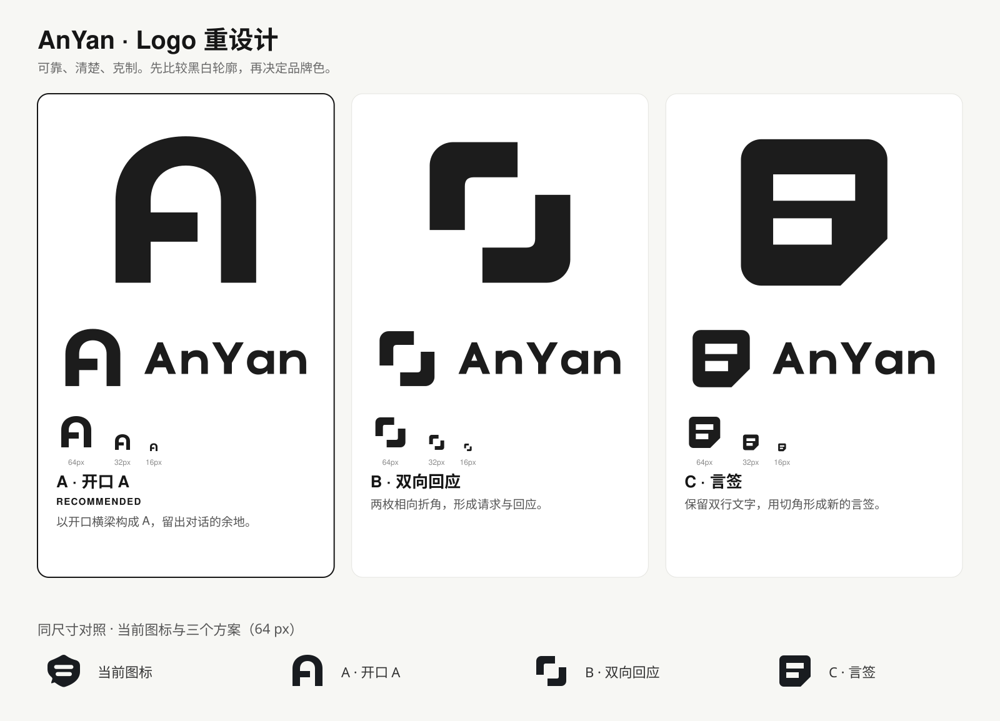

# AnYan Logo 重设计：第一轮方案

日期：2026-11-02。本页保留首轮三款黑白概念。用户已选定 **A「开口 A」**，并最终选定右侧**暖石墨 `#30312D`＋浅金 `#B39A68`**方案，见[最终文件与使用规范](final/README.md)。应用图标、客户端组件、服务器面板和现有参赛包仍以各自实际发布版本为准。

后续配色探索：[陶土橙＋奶油白／暖石墨＋浅金对比](color-study/README.md)。

## 设计简报

品牌名称为 **AnYan**，中文名称“安言”，定位是安全可控的银行 AI 助手。主要接触点为 Android 桌面图标、聊天头像、后台页眉与答辩展示。根据已有项目背景，采用“可靠、清楚、克制、易接近”四个关键词；这是本轮设计假设，用户可在选方向时调整。

沿用精确拼写 AnYan、紧凑轮廓与对话感。现有图标为盾形气泡及两条镂空文字线，指代较多；本轮把识别重点收敛为一个主要特征。用户明确不使用蓝紫渐变，本轮所有 Logo 均为单一深墨色，先评估形状，品牌色在方向确定后细化。

本轮未使用机器人脸、芯片、币种符号、上涨箭头或新增盾牌叠图。参考资料来自 logo-design 技能自带图库，仅学习类别惯例和几何处理，未描摹或分发图库商标。研究了金融分类，以及 Adonis、Atomic、Patreon、Pagekit、Square、Framer 等 SVG 的结构；并在私有测试页中与 11 个金融／支付品牌做同尺寸并列观察。该对比不构成商标清查。

## 概念发散与取舍

| 初始方向 | 类型 | 取舍 |
| --- | --- | --- |
| 开口 A | 字母形 | 入选，名称关联直接，开口横梁形成特征 |
| 双向回应 | 抽象符号 | 入选，两组相向折角形成成对关系 |
| 言签 | 图形与字标组合 | 入选，承接旧标双行镂空，改变外轮廓 |
| AY 共用一笔 | 字母组合 | 首轮不选，紧凑后容易误读为 Y 或箭头 |
| 等号与边界 | 抽象符号 | 首轮不选，过于接近通用功能图标 |
| 托举弧线 | 抽象符号 | 首轮不选，容易落入通用信任／微笑表达 |
| 双页交叠 | 图形符号 | 首轮不选，与文档工具的联系过强 |
| 单笔签名 | 字标 | 首轮不选，16 px 图标难保留特征 |
| 两个 An 的镜像 | 字母组合 | 首轮不选，笔画较多、名称读取不够直接 |
| 闭环回执 | 抽象符号 | 首轮不选，容易被当作刷新或完成状态 |

## 三个方向

### A：开口 A（推荐）

[符号](concept-a-symbol.svg) · [AnYan 横向组合](concept-a-lockup.svg)

连续圆拱构成 A 的主轮廓，横梁在右侧留出开口。以名字首字母建立识别，让“开放对话”通过一个结构细节表达，避免额外叠加气泡。形状紧凑，适合 Android 图标和聊天头像。

构造采用 256 × 256 画布，48 单位竖向笔画、40 单位横梁和 32 单位内侧开口。顶部外拱位于 y=24，底部位于 y=224，视觉中心较几何中心上移 4 单位，属于有意的光学校正。风险：开口细节需要反复曝光建立品牌联想，不能仅凭字母 A 保证独有性。

### B：双向回应

[符号](concept-b-symbol.svg) · [AnYan 横向组合](concept-b-lockup.svg)

两枚相向折角形成请求与回应，中央保持通道。两部分通过 180° 旋转对应，几何简洁，适合技术感较强的界面。第二轮把折角端点从 160 收至 152，使入口间隙由 16 扩至 24 单位。

风险：相较 A，名称关联较弱，也可能被看作对焦或扫描框。

### C：言签

[符号](concept-c-symbol.svg) · [AnYan 横向组合](concept-c-lockup.svg)

用两条镂空文字和一个切角，把现有图标收敛为简洁的“言签”。保留用户熟悉的双行节奏，改变盾牌与气泡混合的外轮廓。第二轮加大镂空至 36 单位高，16 px 下仍保留两行。

风险：容易让人联想到便签、文档或字母 B，品牌个性相对保守。

## 已执行的检查

| 检查 | 本轮结果与范围 |
| --- | --- |
| 两轮绘制与查看 | v1、v2 分别保存并渲染；扩大 A 开口、B 间隙与 C 镂空，再逐款查看 |
| 纯矢量与字形 | 六个 Logo SVG 均通过 XML 与结构检查；无图片、滤镜、渐变、描边或 live text |
| 字标 | AnYan 五个字母为本轮自行构造的几何路径，无外部字体轮廓依赖；说明文字使用系统字体 |
| 16/32/64 px | 查看真实尺寸及放大像素格；A 的开口、B 的分离结构和 C 的两行仍可分辨 |
| 单色与反白 | 已查看黑底白标、白底深标；深色原标不直接用于深色背景 |
| 光学与误读 | 查看模糊、镜像、180° 旋转及字标连接处；属于设计者目视检查，尚无外部人员识别测试 |
| 类别并列 | 与 11 个参考品牌同尺寸观察，仅作类别辨识判断 |
| 结构审计 | 三款符号评分为 99/100、100/100、100/100；这是脚本启发式评分，不代表设计质量或原创性认证。A 仅保留有意上移的 INFO 提示；横向组合已修正左右留白 |

第一轮仅交付概念符号、路径字标及对比页，不把这些文件标为正式发布资产。商标注册可行性、印刷打样、最终品牌色与多设备图标细化尚未验证。

## 后续范围

使用的 [logo-design 技能](https://github.com/kaankiziltug/logo-design-skill/tree/main/skills/logo-design) 要求先展示并确认方向，再制作完整套件。该确认已完成；A 方向的松柏绿正式套件、单色和反白、横竖组合、Android／网页图标及使用规范见 [final/README.md](final/README.md)。客户端或后台接入时应使用这套最终资产。
