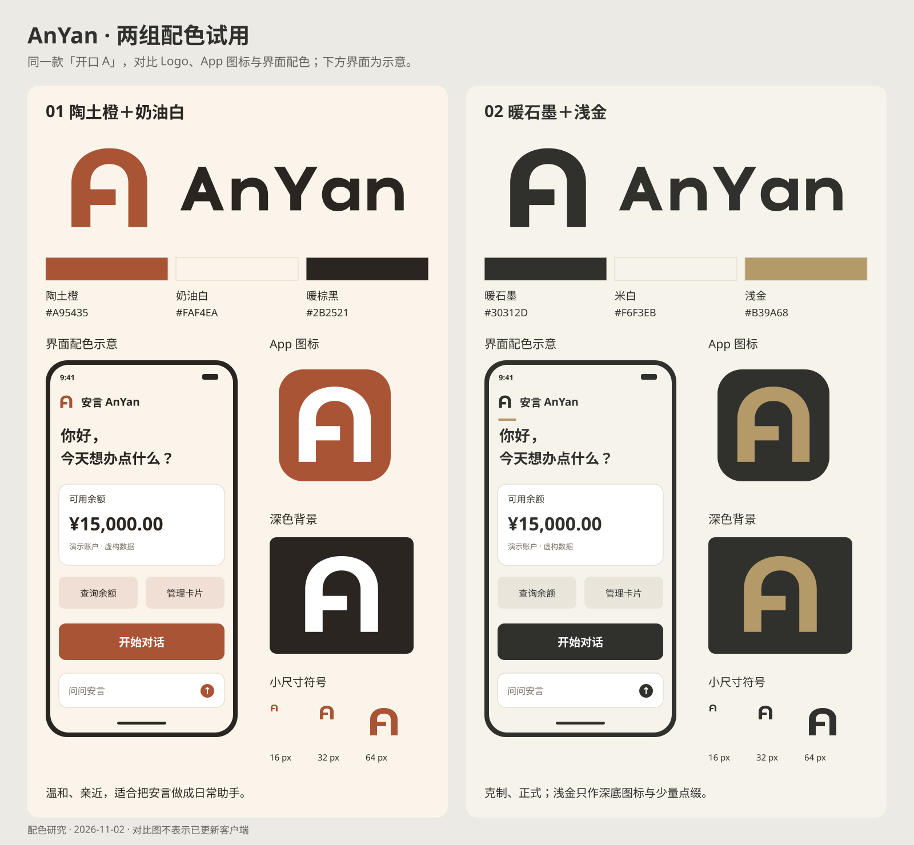

# AnYan 两组配色试用

日期：2026-11-02。根据用户“前两组都试一下”的要求，对已选定的「开口 A」比较以下两套纯色。符号、路径字标、比例和展示内容相同，仅改变配色。

## 01：陶土橙＋奶油白

- 主色：`#A95435`。
- 背景：`#FAF4EA`。
- 正文／字标：`#2B2521`。
- App 图标：陶土橙底、白色 A。

更偏温暖、亲近的日常助手形象。品牌色不替代交易风险的红黄绿，示意页中没有办理或付款动作。

[横向 Logo](terracotta/anyan-horizontal.svg) · [App 图标](terracotta/anyan-app-icon.svg) · [色值与对比度](terracotta/palette.json)

## 02：暖石墨＋浅金

- 主色／正文：`#30312D`。
- 背景：`#F6F3EB`。
- 浅金点缀：`#B39A68`。
- App 图标：暖石墨底、浅金色 A。

更偏克制、正式的金融工具形象。浅金只用于深底标志及装饰；浅底上的正文、小图标与按钮均用暖石墨，不用浅金承载需要读清的内容。

[横向 Logo](graphite-gold/anyan-horizontal.svg) · [App 图标](graphite-gold/anyan-app-icon.svg) · [色值与对比度](graphite-gold/palette.json)

## 已核对

| 组合 | 陶土橙方案 | 暖石墨＋浅金方案 |
| --- | --- | --- |
| 主色／背景 | 4.79:1 | 11.82:1 |
| 正文／背景 | 13.81:1 | 11.82:1 |
| App 图标前景／底色 | 5.24:1 | 4.83:1 |

浅金／米白仅为 2.45:1，故限制为装饰用途。对比度是按色值计算的静态结果，不代表整款应用已完成可用性或无障碍验收。

十个 Logo SVG 均为纯矢量，保持原几何和路径字标；无图片、渐变、滤镜、live text 或未展开描边。已渲染查看主标、App 图标、深底和 16／32／64 px 符号。图中的手机界面为配色示意，余额为虚构数据，不是客户端截图或账户变更。

本目录是配色研究，既有松柏绿套件仍保留原版本。最终选择后，再用同一套色值统一导出图标和接入资源。
