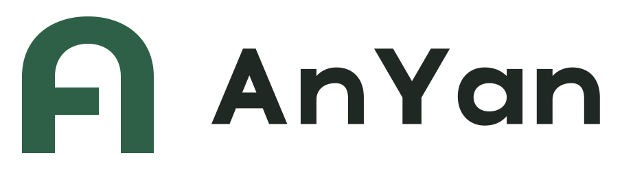

# AnYan「开口 A」使用规范

版本：2026-11-02。用户已选择 A 方向。中文名称“安言”，英文拼写固定为 **AnYan**。



圆拱构成名字首字母 A，横梁在右侧保留开口。按用户“不使用蓝色、由设计决定主题色”的要求，主标采用**松柏绿 `#2D6047`** 与墨黑字标，搭配米白背景。颜色克制、偏暖，突出稳重与易接近；整套不使用渐变、发光或投影。

## 文件与尺寸

| 用途 | 选择 | 建议最小屏幕尺寸 |
| --- | --- | --- |
| 页眉、答辩、文档 | [横向主标](masters/anyan-horizontal.svg) | 宽 180 px |
| 封面、居中版面 | [竖向组合](masters/anyan-stacked.svg) | 宽 120 px |
| 聊天头像、导航 | [标准符号](masters/anyan-symbol.svg) | 48 px |
| 小图标 | [小尺寸符号](masters/anyan-symbol-small.svg) | 16–32 px |
| 仅名称 | [路径字标](masters/anyan-wordmark.svg) | 宽 100 px |
| 深色底 | 对应 `*-reversed.svg` | 与相同组合一致 |
| 桌面图标、商店预览 | [圆角预览](masters/anyan-app-icon.svg)／[方形原稿](masters/anyan-app-icon-square.svg) | 使用导出的 512／1024 px PNG |
| 浏览器图标 | [有底色 favicon](masters/anyan-favicon.svg) | 导出 ICO 与 16／32／48 px PNG |

最小尺寸来自本轮屏幕渲染与目视检查。印刷可从符号高 6 mm、横向标宽 28 mm 开始打样，仍需在实际纸张、工艺和观看距离下确认。

标准符号使用 256 单位画布；竖笔画 48、横梁 40、内侧开口 32 单位，顶部有意比几何中心上移 4 单位。小尺寸版将横梁改为 32 单位，并调整顶拱位置。反白标准版通过扩大内部空间，将竖笔画从 48 减至 46 单位、横梁从 40 减至 38 单位，补偿深底上白色显粗的视觉效果。

## 留白与摆放

把标准符号的竖笔画宽度定义为 **x**。符号或组合外轮廓四周至少保留 **0.5x** 的净空；版面宽松时使用 1x。比例随 Logo 缩放。小 favicon 和平台图标使用专用原稿，不额外压入文字或装饰。

横向组合与竖向组合的相对位置已经固定，整体等比缩放。图片背景上优先使用纯色承托区；浅底使用松柏绿／墨黑，深底使用反白或指定浅鼠尾草绿单色版。不要把墨黑字标直接放在深色底上。

## 色彩

| 颜色 | HEX | RGB | CMYK 数学近似 |
| --- | --- | --- | --- |
| 松柏绿 | `#2D6047` | 45, 96, 71 | 53, 0, 26, 62 |
| Ink | `#202823` | 32, 40, 35 | 20, 0, 13, 84 |
| White | `#FFFFFF` | 255, 255, 255 | 0, 0, 0, 0 |
| 米白 | `#F7F5EF` | 247, 245, 239 | 0, 1, 3, 3 |
| 浅鼠尾草绿 | `#BFD9C5` | 191, 217, 197 | 12, 0, 9, 15 |

色值与角色亦见 [palette.json](palette.json)。CMYK 不是指定 ICC 下的印刷校色结果；专色／Pantone 编号需按实物色卡和介质确认，本轮不指定未经验证的编号。印刷请先交付 SVG 原稿并与印厂确认转换，不把 RGB 数值当作印刷承诺。

## 字体与禁用方式

AnYan 字标是自行构造的几何路径，不依赖安装字体，也不需要购买商业字库才能显示。正文可沿用 Android 系统无衬线字体；中文展示说明使用系统中文字体，不打包字体文件。

保持 AnYan 的大小写。不要拉伸、压扁、旋转、重排组合或用打字重建字标；不要给主标加描边、渐变、阴影或风险光效。风险红黄绿属于业务状态，不替代品牌色，也不要把 Logo 当作付款成功标识。

## Android 与网页接入

`android/` 提供可复制的 VectorDrawable、自适应及单色图标 XML，当前用于交付接入资源。正式替换时对照应用现有的同名资源，特别是 `ic_launcher_background`，保留已有业务颜色。桌面前景使用 108 单位画布，标志经过缩放和平移后位于中央 66 单位安全圆内，背景独立为松柏绿。

导出包包含网页 `favicon.ico`、SVG／PNG favicon、Apple Touch 图标、192／512 px 图标、maskable 图标、`site.webmanifest` 和 HTML 片段。文件默认按网站根目录引用；若部署到 `/panel/` 等子路径，应统一修改图标路径和实际 URL，再检查 HTTP 返回。图标文件本身不把一个网站自动变成离线可用的 PWA。

## 重新导出

在仓库根目录运行，要求已安装本次使用的 logo-design 技能和一个受支持的 SVG 渲染器：

```powershell
.\.venv\Scripts\python.exe scripts/build_anyan_brand.py --output-dir build/anyan-brand
```

输出目录必须不存在或为空；脚本不清空已有文件。输出含矢量、透明 PNG、Android／网页图标、六种相关应用场景示意、使用规范、SHA-256 清单及 ZIP。场景图为品牌摆放示意，不代表真实银行卡、模型实测或已更新客户端。

传入 `--android-sdk <SDK目录>` 可额外用 aapt2 编译、链接交付的 Android 资源；不安装应用，也不修改已有资源。安装 Pillow 时还会逐一解码 PNG 并检查透明通道。收到完整导出包后，也可在包根目录执行 `python source/build_anyan_brand.py --source-dir . --output-dir ../AnYan-Logo-Kit-rebuilt` 重新导出；仍需已安装 logo-design 技能与渲染器。

正式商用前应做专业商标和相似图形检索；本轮参考库并列观察不构成可注册性判断。最终文件的渲染、结构与安全区域结果由导出包内 `validation.json` 记录，不把设计者目视判断当作外部用户研究。
