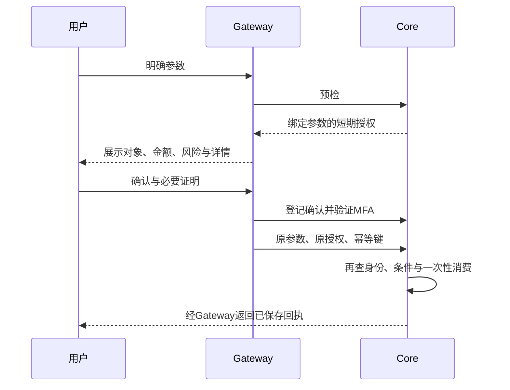

# 安全设计

本文描述安言的威胁边界、权限协议与剩余风险。系统处理虚构银行业务，不构成真实金融机构的安全认证。Core 是模拟业务的最终执行方，模型、客户端和用户输入均不能自行授予权限。

术语：MFA 是多因子验证；OTP 是一次性验证码；HMAC 是带密钥的消息认证码；幂等表示同一请求重发不重复产生业务；Keystore 是 Android 保护和使用设备密钥的机制。

## 保护目标与攻击面

| 目标 | 典型威胁 | 控制位置 |
| --- | --- | --- |
| 账户隔离 | 改 user_id、卡片号、会话或绑定码读取他人资源 | Core 会话与对象归属校验 |
| 执行完整性 | 模型越权、跳过确认、改金额、旧授权重放 | 风险预检、参数绑定、确认状态、一次性授权 |
| 结果可信度 | 编造余额、把预检当成功、超时后重复付款 | 取证、计算证据、回执与幂等 |
| 可追溯性 | 缺少关键操作链路、明文泄露凭据 | Core/Gateway 关联审计、字段脱敏、哈希链 |
| 有限可用性 | 连续失败、可疑行为、模型队列或表达式耗尽 | 熔断、资源预算、有界队列与子进程 |

网络、模型供应商、服务器管理员和运维台构成独立边界。拥有服务器与密钥的管理员仍能更改程序和记录；模型提供者会收到必要的对话内容，不能按全部离线系统对外描述。

## 身份与会话

登录后 Core 签发主体绑定的会话，私有资源需要有效会话和对象归属。客户端的用户名参数、模型解析出的主体和历史对话均不能替代鉴权。`BANK_REQUIRE_SESSION=1` 应保持开启。

退出登录、过期或凭据版本变化使会话及关联授权失效。Core 重启后重新登录，旧审批不能跨重启继续使用。飞书绑定依附 App 会话，不能被当作长期独立凭证。

## 分级权限

| 等级 | 策略 | 示例与注意事项 |
| --- | --- | --- |
| 绿色 | 有权访问时自动执行 | 余额、交易、账单和普通理财查询 |
| 黄色 | 明确展示并确认 | 日累计不超过 1,000 元的小额转账；订阅查询、取消及相应低风险写操作 |
| 红色 | 确认与业务所需强验证 | 超过 1,000 元的转账、挂失、解挂、理财申购等 |

Core 按实时业务条件定级，待执行转账授权参与累计，不能拆单避开红区。接口使用 GET 不等于低风险，订阅读取仍须黄区确认。行为异常可进一步升级或锁定。

查看完整虚构卡号是单独的敏感信息展示路径：要求有效会话与银行卡密码，成功约 30 秒后隐藏，连续错误五次锁定约 300 秒。即便审计标注高敏感度，也不能将它描述成完整资金 MFA。演示卡密码不代替登录密码、设备 PIN 或 OTP。

## 授权与确认协议

HMAC 授权绑定主体、会话、业务、对象、整数金额、备注摘要、上下文、风险、唯一编号和期限。确认由 Core 保存，不信任客户端自行附加 `confirmed=true`。修改关键字段必须重新预检，过期或已消费的凭证不可继续执行。

默认授权有效期约 120 秒，审批句柄约 110 秒，设备挑战约 60 秒，具体以配置与响应为准。短期句柄和模型文字不能暴露为可跨主体使用的资金凭证。

## 设备与演示 MFA

Android 使用 Keystore 的 P-256 私钥对服务端挑战签名；Core 验证登记公钥、挑战、会话和当前审批绑定。设备凭据不会随会话导出。红区演示还使用 App 获取的 OTP，并要求设备屏幕锁条件。

当前 OTP 不是实际运营商短信，不具备真实银行验证的独立渠道保证。设备真实性、客户端防篡改、硬件证明、恢复流程和真实身份核验均不能仅凭这个演示协议推断已完成。

## 模型与注入防御

模型只产生受约束结构、只读规划和回答草稿。固定工具限制方法、路径、字段和当前主体；生成器与核验器没有账本写工具。原话中的否定、引用、假设和流程询问不得升级成执行意图。

输入检测拦截部分提示词注入，结构校验拒绝任意 URL、身份和操作。规则来自同版本目录，用户提供的“系统规则”不能覆盖 Core。即便某种注入绕过模型或关键词检测，最终写操作仍要通过独立授权；这不意味着已证明对所有注入免疫。

回答先读取证据，金额由程序计算，草稿独立核验。失败、空数据、未展示字段和已执行回执分别处理。核验器可能与生成器犯相同错误，因此它只是附加防线。

## 沙箱与资源约束

表达式执行采用 AST 白名单和独立进程，限制运行时间、内存、CPU 与复用次数，默认关闭线程回退。它不提供容器、文件系统、网络或多租户隔离，不能开放成任意代码执行服务。

模型请求受队列、并发、超时和修复轮次限制，延迟对冲仍可能产生两笔调用费用。连续失败约五次 / 300 秒触发约 300 秒锁定，另有可疑行为加权机制；进程内行为窗口重启后会重建，不能当作持久风控系统。

## 幂等与持久化

同一幂等键和请求摘要返回原结果，改参数复用键被拒绝。业务变更与回执在锁内保存成功后才返回成功，写盘失败返回 503 / `LEDGER_PERSISTENCE_FAILED` 并回滚本次内存业务和回执。签名账本加载失败时冻结写入，返回 `LEDGER_STORE_BLOCKED`，保留损坏文件供核对。

超时不等于失败，也不等于成功。客户端应查询原回执，再按明确状态继续；不能自动发起第二次付款。当前保证限于单机实现，不覆盖分布式事务、所有断电窗口或恶意管理员。

## 审计、渠道与运维

Core 和 Gateway 使用关联请求标识记录身份、风险、确认、执行、失败与回执事件，敏感凭据脱敏。审计记录决策事件，不声称保存或公开模型私有思维链。哈希链可检测部分记录改动，不能防止有权限者整体重写链和程序。

语音优先端侧识别，云端回退需明确同意；退出页面或取消后迟到结果不得填回草稿。飞书只处理绑定后的私聊只读请求，资金业务回 App。云端通过 HTTPS 和反代限流，管理面板单独令牌且后端回环监听。

账户管理只在演示模式开放，写入先备份并停止服务，再校验和重启。单账户恢复不会撤销已完成的跨账户资金，不能用于真实金融纠错。密钥、真实日志、账本与设备文件不入库，公共仓库只提供配置样例。

## 验证与剩余风险

后端回归覆盖跨主体、参数篡改、授权过期、重放、持久化失败和注入路径；设备测试另核对确认界面、设备签名、语音取消与生命周期。构建通过、测试替身通过或几项真实模型成功，均不代表生产安全验收。

剩余风险包括模型误判与相关错误、管理员权限、演示 OTP、单机状态、供应商数据外发、依赖供应链、共享演示账户和长时间运行故障。真实部署前需要最小权限基础设施、独立密钥托管、真实身份与验证渠道、持久风控、外部安全测试及适用法规评估。
