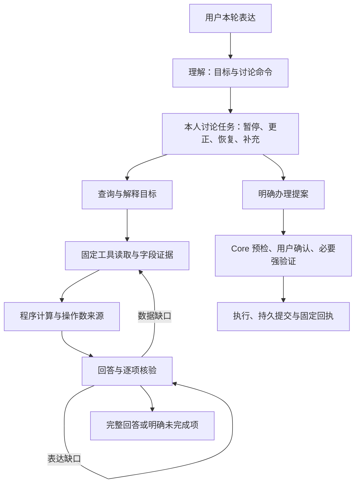

# 对话任务、计算证据与修复反馈

截至 2026-11-02 的实现约束。讨论、取证和回答可以修复，资金权限仍由 Core 独立控制；实际执行证据见[验证记录](验证记录.md)。历史逐轮修复说明保留在 Git 中。

设计参考 Rasa CALM 的结构化对话指令、Parlant 的工具与回答协同，以及 τ-bench、ToolSandbox 的任务评测方法。保留现有 LangGraph 和 Mock Core，实现这些机制；没有接入 Rasa Pro 或 Parlant 运行时。GEPA 是可选的离线优化依赖，不改变线上依赖或自动发布提示词。



## 共享语言与证据边界

| 情况 | 当前约束 |
| --- | --- |
| 办理意愿后先问费用、时效或影响 | 优先回答当前咨询，保留原意向；独立明确办理仍按混合请求处理，不能因旧任务缺金额而吞掉插问 |
| 等待确认与停止办理 | “先别确认”保留审批；当前明确停止只清理唯一匹配的本人未完成讨论或问卷，疑问、条件、转述、历史、错对象和多候选不能触发。已完成业务、Core 待办与审批走各自协议 |
| 补槽与恢复 | 金额只取本轮；可省略固定恢复动词，但需业务与唯一本人讨论一致。原任务只能为 ACTION 提供对象引用，不证明查询事实，不继承授权 |
| 收款人和付款卡 | 姓名与任务修饰语按当前 Core 身份核对，完整真实长姓名优先，不猜短前缀；选卡须匹配本人实际卡片，不更改原收款人、金额或备注，无匹配、多匹配及读取失败不选默认卡 |
| 指代与日期 | 使用同主体最近已核验并展示的资源集合、编号与区间；最新空集合或多义不回找旧记录。明确新日期优先，金额 19.90 不因外形成为日期；括号名称和编号须指向同条记录 |
| 字段与否定 | `omitted_fields` 只登记存在性，未投影不等于缺失；同条记录的 `context_fields` 保留必要状态。用户自报金额只能标作输入，不能作为余额、批准结果或计算操作数 |
| 状态与完成声明 | 任务 status 与 task_type 同次取证；提醒完成不代表付款。“不代表已扣款”等紧邻否定仅约束当前谓语，其他正向完成声明仍独立检查 |
| 读取失败与规则范围 | `read_outcome` 只证明某次读取失败，不证明无记录或已恢复；演示入口政策不能推广为商户或真实产品政策，订阅登记不证明真实权益 |
| 只读和边界 | 查询只投影当日累计，不清空或初始化日期桶；精确“理财”入口展示公开货架，不自动测评或申购。范围外内容不修改讨论状态 |
| 模型与修复 | JSON 对象传输不替代事实校验；有界错误片段只供当前重写，审计仅记错误码。首次理解的追加请求和全部真实调用计量见 [Agent 架构](Agent架构.md) |

当前余额接口没有期初余额快照，也不提供完整历史资金来源重建。解释消费合计与余额的口径可以回答，但不能编造具体差额来源；已支持字段缺失仍须按缺口处理，不能改称“不支持”绕过核验。公开货架也不能称为本人持仓。

只读对象绑定容忍显示空格与全半角差异，编号边界继续核对；卡片尾号仅作为身份标签，不证明金额。规则理解已经完成不等于银行业务已完成，前句“已经清楚”不能掩盖后句明确停止未完成讨论的决定。当前任务状态与已成交资金仍按不同协议处理。

## 讨论任务

`dialogue_state.version=2` 为每个会话主体保存最多四个讨论任务，包含稳定编号、业务、对象、缺失字段及状态。相同业务的不同对象使用不同编号；完成一个任务不会清除另一个对象的未完成任务。插问可暂停原任务，当前问题优先。

理解输出可携带 `task_command={type,task_id,evidence}`，类型为 `RESUME`、`FILL`、`CORRECT`、`PAUSE`、`CANCEL`。任务编号必须已存在，片段必须逐字出现在本轮。恢复与补值另核对言语行为、当前操作类型、明确金额、对象和歧义；多个同类任务不能凭模型猜对象。仅恢复但未补值时，继续询问原缺失字段。

恢复转账时，“把转给某人的提案恢复出来”和“恢复转给某人的转账提案”使用相同的身份核验：重复片段须全部对应当前 Core 允许的同一个收款人，才能清除由“的转账提案”等修饰语造成的歧义。完整真实联系人标签优先于语法推断；未知姓名、真实第二个对象和同名不同账户继续澄清。核验不改变原文金额，也不恢复旧授权，完整办理仍需新预检与确认。

片段按与输入一致的 Unicode NFKC 规范化核对，允许全角标点与等价字符，不接受改写或新数值。风险问卷作为 `questionnaire` 任务管理：原生选项仍由用户填写，非答题输入先理解当前问题，规则插问可以暂停问卷；明确恢复时保留本人已答选项，明确取消时不提交答案。理解模型的任务视图不携带保存的选项，对话历史按既有脱敏边界处理；问卷答案不能由任务命令或模型补造。

放弃、暂停或否定办理的表达同时受理解后与风险预检前的确定性约束；即使模型误选写操作，也不能取得新授权或创建对应审批。“先不确认”仍可保留明确提出的办理提案，正常的取消订阅请求也不等于放弃办理。该约束不阻止同轮查询和规则解释；它不能替代开放表达的语义评测。

“取消零星宝的待确认申购”可指向已有缺金额任务或该申购发起的未完成问卷。取消与未完成限定或本次业务指代须在同一明确办理分句中；再结合整轮对象核对当前主体、业务及对象。模型未给任务编号时，仅唯一匹配的现存任务可被取消。对象不符、多对象、条件、引用、历史叙述和取消规则咨询均不能走此取消路径。这里清除的是未完成讨论，不撤销已完成申购，不处理真实审批；没有原任务时也不能宣称已撤单。`WITHDRAW` 保持为非执行言语行为，执行约束不能把它改成普通咨询而丢失取消衔接。

取消判断共用同一开头语法，允许“那我决定”“那就”“那么”“所以”“因此”承接前文。疑问语气词按句尾或分句边界识别，不将“那么”这样的连接词误判成问句；真实疑问和条件表达仍不能清除任务。

取消决定可省略主语，如前句说明不再办理、后句以“决定取消”承接。取取消限定的同时保留整轮明确对象，核验前句产品或收款人是否匹配本人原任务，多对象仍拒绝。问卷和缺金额讨论均用该路径；不会撤销已完成业务。

“仍想办理，但决定先取消这次业务”按后半句的明确取消决定核对，不要求重复“意向”或“待确认”。本次业务指代只适用于已存未完成讨论，不能推定真实任务、审批或已完成交易可撤销。取消动作自身被否定时保留原讨论，不把“不用取消”误作“不用办理”。

理解和风控检查按操作类型应用本次业务引用约束，阻止被错标为新办理的取消句发起授权；真实 `UNDO_OPERATION` 仍走独立的撤销审批流程。实际预约撤销与讨论放弃须分别回归，不能为修复取消意向而禁用受支持的预约撤销。

明确否定原业务与后文取消该意向可共同证明停止请求；不能仅因后文出现“意向”而丢弃前句“不申购”的约束。取消谓语也可位于未完成对象之后，仍检查疑问、条件、引用、历史、说明请求和否定取消。共享的收款人介词提取区分“向某人”与“意向、方向、倾向”，避免将“意向也一起取消”中的“也一起取消”误作收款人并覆盖产品；真实姓名和标签仍按完整字面值绑定。

任务参数不含授权令牌、验证码、设备签名、审批句柄或确认标记。命令只处理讨论；完整请求仍获取新的审批。已存在的实际审批继续由原审批服务管理，讨论命令不能确认、替换或执行它。

限额政策解释可以提供一次性的类型化金额入口，状态为 `OFFERED`，下一轮后失效；这不是已提出的调额请求，也不保存上次金额。原有简单补槽与省略表达兼容路径保留。

## 计算证据

多目标协议新增可选 `calculation={operation,field}`，支持 `difference`、`sum`、`count`。差额绑定两个原文或已核验对象；金额运算限定已登记的金额字段，使用 Decimal。计数限定集合的 `records` 字段，不开放表达式、Python、任意字段、URL 或新身份。

原始读取投影提供已核验数值、实体和集合统计。计算在读取完成后统一进行，因此分别读取两个对象也能形成计算证据。计算结果记录目标编号与操作数证据，引用结果自动连同其来源接受核验；最终响应层重新计算比较，修改金额或来源的结果不能通过。

余额证据的本人姓名与账户别名来自 Core 实际返回的账户信息。用户自称姓名不能改变会话主体，也不能把当前余额标成他人余额。普通字段目标的回退只列该字段原始记录，计算结果由相应计算目标回答，减少在多个目标中重复拼接同一差额。

金额合计要求完整匹配记录，不用展示的截断子集推断总额；计数可采用完整读取的服务端集合统计。缺失对象、同一对象的重复别名、非有限值或没有原始字段时不能计算。固定回退也须真正给出计算结果，不能仅列两个金额就把差额问题标为完成。

## 修复反馈

反馈绑定本轮 `goal_id`，区分 `READ` 补数据、`CALCULATE` 补计算、`REWRITE` 改写和 `CLARIFY` 澄清。保留核验器指出的具体问题，不替换成笼统的审核失败。

逐项目标引用通过校验后，并入答复的全局引用表，避免同一来源漏列于重复字段而反复生成。未知来源仍拒绝，字段覆盖、金额归属、计算来源和独立语义核验继续执行。金额占位、未知数字与用户输入金额归属错误可将本地校验器定位的有限片段传给下一次改写，并明确标为待修正文本；审计仍只记录错误码，不复制这些片段或外部接口错误正文。

金额占位、未知数字和字段标签错误只重写，不为同一批事实重复取数。数据缺口可以补查；初读、失败重试和补查共享最多十次逻辑工具读取、三轮规划、三次回答草稿。同一失败读取最多重试一次。规则主题读取最多四十条，按 Core 每批二十条分批核对；这是同一逻辑工具读取中的至多两次固定 GET。

当前知识版本为 `2026-11-01.2`，105 条记录包含 75 条规则与 30 项能力，提供近期查询默认窗口与列表继承说明。本演示冻结只针对单张卡片，没有单独冻结整个账户的功能；用户说“账户冻结”时按卡片冻结解释，冻结限制该卡付款、账户仍可收款，解冻须另行确认和强验证。内部任务、计算和修复条款标为 `audience=model`，不作为用户回退正文。期间消费与当前余额的口径说明是可检索的产品知识；实际数值仍须对应记录。额度政策问题读取当前核心政策，即使用户尚未提出具体数值，也能查询最高设置范围；日额度按卡片当日累计支付校验，没有独立单笔额度字段或设置入口。预约转账须补齐收款人、金额和执行日期时间，缺项时只保留意向，不创建预约或审批；取消未完成意向不撤销其他已创建任务。真实办理另行确认；风险档案缺失不能跳过适当性，交易字段缺失不能推断真实扣款渠道或签约凭证。申购取消区分待确认审批、未完成意向与已完成申购，本演示没有申购撤单或自动回滚入口，赎回需另行校验和确认。

## 评测与离线优化

阶段可登记 `required_reads` 和 `answered_goals` 中间检查点，不强制唯一工具顺序。确定性检查与事后语义评分都须通过。报告另记目标切换后的当轮完成数、重复 GET、实际中位/P95 轮耗时及重复试验的 pass^k；重复 GET 仅是诊断计数，不自动判作错误。

`dialogue_repair_holdout.json` 的六项新任务由单独模型调用依据预先给定能力及任务类型生成，未提供实现代码、历史运行轨迹或本轮 Agent 输出。首次运行前修正了作者生成的格式和产品前提错误，保留原始草稿；它仍不是外部独立盲测。首次暴露后按回归统计，不能继续称作未见任务。详见[评测说明](多轮任务评测.md)。

可选安装 `pip install -e ".[optimization]"`，使用 `scripts/optimize_dialogue_prompts.py`。训练与验证必须为明确的 development 数据集，任务编号及去除编号后的任务内容均不能重叠；优化器拒绝 holdout。

```powershell
.\.venv\Scripts\python.exe scripts/optimize_dialogue_prompts.py --train build/optimization-data/train.json --validation build/optimization-data/validation.json --dry-run
.\.venv\Scripts\python.exe scripts/optimize_dialogue_prompts.py --train build/optimization-data/train.json --validation build/optimization-data/validation.json --live --unlimited-cost --max-metric-calls 12 --output-dir build/new-gepa-run
```

每个候选通过独立子进程和临时账本运行，完整任务通过才获得成功分；不完整评测会中止优化。候选指导只装入隔离评测进程的 ContextVar，生产没有文件、环境变量或聊天入口可以安装它。候选、任务与源文件摘要一起记录；最佳候选只输出到忽略目录，不能凭验证集成绩自动发布。冻结候选后还需要未参与优化的重复任务验证。

真实优化须明确金额预算或 `--unlimited-cost`。反思模型与所有候选评测共用费用账本，逐次记录 token，接口故障停止；`max_metric_calls` 不是模型调用总数或费用上限。参数与限制见[费用记录](多轮任务评测.md#费用记录与停止条件)，本轮没有重新运行付费 GEPA。

## 仍未解决的限制

现有单元与 API 回归不能证明开放表达已全部通过。理解、生成、独立核验和模型评分仍可能误判，模型容量耗尽或超时也会导致无法回答。需要在冻结源码、模型、依赖与数据集上完成重复评测及人工复核；目前没有足够证据宣称已满足完整稳定发布门槛。部署提交与各版执行结果见[验证记录](验证记录.md)。离线 GEPA 已跑通，但小验证集最佳候选仍为原种子，尚无证据证明它提高了任务成功率。

## 参考

- [Rasa：对话管理](https://rasa.com/docs/learn/concepts/dialogue-management/)、[对话修复模式](https://rasa.com/docs/reference/primitives/patterns/)；[官方演示](https://github.com/RasaHQ/rasa-calm-demo)需要 Rasa Pro 许可。
- [Parlant](https://github.com/emcie-co/parlant)、[工具协同与业务计算](https://github.com/emcie-co/parlant/blob/develop/docs/concepts/customization/tools.md)。
- [τ-bench](https://github.com/sierra-research/tau2-bench)、[τ-Knowledge 论文](https://arxiv.org/abs/2603.04370)；本项目分数不与上游排行榜比较。
- [ToolSandbox](https://github.com/apple-aiml-research/ToolSandbox)、[AgentChangeBench](https://arxiv.org/abs/2510.18170)。
- [GEPA](https://github.com/gepa-ai/gepa)、[自定义适配器](https://gepa-ai.github.io/gepa/guides/adapters/)。本项目可选依赖固定为 `gepa==0.1.4`。
