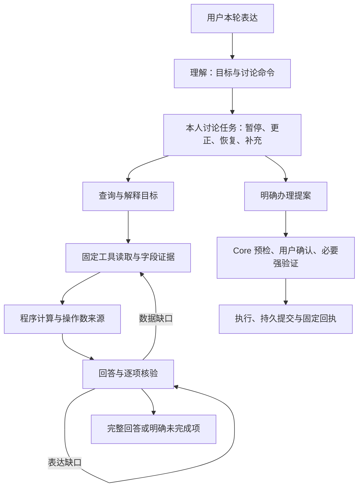

# 对话任务、计算证据与修复反馈

明确停止意向不依赖逐个枚举“但想了想／权衡后”等句首措辞。分句内的请、决定、先等明确指令仍须带当前业务或未完成对象，并经过整句问题、条件、历史、转述、犹豫及否定检查，再绑定本人唯一讨论。“还是”后为这种指令时不能被误识别为第二个收款人，真正的姓名选择继续拒绝猜测。该边界仅管理未完成讨论，不办理业务、不产生授权。

“不过考虑后决定这次先取消，不继续提交了”不能因末句省略业务而再次追问对象。共享边界提取句末明确放弃流程的分句，再由原文及本人唯一讨论核对业务、对象与状态；原文并列业务或对象不能丢失。暂停提交和暂不确认不等于停止意向，已完成业务不在此路径撤销。模拟用户也须区分“不确认”和“不办理”，查询时保留原待确认提案；原目标漂移仍记错误。

查询阶段的模拟用户不能自行添加“先别提交／先暂停”等流程指令。生成提示与公开阶段契约要求仅询问目标中的事实或规则，保留原办理意向；目标明确要求的动作仍可表达。此项只修正测试输入生成，不修改银行理解与执行，也不放宽目标预检。询问是否支持撤单仍可问，要求现在停止申购则属于额外动作；偏移原文、预检判断及评测错误全部保留，不重判旧报告。

“既然／因为／由于”引出的已知背景不是本轮请求。主题选择和联系人专用答复先排除仅作前置原因的陈述，当前问题继续交给原模型及业务链路；该排除不改写模型输入、收款人来源、执行约束或授权。明确预约办理后询问怎么继续，与单纯问预约步骤分开：前者保留日期金额缺项，后者只解释，二者均不能被联系人旧答案覆盖。

否定结论必须保留证据范围。字段投影的未展示列不是原始记录缺失：登记状态与配置同次读取，未展示字段仅登记字段名，正文不能据此否认字段存在、猜测值或报告已执行。确定的同条记录字段缺失误述触发 `PROJECTED_FIELD_ABSENCE`，只重写、不新增读取；真正缺项和不同记录不能相互借证。生成与独立核验共享投影清单，核验逐项检查否定主语及适用范围；`LOCAL_SERVICE_POLICY` 的本演示无入口不能变成产品或商户不支持的断言。

确认等待条件不能被拆成未知业务，从而覆盖模型已理解的单项办理。共享拆分器只将纯否定确认及等待审批界面的限定合回前一请求，保留完整原文；“再说／再看／再确认”作为无独立对象的句末承接不另起业务。真正的后续查询、另一转账、费用问题、矛盾金额或对象仍经原多任务与歧义检查，不因归并而获取执行权限。

`UNVERIFIED_OPERATION_CLAIM` 不能只反馈英文错误码，让模型重复同一句声明。校验器给本轮重写提供有界措辞片段，反馈明确区分“冻结后会有什么影响”与“已替用户冻结”；不得通过删掉所问影响、改讲其他流程来躲避拒绝。拒绝标准、读取预算、三次重写上限及独立逐项核验保持，审计仍只保存安全错误码。

前置咨询的优先级贯穿模型协议、执行约束与问卷暂停：“我想办理……；办理前先问一下……”先回答后半句，保留原意向，不因前半句恢复问卷或新建办理流程。独立后续动作仍保留混合请求语义；矛盾的 ACTION 目标只允许一次受限的只读计划修复，失败则保留已答题目并明确报错。可检索对话规则同步该顺序。

停止意向的共享语言校验支持否定词、办理助动词与当前业务指代的组合，不让“现在决定取消，先不办这笔申购了”在模型已理解后又被校验覆盖成不明确。此修正适用转账、预约、申购赎回及卡片业务的执行约束，不为实际已登记任务增加撤销能力；主体、对象、历史、问句和条件保护保持。

交易列表的指代包括范围和成员，不只是业务名称。“刚才这些最近交易整体看看有没有可疑”应分析最近实际展示的整批；泛指“最近”不重置已知范围，也不能因“可疑”先缩成异常子集再声称分析全部。明确新日期仍覆盖旧范围，最新 `ALL` 或空列表不能被更早记录替代；跨主体不继承。第二次意图约束复核使用相同会话上下文，避免把首次正确识别的范围再次覆盖。

句末“取消了”不能一律判为历史：同一命令分句明确表示“决定”时，可以是当前放弃未完成意向；不含决定的过去陈述不变。插问其他话题后补参数时，补槽分句的明确业务优先于已搁置话题，但必须与模型识别及唯一本人任务匹配。完整输入的冲突金额、不同操作、条件、问句和执行否定仍保护，不能截取片段后直接办理。

纯讨论取消不应因模型超时或容量故障而被强行保留。故障后仍可用独立命令校验停止唯一匹配的本人未完成讨论，审计登记本地讨论取消；实际审批、复合流程和并行咨询不走该路径。所有新办理与真实撤销仍依赖原业务边界，模型故障时不执行。

时态保护按业务含义限制：前句已了解或想清楚，不应遮蔽后句当前“不办理”的决定；如果出现已完成／执行／付款或历史业务操作，仍保留原保护，不直接取消实际交易。产品已有的精确入口标签另作只读编译，避免模型将“理财”入口要求用户重新选业务；它只展示真实产品货架，不触发测评或申购，不能扩展为对所有包含“理财”的自由问题进行规则覆盖。

读取失败的内部元数据会生成可引用的受限结果证据，使回答生成与独立核验能解释“失败不能证明没有记录”，避免因缺少引用退成规则拼贴。此证据与账户记录分离，正文由服务器固定编译并重新校验，不复制异常文本；一次失败不能否定后续成功读取，也不能声称已经恢复。解释目标答完不要求补查未询问的个人状态，查询目标仍须真实有效记录，否则保留 `TOOL_FAILED`。

准备办理时即使收款人未知，也保留本人未完成讨论及其缺项，避免答复声称保留意向却没有实际上下文。泛指“这个意向”的停止按唯一讨论和本轮已指明的业务匹配；并列多个业务不能被一次单目标取消静默合并。该记录不填补收款人、不创建 Core 任务、不继承授权。

预约转账的“不预约了／先不预约转账”纳入统一执行否定；“这笔预约转账帮我取消”等对象前置句式按同一分句的当前讨论限定识别，仍只停止唯一匹配的本人未完成意向。实际已登记任务的撤销继续走 Core 确认协议，已完成交易不能借此回滚。

同步于 2026-10-29。本文区分候选实现与线上版本；执行结果与部署状态以[验证记录](验证记录.md)为准。

恢复缺金额任务增加语义补槽路径：本轮办理／补资料类型与原文业务相符、金额来自本轮且唯一任务匹配时，无需出现恢复动词。只合并业务字段，重新预检并等待确认；不改变查询／解释／不明确目标或范围外判定，不替用户补金额、猜新对象或继承授权。显式恢复分句仍优先于这一兼容路径，避免前文旧话题重新覆盖当前任务。“不再继续办理”与“先不办理”同属执行否定，“暂不确认”仍等待审批。收款人提取区分“我的／我+亲属或通讯录”领属前缀与“给我看确认信息／把确认卡发给我”等第一人称宾语指令，避免把指令动作提成伪收款人，同时保留“或者给我转”的收款人歧义检查。询问待办／预约／任务及其到期或到时间是否会自动扣款／付款、且不含订阅／代扣／会员等字面依据时，目标归一化将其作为 `tasks` 主题规则解释（`act=EXPLAIN, resource=general, topic=tasks`），不误入需确认的订阅记录查询。

讨论命令须先校验，再归一化其业务目标。此前模型正确输出 FILL 和原收款人，目标检查却要求收款人在本轮原话中再次出现，误改 UNCLEAR 后又阻止 FILL，形成内部冲突。现由同业务已选或唯一暂停任务提供仅限 ACTION 的对象引用；不会向读取目标开放或证明账户事实，最后仍由字段编译及 Core 独立核验。

字面明确停止执行且没有独立查询／解释时，停止限制继续传到唯一匹配的未完成讨论，而非只拦执行后返回泛化咨询。范围外、错对象、多候选、条件、疑问及独立查询仍拒绝这一兼容处理。该路径仅清理讨论并明确尚未执行，不撤销 Core 任务或已成交资金。

跨话题补槽允许“转账金额补300元”省略“补上”的自然表达，仅在唯一匹配的本人未完成任务、目标及金额无歧义且没有咨询、条件或停止办理时恢复。仍重新预检和等待确认，不继承旧授权。独立分句“先不办理／暂时不办”属于停止执行，“先别确认”只表示等待审批卡。

对象不清但业务资源已识别时，澄清保留该资源和同主体最近展示的候选编号，避免退回“查询还是办理”的泛问；不借其他资源或旧整批编号补候选，不替用户从多条交易中猜定某条。没有同主体候选时询问具体资源的名称或编号，范围外问题仍不进入此路径。

实体原文绑定容忍显示空格及全半角差异，仍保留编号边界并独立核验本人实际记录。公共产品货架不称为“本人理财产品”，投影记录增加公开货架／本人记录归属，生成与审核不能将货架数量当持仓。现代证据的记录编号优先于旧整批读取编号；唯一对象可以承接，空结果、多义及跨主体引用不能复活或扩大旧集合。

生成与独立审核收到相同的字段投影契约：未请求的字段未展示，不代表原始 Core 没有该数据；只有所问字段的真实缺口才进入补读或未完成说明。避免在“类别有哪些／消费合计为何不等于余额”等回答中凭空声称记录没有金额，同时保留真正缺字段时的证据约束。

取消意向的当前明确否定先于一般“取消了”的完成语气判断，例如“现在决定取消了，先不办了”可以停止匹配的未完成讨论。已执行状态、历史完成、错对象、条件、疑问与引用保护仍先行；该入口不撤销 Core 已成交交易、不恢复授权。

任务查询加载与业务提交使用不同状态，等待只读结果时可返回；取消任务、请求人工处理和拒绝 AA 的提交期间保留导航保护并防止重复提交。设备回归保留成功、失败及超时的实际结果快照，拒绝复用旧 JUnit/protobuf；设备撤销测试观察通知完整状态流，同时继续检查原密钥不被替换、无新注册和原设备仍撤销。

当前候选将需求字段核对放在取数之前，输入只有原始问题、目标对象与公开字段目录，不展示初次解析的字段清单或改写问题，避免沿用未被用户询问的要求，也避免看到缺失字段后降低要求。模型独立判断后，程序只取与原字段的交集或通用明细，不能改对象、意图、计算字段或增加能力；失败保留原目标。明确询问但缺失的字段仍须报告 `NEEDS_DATA`。这是有界模型判断，不能证明语义必然正确，验收仍检查是否真正回答问题。

本轮查询证据区分当前用户引用、实际记录、查询日期范围和资源通用政策。输入中的流水编号只证明用户询问了该对象；范围元数据不证明有记录；通用争议时限不证明某工单状态。共享流水读取后，整体分析和指定对象分析分别计算，合并缓存不能互相冒用。完成规则解释不以用户是否提供后续办理参数为前提，办理仍独立要求完整参数及确认。

额度上下文补槽不能只看前一分句里的改额用词：本轮任何分句含问句时，均退出这一快捷路径，交由完整理解；询问允许范围或是否符合条件另受只读执行约束保护。用户本轮同时引用的金额分别保留为最多五项输入证据，复述须明确归属用户，不可作为实际余额或已核验合计；解释统计口径不要求先核验用户自报合计。实际账户数值和计算结果仍各自需要取数或计算来源。

对象协议使用接口的 JSON 对象约束，统一附加格式声明，减少说明文字混入 JSON 的传输错误；不能由此推断目标和事实正确。读取结果包含当前卡片尾号时，可按身份标签复述经引用的四位尾号，缺失、错误、未引用或作为金额使用仍拒绝。隔离评测只保存当前请求最近三次审核拒绝代码与尝试次数，帮助定位无效回退，不复制模型错误正文或审计私有载荷。

货币符号后的数值先从日期解析中排除；只读目标不使用流水日期范围时，清除旧解析产生的日期歧义，产品持有天数不能阻断货架查询。尾号、末四位与后四位是卡片资源的精确选择方式，不用于匹配其他资源。收款人后的办理动词只有在当前 Core 唯一身份支持时才可修正，真实完整联系人姓名优先。

每个输入金额在同一回答内至少一次明确归属用户，也可在金额后用括号标明；同一输入的重复引用无需反复使用固定标签。明确假设也可引用输入。归属声明不跨回答、不跨金额，不能证明实际余额、实际额度、获批或执行结果；即使已声明输入，后文的实际状态断言仍会拒绝。日期、金额未定的预约意向可绑定“给李四办一笔预约转账”中的 Core 收款人，仍须补齐参数并单独确认。

恢复提案时，重复姓名后接“的提案恢复出来”等业务描述可能被词法规则误认为第二个收款人。仅在读取当前本人联系人和可用收款账户后，每个片段均能对应同一个真实身份时才消除此类歧义；未知对象、同名不同身份及真实较长标签优先保留澄清。该核对只修正收款人参数，不恢复旧授权、不跳过新的核心预检或用户确认，也不改变金额。

跨午夜查询同样保持只读：过期的账户日转出与卡片日支付计数只投影为当日零值，不改持久化金额或日期。新金额与日期仅在实际扣款事务中一起提交，写盘失败一起回滚。评测已移除日期桶预热，不能用准备阶段的初始化掩盖查询写入。

当前余额接口不提供期初余额快照，现有流水不能重建完整历史资金来源。解释统计口径与要求重建具体来源须拆开：前者可以回答，后者说明未提供能力，不能编造差额构成。已经支持的字段在某条记录中缺失，仍按证据缺口处理，不能改称不支持来绕过核验。

2026-10-28 候选新增[稳定发布门槛](稳定验收标准.md)：有界排队和理解故障显式回复；恢复引用不拆成重复办理；收款人语法修饰的修正须由当前 Core 对象支持，真实完整名称优先、多义不绑定。问卷保留所属申购意向，停止意向时正确退出对应前置讨论；任务命令仍不能撤销已执行交易或确认原审批。用户明确先了解可行性时只解释，之后明确要求办理才提案。候选提交不代表已部署或稳定验收通过。

理解协议明确只有一项 ACTION 时，办理参数从本轮完整原话编译，而非取逗号前的残句。多个完整操作、不同对象或金额、独立查询、咨询或否定不能进入这个路径；两个相同金额的真实转账也保持分别办理。该编译只生成业务输入，不产生授权。评测角色另采用结构化 JSON 传输，格式错误与银行任务失败分开记录。

明确的第一人称办理句（如“那我先申购零星宝吧”或“那我想把这张卡的日限额改成10000，先别确认，帮我看看怎么办理”）不会因后续“下一步怎么填／帮我看看怎么办理”而被通用流程关键词覆盖。单独询问流程、条件、否定和数值可行性仍留在咨询路径；缺金额或风险档案时继续补充资料或测评，不能推断金额、创建交易或替用户确认。

规则规划可查看完整的公开条款目录，按语义选择 `rules(rule_ids)`，每次至多二十个已知编号；实际条文仍须通过 Core 版本与全文核对，目录不证明账户事实。现代查询协议的目标缺失或字段与资源不匹配时，最多修复一次，保持原问题并限定只读目标；理解提示明确 `general` 资源的 `fields` 必须为空数组，`goal_repair` 兼容单数主题名到复数资源键的映射，且修复不能添加 ACTION、身份参数或新授权。修复失败明确返回计划无效，风险节点独立拒绝该轮预检，保留原任务，不静默退回旧咨询流程。

记录存在但部分字段缺失时，回退保留已核实信息、说明具体缺项，仍标为 `NEEDS_DATA`，不把缺字段说成没有记录或全部完成。覆盖反馈按目标列出缺少的字段；已请求这些字段时先改写回答，没有请求过时允许补查。个人记录的解释也保留已知字段，不能被通用规则覆盖。

2026-10-28 后续候选将卡片参数与收款人语法分开，卡片输入不接收通用“给某某”片段。只读目标中提到的金额不传给订阅操作预检；交易线索与订阅登记查询分别选路。联系人单对象读取保留真实联系编号，明确回指仍需同主体、唯一记录及当前 Core 复核；未知或多义对象不绑定。完整真实名称优先于语法修正。

账单时间范围区分查询中的“最近交易”（含“最近这些交易／这些最近交易／最近这两笔交易”）和“最近总担心”等背景表达；明确日历范围优先。“余额不对”等非时间纠正不自动变成日期歧义。非执行的澄清、寒暄或不支持回合保留上文已核验的账单时间范围，后续针对“刚才／这些／这两笔”流水的解释刷新与补查沿用同一已验证区间，同时支持“这两笔／那两笔”等指示性中文数词匹配已展示交易列表，避免因中间澄清回合而将近期范围扩大为全部历史；变更区间时重新读取，不能用旧缓存替代。已讨论但缺少参数的明确对象可保存为暂停意向；未建立审批，不作为当前补槽，单独回复金额不会办理，之后须明确续办才恢复并重新预检。

无货币符号的小数也可由“金额、数额”或“这笔／一笔商户……的代扣、扣款、消费”等关系确定为金额，避免把 19.90 当成点分日期。显式日期关系、点分日期范围和非法日期继续按原规则校验；该判断不提供商户身份或实际交易证明，查询仍须本人记录取证。

暂停命令所指任务不会因无关插问成功而被清除；只有真正完成的同类任务才移除。明确说补填某项业务金额也走同一补值核验，多笔同类任务仍须明确对象。余额及风险档案属于本人单例资源，当前账户、本人档案等通用名称不当作另一个人；其他姓名仍须正常绑定和主体校验。

本轮询问金额以 `user://current-request` 单列为参数证据，仅允许明确称为询问金额或拟设额度，不能用作余额、已生效额度或批准结果，也不进入实际计算的账户操作数。金额范围、当前值与真实状态仍从 Core 取证；解释回退仅展示字段不等于完整回答。未报告的解释缺口按改写处理，不为格式不一致盲目补查。

本轮参考 Rasa CALM 的结构化对话指令、Parlant 的工具与回答协同，以及 τ-bench、ToolSandbox 的任务评测方法。保留现有 LangGraph 和 Mock Core，实现这些机制；没有接入 Rasa Pro 或 Parlant 运行时。GEPA 是可选的离线优化依赖，不改变线上依赖或自动发布提示词。



## 讨论任务

`dialogue_state.version=2` 为每个会话主体保存最多四个讨论任务，包含稳定编号、业务、对象、缺失字段及状态。相同业务的不同对象使用不同编号；完成一个任务不会清除另一个对象的未完成任务。插问可暂停原任务，当前问题优先。

理解输出可携带 `task_command={type,task_id,evidence}`，类型为 `RESUME`、`FILL`、`CORRECT`、`PAUSE`、`CANCEL`。任务编号必须已存在，片段必须逐字出现在本轮。恢复与补值另核对言语行为、当前操作类型、明确金额、对象和歧义；多个同类任务不能凭模型猜对象。仅恢复但未补值时，继续询问原缺失字段。

恢复转账时，“把转给某人的提案恢复出来”和“恢复转给某人的转账提案”使用相同的身份核验：重复片段须全部对应当前 Core 允许的同一个收款人，才能清除由“的转账提案”等修饰语造成的歧义。完整真实联系人标签优先于语法推断；未知姓名、真实第二个对象和同名不同账户继续澄清。核验不改变原文金额，也不恢复旧授权，完整办理仍需新预检与确认。

片段按与输入一致的 Unicode NFKC 规范化核对，允许全角标点与等价字符，不接受改写或新数值。风险问卷作为 `questionnaire` 任务管理：原生选项仍由用户填写，非答题输入先理解当前问题，规则插问可以暂停问卷；明确恢复时保留本人已答选项，明确取消时不提交答案。理解模型的任务视图不携带保存的选项，对话历史按既有脱敏边界处理；问卷答案不能由任务命令或模型补造。

放弃、暂停或否定办理的表达同时受理解后与风险预检前的确定性约束；即使模型误选写操作，也不能取得新授权或创建对应审批。“先不确认”仍可保留明确提出的办理提案，正常的取消订阅请求也不等于放弃办理。该约束不阻止同轮查询和规则解释；它不能替代开放表达的语义评测。

“取消零星宝的待确认申购”可指向已有缺金额任务或该申购发起的未完成问卷。取消与未完成限定或本次业务指代须在同一明确办理分句中；再结合整轮对象核对当前主体、业务及对象。模型未给任务编号时，仅唯一匹配的现存任务可被取消。对象不符、多对象、条件、引用、历史叙述和取消规则咨询均不能走此取消路径。这里清除的是未完成讨论，不撤销已完成申购，不处理真实审批；没有原任务时也不能宣称已撤单。`WITHDRAW` 保持为非执行言语行为，执行约束不能把它改成普通咨询而丢失取消衔接。

取消判断共用同一开头语法，允许“那我决定”“那就”“那么”“所以”“因此”承接前文。疑问语气词按句尾或分句边界识别，不将“那么”这样的连接词误判成问句；真实疑问和条件表达仍不能清除任务。

取消决定可省略主语，如前句说明不再办理、后句以“决定取消”承接。取取消限定的同时保留整轮明确对象，核验前句产品或收款人是否匹配本人原任务，多对象仍拒绝。问卷和缺金额讨论均用该路径；不会撤销已完成业务。

“仍想办理，但决定先取消这次业务”按后半句的明确取消决定核对，不要求重复“意向”或“待确认”。本次业务指代只适用于已存未完成讨论，不能推定真实任务、审批或已完成交易可撤销。取消动作自身被否定时保留原讨论，不把“不用取消”误作“不用办理”。

理解和风控检查按操作类型应用本次业务引用约束，阻止被错标为新办理的取消句发起授权；真实 `UNDO_OPERATION` 仍走独立的撤销审批流程。实际预约撤销与讨论放弃须分别回归，不能为修复取消意向而禁用受支持的预约撤销。

明确否定原业务与后文取消该意向可共同证明停止请求；不能仅因后文出现“意向”而丢弃前句“不申购”的约束。取消谓语也可位于未完成对象之后，仍检查疑问、条件、引用、历史、说明请求和否定取消。共享的收款人介词提取区分“向某人”与“意向、方向、倾向”，避免将“意向也一起取消”中的“也一起取消”误作收款人并覆盖产品；真实姓名和标签仍按完整字面值绑定。

任务参数不含授权令牌、验证码、设备签名、审批句柄或确认标记。命令只处理讨论；完整请求仍获取新的审批。已存在的实际审批继续由原审批服务管理，讨论命令不能确认、替换或执行它。

限额政策解释可以提供一次性的类型化金额入口，状态为 `OFFERED`，下一轮后失效；这不是已提出的调额请求，也不保存上次金额。原有简单补槽与省略表达兼容路径保留。

## 计算证据

多目标协议新增可选 `calculation={operation,field}`，支持 `difference`、`sum`、`count`。差额绑定两个原文或已核验对象；金额运算限定已登记的金额字段，使用 Decimal。计数限定集合的 `records` 字段，不开放表达式、Python、任意字段、URL 或新身份。

原始读取投影提供已核验数值、实体和集合统计。计算在读取完成后统一进行，因此分别读取两个对象也能形成计算证据。计算结果记录目标编号与操作数证据，引用结果自动连同其来源接受核验；最终响应层重新计算比较，修改金额或来源的结果不能通过。

余额证据的本人姓名与账户别名来自 Core 实际返回的账户信息。用户自称姓名不能改变会话主体，也不能把当前余额标成他人余额。普通字段目标的回退只列该字段原始记录，计算结果由相应计算目标回答，减少在多个目标中重复拼接同一差额。

金额合计要求完整匹配记录，不用展示的截断子集推断总额；计数可采用完整读取的服务端集合统计。缺失对象、同一对象的重复别名、非有限值或没有原始字段时不能计算。固定回退也须真正给出计算结果，不能仅列两个金额就把差额问题标为完成。

## 修复反馈

反馈绑定本轮 `goal_id`，区分 `READ` 补数据、`CALCULATE` 补计算、`REWRITE` 改写和 `CLARIFY` 澄清。保留核验器指出的具体问题，不替换成笼统的审核失败。

逐项目标引用通过校验后，并入答复的全局引用表，避免同一来源漏列于重复字段而反复生成。未知来源仍拒绝，字段覆盖、金额归属、计算来源和独立语义核验继续执行。金额占位、未知数字与用户输入金额归属错误可将本地校验器定位的有限片段传给下一次改写，并明确标为待修正文本；审计仍只记录错误码，不复制这些片段或外部接口错误正文。

金额占位、未知数字和字段标签错误只重写，不为同一批事实重复取数。数据缺口可以补查；初读、失败重试和补查共享最多十次逻辑工具读取、三轮规划、三次回答草稿。同一失败读取最多重试一次。规则主题读取最多四十条，按 Core 每批二十条分批核对；这是同一逻辑工具读取中的至多两次固定 GET。

候选知识版本为 `2026-10-30.5`，104 条记录包含 74 条规则与 30 项能力，新增可检索的近期查询默认窗口与列表继承说明。本演示冻结只针对单张卡片，没有单独冻结整个账户的功能；用户说“账户冻结”时按卡片冻结解释，冻结限制该卡付款、账户仍可收款，解冻须另行确认和强验证。内部任务、计算和修复条款标为 `audience=model`，不作为用户回退正文。期间消费与当前余额的口径说明是可检索的产品知识；实际数值仍须对应记录。额度政策问题读取当前核心政策，即使用户尚未提出具体数值，也能查询最高设置范围；日额度按卡片当日累计支付校验，没有独立单笔额度字段或设置入口。预约转账须补齐收款人、金额和执行日期时间，缺项时只保留意向，不创建预约或审批；取消未完成意向不撤销其他已创建任务。真实办理另行确认；风险档案缺失不能跳过适当性，交易字段缺失不能推断真实扣款渠道或签约凭证。申购取消区分待确认审批、未完成意向与已完成申购，本演示没有申购撤单或自动回滚入口，赎回需另行校验和确认。

## 评测与离线优化

阶段可登记 `required_reads` 和 `answered_goals` 中间检查点，不强制唯一工具顺序。确定性检查与事后语义评分都须通过。报告另记目标切换后的当轮完成数、重复 GET、实际中位/P95 轮耗时及重复试验的 pass^k；重复 GET 仅是诊断计数，不自动判作错误。

`dialogue_repair_holdout.json` 的六项新任务由单独模型调用依据预先给定能力及任务类型生成，未提供实现代码、历史运行轨迹或本轮 Agent 输出。首次运行前修正了作者生成的格式和产品前提错误，保留原始草稿；它仍不是外部独立盲测。首次暴露后按回归统计，不能继续称作未见任务。详见[评测说明](多轮任务评测.md)。

可选安装 `pip install -e ".[optimization]"`，使用 `scripts/optimize_dialogue_prompts.py`。训练与验证必须为明确的 development 数据集，任务编号及去除编号后的任务内容均不能重叠；优化器拒绝 holdout。

```powershell
.\.venv\Scripts\python.exe scripts/optimize_dialogue_prompts.py --train build/optimization-data/train.json --validation build/optimization-data/validation.json --dry-run
.\.venv\Scripts\python.exe scripts/optimize_dialogue_prompts.py --train build/optimization-data/train.json --validation build/optimization-data/validation.json --live --unlimited-cost --max-metric-calls 12 --output-dir build/new-gepa-run
```

每个候选通过独立子进程和临时账本运行，完整任务通过才获得成功分；不完整评测会中止优化。候选指导只装入隔离评测进程的 ContextVar，生产没有文件、环境变量或聊天入口可以安装它。候选、任务与源文件摘要一起记录；最佳候选只输出到忽略目录，不能凭验证集成绩自动发布。冻结候选后还需要未参与优化的重复任务验证。

真实优化须明确金额预算或 `--unlimited-cost`。反思模型与所有候选评测共用费用账本，逐次记录 token，接口故障停止；`max_metric_calls` 不是模型调用总数或费用上限。参数与限制见[费用记录](多轮任务评测.md#费用记录与停止条件)，本轮没有重新运行付费 GEPA。

## 仍未解决的限制

开放表达回归尚未全部通过，实际失败与线上版本见[验证记录](验证记录.md)顶部。线上 2026-10-27 版本仍有收款人、任务恢复、流水解释和放弃办理的已知失败，并发槽位耗尽时也可能退回本地规则。2026-10-28 候选针对共享机制修复并改为理解故障显式失败，不能据此宣称这些问题已在开放表达中消除；回答核验和模型评分仍可能误判，须在冻结版本上重复验证。离线 GEPA 已跑通，但小验证集最佳候选仍为原种子，尚无证据证明它提高了任务成功率。

## 参考

- [Rasa：对话管理](https://rasa.com/docs/learn/concepts/dialogue-management/)、[对话修复模式](https://rasa.com/docs/reference/primitives/patterns/)；[官方演示](https://github.com/RasaHQ/rasa-calm-demo)需要 Rasa Pro 许可。
- [Parlant](https://github.com/emcie-co/parlant)、[工具协同与业务计算](https://github.com/emcie-co/parlant/blob/develop/docs/concepts/customization/tools.md)。
- [τ-bench](https://github.com/sierra-research/tau2-bench)、[τ-Knowledge 论文](https://arxiv.org/abs/2603.04370)；本项目分数不与上游排行榜比较。
- [ToolSandbox](https://github.com/apple-aiml-research/ToolSandbox)、[AgentChangeBench](https://arxiv.org/abs/2510.18170)。
- [GEPA](https://github.com/gepa-ai/gepa)、[自定义适配器](https://gepa-ai.github.io/gepa/guides/adapters/)。本项目可选依赖固定为 `gepa==0.1.4`。
