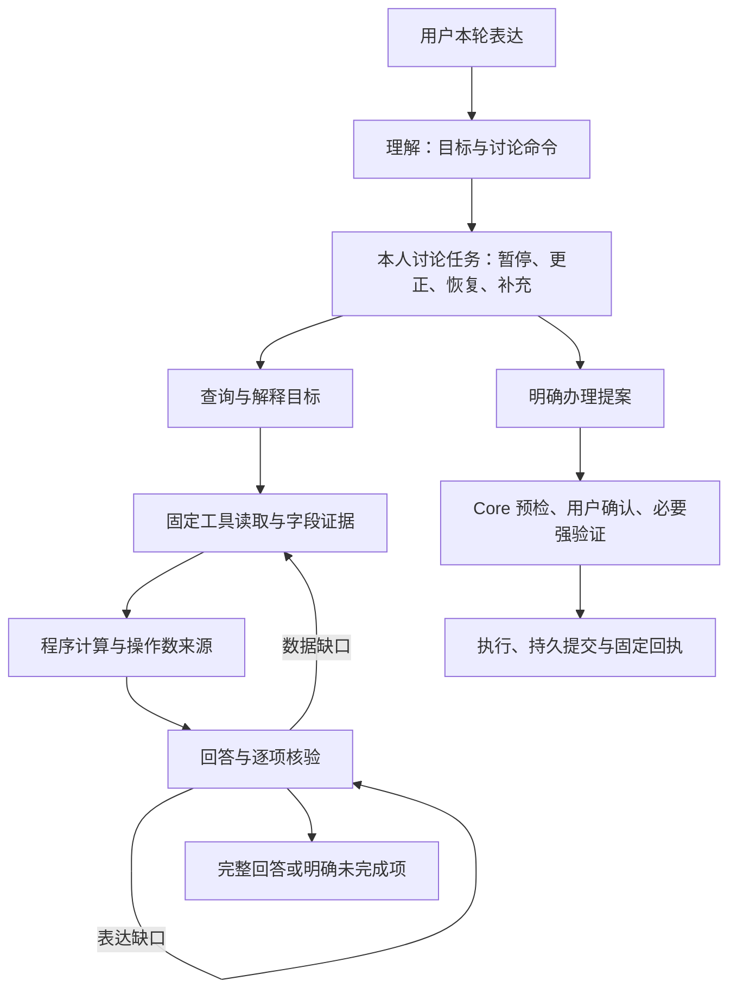

# 对话任务、计算证据与修复反馈

同步于 2026-10-27。本文说明现行实现；执行结果与线上业务版本以[验证记录](验证记录.md)为准。

本轮参考 Rasa CALM 的结构化对话指令、Parlant 的工具与回答协同，以及 τ-bench、ToolSandbox 的任务评测方法。保留现有 LangGraph 和 Mock Core，实现这些机制；没有接入 Rasa Pro 或 Parlant 运行时。GEPA 是可选的离线优化依赖，不改变线上依赖或自动发布提示词。



## 讨论任务

`dialogue_state.version=2` 为每个会话主体保存最多四个讨论任务，包含稳定编号、业务、对象、缺失字段及状态。相同业务的不同对象使用不同编号；完成一个任务不会清除另一个对象的未完成任务。插问可暂停原任务，当前问题优先。

理解输出可携带 `task_command={type,task_id,evidence}`，类型为 `RESUME`、`FILL`、`CORRECT`、`PAUSE`、`CANCEL`。任务编号必须已存在，片段必须逐字出现在本轮。恢复与补值另核对言语行为、当前操作类型、明确金额、对象和歧义；多个同类任务不能凭模型猜对象。仅恢复但未补值时，继续询问原缺失字段。

片段按与输入一致的 Unicode NFKC 规范化核对，允许全角标点与等价字符，不接受改写或新数值。风险问卷作为 `questionnaire` 任务管理：原生选项仍由用户填写，非答题输入先理解当前问题，规则插问可以暂停问卷；明确恢复时保留本人已答选项，明确取消时不提交答案。理解模型的任务视图不携带保存的选项，对话历史按既有脱敏边界处理；问卷答案不能由任务命令或模型补造。

放弃、暂停或否定办理的表达同时受理解后与风险预检前的确定性约束；即使模型误选写操作，也不能取得新授权或创建对应审批。“先不确认”仍可保留明确提出的办理提案，正常的取消订阅请求也不等于放弃办理。该约束不阻止同轮查询和规则解释；它不能替代开放表达的语义评测。

任务参数不含授权令牌、验证码、设备签名、审批句柄或确认标记。命令只处理讨论；完整请求仍获取新的审批。已存在的实际审批继续由原审批服务管理，讨论命令不能确认、替换或执行它。

限额政策解释可以提供一次性的类型化金额入口，状态为 `OFFERED`，下一轮后失效；这不是已提出的调额请求，也不保存上次金额。原有简单补槽与省略表达兼容路径保留。

## 计算证据

多目标协议新增可选 `calculation={operation,field}`，支持 `difference`、`sum`、`count`。差额绑定两个原文或已核验对象；金额运算限定已登记的金额字段，使用 Decimal。计数限定集合的 `records` 字段，不开放表达式、Python、任意字段、URL 或新身份。

原始读取投影提供已核验数值、实体和集合统计。计算在读取完成后统一进行，因此分别读取两个对象也能形成计算证据。计算结果记录目标编号与操作数证据，引用结果自动连同其来源接受核验；最终响应层重新计算比较，修改金额或来源的结果不能通过。

余额证据的本人姓名与账户别名来自 Core 实际返回的账户信息。用户自称姓名不能改变会话主体，也不能把当前余额标成他人余额。普通字段目标的回退只列该字段原始记录，计算结果由相应计算目标回答，减少在多个目标中重复拼接同一差额。

金额合计要求完整匹配记录，不用展示的截断子集推断总额；计数可采用完整读取的服务端集合统计。缺失对象、同一对象的重复别名、非有限值或没有原始字段时不能计算。固定回退也须真正给出计算结果，不能仅列两个金额就把差额问题标为完成。

## 修复反馈

反馈绑定本轮 `goal_id`，区分 `READ` 补数据、`CALCULATE` 补计算、`REWRITE` 改写和 `CLARIFY` 澄清。保留核验器指出的具体问题，不替换成笼统的审核失败。

金额占位、未知数字和字段标签错误只重写，不为同一批事实重复取数。数据缺口可以补查；初读、失败重试和补查共享最多十次逻辑工具读取、三轮规划、三次回答草稿。同一失败读取最多重试一次。规则主题读取最多四十条，按 Core 每批二十条分批核对；这是同一逻辑工具读取中的至多两次固定 GET。

知识版本为 `2026-10-27.2`，101 条记录包含 71 条规则与 30 项能力。内部任务、计算和修复条款标为 `audience=model`，不作为用户回退正文。期间消费与当前余额的口径说明是可检索的产品知识；实际数值仍须对应记录。

## 评测与离线优化

阶段可登记 `required_reads` 和 `answered_goals` 中间检查点，不强制唯一工具顺序。确定性检查与事后语义评分都须通过。报告另记目标切换后的当轮完成数、重复 GET、实际中位/P95 轮耗时及重复试验的 pass^k；重复 GET 仅是诊断计数，不自动判作错误。

`dialogue_repair_holdout.json` 的六项新任务由单独模型调用依据预先给定能力及任务类型生成，未提供实现代码、历史运行轨迹或本轮 Agent 输出。首次运行前修正了作者生成的格式和产品前提错误，保留原始草稿；它仍不是外部独立盲测。首次暴露后按回归统计，不能继续称作未见任务。详见[评测说明](多轮任务评测.md)。

可选安装 `pip install -e ".[optimization]"`，使用 `scripts/optimize_dialogue_prompts.py`。训练与验证必须为明确的 development 数据集，任务编号及去除编号后的任务内容均不能重叠；优化器拒绝 holdout。

```powershell
.\.venv\Scripts\python.exe scripts/optimize_dialogue_prompts.py --train build/optimization-data/train.json --validation build/optimization-data/validation.json --dry-run
.\.venv\Scripts\python.exe scripts/optimize_dialogue_prompts.py --train build/optimization-data/train.json --validation build/optimization-data/validation.json --live --max-metric-calls 12 --output-dir build/new-gepa-run
```

每个候选通过独立子进程和临时账本运行，完整任务通过才获得成功分；不完整评测会中止优化。候选指导只装入隔离评测进程的 ContextVar，生产没有文件、环境变量或聊天入口可以安装它。候选、任务与源文件摘要一起记录；最佳候选只输出到忽略目录，不能凭验证集成绩自动发布。冻结候选后还需要未参与优化的重复任务验证。

## 仍未解决的限制

本轮开放表达回归尚未全部通过，实际失败与线上版本见[验证记录](验证记录.md)顶部。模型仍可能错接收款人、未恢复原任务、缺少已有流水解释，或把放弃办理答成能力未接入。核验可能拒绝可改写的数值表达；模型调用的两个并发槽位耗尽时，理解还可能退回本地规则，形成 `UNKNOWN`，需要专门验证并改进降级行为。离线 GEPA 已跑通，但小验证集最佳候选仍为原种子，尚无证据证明它提高了任务成功率。

## 参考

- [Rasa：对话管理](https://rasa.com/docs/learn/concepts/dialogue-management/)、[对话修复模式](https://rasa.com/docs/reference/primitives/patterns/)；[官方演示](https://github.com/RasaHQ/rasa-calm-demo)需要 Rasa Pro 许可。
- [Parlant](https://github.com/emcie-co/parlant)、[工具协同与业务计算](https://github.com/emcie-co/parlant/blob/develop/docs/concepts/customization/tools.md)。
- [τ-bench](https://github.com/sierra-research/tau2-bench)、[τ-Knowledge 论文](https://arxiv.org/abs/2603.04370)；本项目分数不与上游排行榜比较。
- [ToolSandbox](https://github.com/apple-aiml-research/ToolSandbox)、[AgentChangeBench](https://arxiv.org/abs/2510.18170)。
- [GEPA](https://github.com/gepa-ai/gepa)、[自定义适配器](https://gepa-ai.github.io/gepa/guides/adapters/)。本项目可选依赖固定为 `gepa==0.1.4`。
