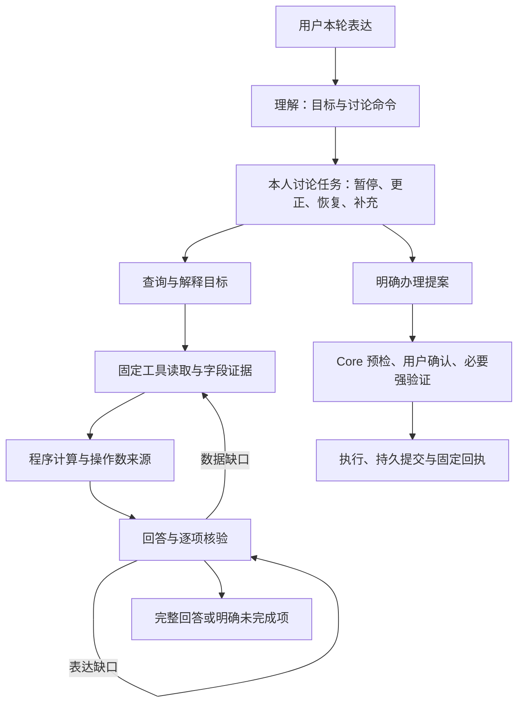

# 对话任务、计算证据与修复反馈

同步于 2026-10-28。本文区分候选实现与线上版本；执行结果与部署状态以[验证记录](验证记录.md)为准。

当前候选将需求字段核对放在取数之前，输入只有原始问题、目标对象与公开字段目录，不展示初次解析的字段清单或改写问题，避免沿用未被用户询问的要求，也避免看到缺失字段后降低要求。模型独立判断后，程序只取与原字段的交集或通用明细，不能改对象、意图、计算字段或增加能力；失败保留原目标。明确询问但缺失的字段仍须报告 `NEEDS_DATA`。这是有界模型判断，不能证明语义必然正确，验收仍检查是否真正回答问题。

本轮查询证据区分当前用户引用、实际记录、查询日期范围和资源通用政策。输入中的流水编号只证明用户询问了该对象；范围元数据不证明有记录；通用争议时限不证明某工单状态。共享流水读取后，整体分析和指定对象分析分别计算，合并缓存不能互相冒用。完成规则解释不以用户是否提供后续办理参数为前提，办理仍独立要求完整参数及确认。

额度上下文补槽不能只看前一分句里的改额用词：本轮任何分句含问句时，均退出这一快捷路径，交由完整理解；询问允许范围或是否符合条件另受只读执行约束保护。用户本轮同时引用的金额分别保留为最多五项输入证据，复述须明确归属用户，不可作为实际余额或已核验合计；解释统计口径不要求先核验用户自报合计。实际账户数值和计算结果仍各自需要取数或计算来源。

对象协议使用接口的 JSON 对象约束，统一附加格式声明，减少说明文字混入 JSON 的传输错误；不能由此推断目标和事实正确。读取结果包含当前卡片尾号时，可按身份标签复述经引用的四位尾号，缺失、错误、未引用或作为金额使用仍拒绝。隔离评测只保存当前请求最近三次审核拒绝代码与尝试次数，帮助定位无效回退，不复制模型错误正文或审计私有载荷。

货币符号后的数值先从日期解析中排除；只读目标不使用流水日期范围时，清除旧解析产生的日期歧义，产品持有天数不能阻断货架查询。尾号、末四位与后四位是卡片资源的精确选择方式，不用于匹配其他资源。收款人后的办理动词只有在当前 Core 唯一身份支持时才可修正，真实完整联系人姓名优先。

每个输入金额在同一回答内至少一次明确归属用户，也可在金额后用括号标明；同一输入的重复引用无需反复使用固定标签。明确假设也可引用输入。归属声明不跨回答、不跨金额，不能证明实际余额、实际额度、获批或执行结果；即使已声明输入，后文的实际状态断言仍会拒绝。日期、金额未定的预约意向可绑定“给李四办一笔预约转账”中的 Core 收款人，仍须补齐参数并单独确认。

恢复提案时，重复姓名后接“的提案恢复出来”等业务描述可能被词法规则误认为第二个收款人。仅在读取当前本人联系人和可用收款账户后，每个片段均能对应同一个真实身份时才消除此类歧义；未知对象、同名不同身份及真实较长标签优先保留澄清。该核对只修正收款人参数，不恢复旧授权、不跳过新的核心预检或用户确认，也不改变金额。

当前余额接口不提供期初余额快照，现有流水不能重建完整历史资金来源。解释统计口径与要求重建具体来源须拆开：前者可以回答，后者说明未提供能力，不能编造差额构成。已经支持的字段在某条记录中缺失，仍按证据缺口处理，不能改称不支持来绕过核验。

2026-10-28 候选新增[稳定发布门槛](稳定验收标准.md)：有界排队和理解故障显式回复；恢复引用不拆成重复办理；收款人语法修饰的修正须由当前 Core 对象支持，真实完整名称优先、多义不绑定。问卷保留所属申购意向，停止意向时正确退出对应前置讨论；任务命令仍不能撤销已执行交易或确认原审批。用户明确先了解可行性时只解释，之后明确要求办理才提案。候选提交不代表已部署或稳定验收通过。

理解协议明确只有一项 ACTION 时，办理参数从本轮完整原话编译，而非取逗号前的残句。多个完整操作、不同对象或金额、独立查询、咨询或否定不能进入这个路径；两个相同金额的真实转账也保持分别办理。该编译只生成业务输入，不产生授权。评测角色另采用结构化 JSON 传输，格式错误与银行任务失败分开记录。

规则规划可查看完整的公开条款目录，按语义选择 `rules(rule_ids)`，每次至多二十个已知编号；实际条文仍须通过 Core 版本与全文核对，目录不证明账户事实。现代查询协议的目标缺失或字段与资源不匹配时，最多修复一次，保持原问题并限定只读目标；修复不能添加 ACTION、身份参数或新授权。修复失败明确返回计划无效，风险节点独立拒绝该轮预检，保留原任务，不静默退回旧咨询流程。

记录存在但部分字段缺失时，回退保留已核实信息、说明具体缺项，仍标为 `NEEDS_DATA`，不把缺字段说成没有记录或全部完成。覆盖反馈按目标列出缺少的字段；已请求这些字段时先改写回答，没有请求过时允许补查。个人记录的解释也保留已知字段，不能被通用规则覆盖。

2026-10-28 后续候选将卡片参数与收款人语法分开，卡片输入不接收通用“给某某”片段。只读目标中提到的金额不传给订阅操作预检；交易线索与订阅登记查询分别选路。联系人单对象读取保留真实联系编号，明确回指仍需同主体、唯一记录及当前 Core 复核；未知或多义对象不绑定。完整真实名称优先于语法修正。

账单时间范围区分查询中的“最近交易”和“最近总担心”等背景表达；明确日历范围优先。“余额不对”等非时间纠正不自动变成日期歧义。解释刷新与补查沿用同一已验证区间，变更区间时重新读取，不能用旧缓存替代。已讨论但缺少参数的明确对象可保存为暂停意向；未建立审批，不作为当前补槽，单独回复金额不会办理，之后须明确续办才恢复并重新预检。

暂停命令所指任务不会因无关插问成功而被清除；只有真正完成的同类任务才移除。明确说补填某项业务金额也走同一补值核验，多笔同类任务仍须明确对象。余额及风险档案属于本人单例资源，当前账户、本人档案等通用名称不当作另一个人；其他姓名仍须正常绑定和主体校验。

本轮询问金额以 `user://current-request` 单列为参数证据，仅允许明确称为询问金额或拟设额度，不能用作余额、已生效额度或批准结果，也不进入实际计算的账户操作数。金额范围、当前值与真实状态仍从 Core 取证；解释回退仅展示字段不等于完整回答。未报告的解释缺口按改写处理，不为格式不一致盲目补查。

本轮参考 Rasa CALM 的结构化对话指令、Parlant 的工具与回答协同，以及 τ-bench、ToolSandbox 的任务评测方法。保留现有 LangGraph 和 Mock Core，实现这些机制；没有接入 Rasa Pro 或 Parlant 运行时。GEPA 是可选的离线优化依赖，不改变线上依赖或自动发布提示词。



## 讨论任务

`dialogue_state.version=2` 为每个会话主体保存最多四个讨论任务，包含稳定编号、业务、对象、缺失字段及状态。相同业务的不同对象使用不同编号；完成一个任务不会清除另一个对象的未完成任务。插问可暂停原任务，当前问题优先。

理解输出可携带 `task_command={type,task_id,evidence}`，类型为 `RESUME`、`FILL`、`CORRECT`、`PAUSE`、`CANCEL`。任务编号必须已存在，片段必须逐字出现在本轮。恢复与补值另核对言语行为、当前操作类型、明确金额、对象和歧义；多个同类任务不能凭模型猜对象。仅恢复但未补值时，继续询问原缺失字段。

片段按与输入一致的 Unicode NFKC 规范化核对，允许全角标点与等价字符，不接受改写或新数值。风险问卷作为 `questionnaire` 任务管理：原生选项仍由用户填写，非答题输入先理解当前问题，规则插问可以暂停问卷；明确恢复时保留本人已答选项，明确取消时不提交答案。理解模型的任务视图不携带保存的选项，对话历史按既有脱敏边界处理；问卷答案不能由任务命令或模型补造。

放弃、暂停或否定办理的表达同时受理解后与风险预检前的确定性约束；即使模型误选写操作，也不能取得新授权或创建对应审批。“先不确认”仍可保留明确提出的办理提案，正常的取消订阅请求也不等于放弃办理。该约束不阻止同轮查询和规则解释；它不能替代开放表达的语义评测。

任务参数不含授权令牌、验证码、设备签名、审批句柄或确认标记。命令只处理讨论；完整请求仍获取新的审批。已存在的实际审批继续由原审批服务管理，讨论命令不能确认、替换或执行它。

限额政策解释可以提供一次性的类型化金额入口，状态为 `OFFERED`，下一轮后失效；这不是已提出的调额请求，也不保存上次金额。原有简单补槽与省略表达兼容路径保留。

## 计算证据

多目标协议新增可选 `calculation={operation,field}`，支持 `difference`、`sum`、`count`。差额绑定两个原文或已核验对象；金额运算限定已登记的金额字段，使用 Decimal。计数限定集合的 `records` 字段，不开放表达式、Python、任意字段、URL 或新身份。

原始读取投影提供已核验数值、实体和集合统计。计算在读取完成后统一进行，因此分别读取两个对象也能形成计算证据。计算结果记录目标编号与操作数证据，引用结果自动连同其来源接受核验；最终响应层重新计算比较，修改金额或来源的结果不能通过。

余额证据的本人姓名与账户别名来自 Core 实际返回的账户信息。用户自称姓名不能改变会话主体，也不能把当前余额标成他人余额。普通字段目标的回退只列该字段原始记录，计算结果由相应计算目标回答，减少在多个目标中重复拼接同一差额。

金额合计要求完整匹配记录，不用展示的截断子集推断总额；计数可采用完整读取的服务端集合统计。缺失对象、同一对象的重复别名、非有限值或没有原始字段时不能计算。固定回退也须真正给出计算结果，不能仅列两个金额就把差额问题标为完成。

## 修复反馈

反馈绑定本轮 `goal_id`，区分 `READ` 补数据、`CALCULATE` 补计算、`REWRITE` 改写和 `CLARIFY` 澄清。保留核验器指出的具体问题，不替换成笼统的审核失败。

逐项目标引用通过校验后，并入答复的全局引用表，避免同一来源漏列于重复字段而反复生成。未知来源仍拒绝，字段覆盖、金额归属、计算来源和独立语义核验继续执行。金额占位、未知数字与用户输入金额归属错误可将本地校验器定位的有限片段传给下一次改写，并明确标为待修正文本；审计仍只记录错误码，不复制这些片段或外部接口错误正文。

金额占位、未知数字和字段标签错误只重写，不为同一批事实重复取数。数据缺口可以补查；初读、失败重试和补查共享最多十次逻辑工具读取、三轮规划、三次回答草稿。同一失败读取最多重试一次。规则主题读取最多四十条，按 Core 每批二十条分批核对；这是同一逻辑工具读取中的至多两次固定 GET。

候选知识版本为 `2026-10-28.5`，103 条记录包含 73 条规则与 30 项能力。内部任务、计算和修复条款标为 `audience=model`，不作为用户回退正文。期间消费与当前余额的口径说明是可检索的产品知识；实际数值仍须对应记录。额度政策问题读取当前核心政策，即使用户尚未提出具体数值，也能查询最高设置范围；日额度按卡片当日累计支付校验，没有独立单笔额度字段或设置入口。预约转账须补齐收款人、金额和执行日期时间，缺项时只保留意向，不创建预约或审批；取消未完成意向不撤销其他已创建任务。真实办理另行确认；风险档案缺失不能跳过适当性，交易字段缺失不能推断真实扣款渠道或签约凭证。申购取消区分待确认审批、未完成意向与已完成申购，本演示没有申购撤单或自动回滚入口，赎回需另行校验和确认。

## 评测与离线优化

阶段可登记 `required_reads` 和 `answered_goals` 中间检查点，不强制唯一工具顺序。确定性检查与事后语义评分都须通过。报告另记目标切换后的当轮完成数、重复 GET、实际中位/P95 轮耗时及重复试验的 pass^k；重复 GET 仅是诊断计数，不自动判作错误。

`dialogue_repair_holdout.json` 的六项新任务由单独模型调用依据预先给定能力及任务类型生成，未提供实现代码、历史运行轨迹或本轮 Agent 输出。首次运行前修正了作者生成的格式和产品前提错误，保留原始草稿；它仍不是外部独立盲测。首次暴露后按回归统计，不能继续称作未见任务。详见[评测说明](多轮任务评测.md)。

可选安装 `pip install -e ".[optimization]"`，使用 `scripts/optimize_dialogue_prompts.py`。训练与验证必须为明确的 development 数据集，任务编号及去除编号后的任务内容均不能重叠；优化器拒绝 holdout。

```powershell
.\.venv\Scripts\python.exe scripts/optimize_dialogue_prompts.py --train build/optimization-data/train.json --validation build/optimization-data/validation.json --dry-run
.\.venv\Scripts\python.exe scripts/optimize_dialogue_prompts.py --train build/optimization-data/train.json --validation build/optimization-data/validation.json --live --unlimited-cost --max-metric-calls 12 --output-dir build/new-gepa-run
```

每个候选通过独立子进程和临时账本运行，完整任务通过才获得成功分；不完整评测会中止优化。候选指导只装入隔离评测进程的 ContextVar，生产没有文件、环境变量或聊天入口可以安装它。候选、任务与源文件摘要一起记录；最佳候选只输出到忽略目录，不能凭验证集成绩自动发布。冻结候选后还需要未参与优化的重复任务验证。

真实优化须明确金额预算或 `--unlimited-cost`。反思模型与所有候选评测共用费用账本，逐次记录 token，接口故障停止；`max_metric_calls` 不是模型调用总数或费用上限。参数与限制见[费用记录](多轮任务评测.md#费用记录与停止条件)，本轮没有重新运行付费 GEPA。

## 仍未解决的限制

开放表达回归尚未全部通过，实际失败与线上版本见[验证记录](验证记录.md)顶部。线上 2026-10-27 版本仍有收款人、任务恢复、流水解释和放弃办理的已知失败，并发槽位耗尽时也可能退回本地规则。2026-10-28 候选针对共享机制修复并改为理解故障显式失败，不能据此宣称这些问题已在开放表达中消除；回答核验和模型评分仍可能误判，须在冻结版本上重复验证。离线 GEPA 已跑通，但小验证集最佳候选仍为原种子，尚无证据证明它提高了任务成功率。

## 参考

- [Rasa：对话管理](https://rasa.com/docs/learn/concepts/dialogue-management/)、[对话修复模式](https://rasa.com/docs/reference/primitives/patterns/)；[官方演示](https://github.com/RasaHQ/rasa-calm-demo)需要 Rasa Pro 许可。
- [Parlant](https://github.com/emcie-co/parlant)、[工具协同与业务计算](https://github.com/emcie-co/parlant/blob/develop/docs/concepts/customization/tools.md)。
- [τ-bench](https://github.com/sierra-research/tau2-bench)、[τ-Knowledge 论文](https://arxiv.org/abs/2603.04370)；本项目分数不与上游排行榜比较。
- [ToolSandbox](https://github.com/apple-aiml-research/ToolSandbox)、[AgentChangeBench](https://arxiv.org/abs/2510.18170)。
- [GEPA](https://github.com/gepa-ai/gepa)、[自定义适配器](https://gepa-ai.github.io/gepa/guides/adapters/)。本项目可选依赖固定为 `gepa==0.1.4`。
