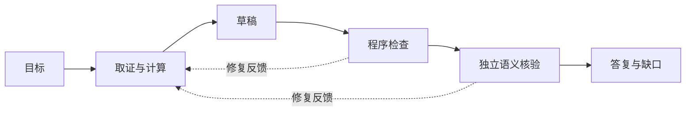

# 对话可靠性：目标、证据与修复

语言流畅不等于业务完成。安言用显式目标、可追溯证据和有界修复，把“理解了什么”“查到了什么”“还缺什么”分开记录。本文面向扩展对话和排查回答问题的开发者。

## 先定义本轮目标

本轮最多五项目标，每项限定行为、资源、字段、对象、主题和是否需要本人记录。目标不是从回答倒推的评分清单；模型不能删掉难答的目标来让覆盖率看起来完整。

| 用户表达 | 应形成的处理 | 不应发生的推断 |
| --- | --- | --- |
| “这张卡还能转多少？” | 查指定卡、相关额度与当前累计，解释限制 | 只读静态额度就说剩余可转金额 |
| “先别转，讲讲验证要求” | 解释规则，保留未完成意向 | 把“转”当立即执行授权 |
| “李四那笔补 300” | 唯一匹配本人任务，补本轮金额后重新预检 | 恢复旧确认或另选收款人 |
| “有产品也有持仓吗？” | 分别读取公开货架和本人持仓 | 用产品目录替代本人资产 |

## 证据有类型与时效

政策只能证明系统规则；账户读取证明当前本人记录；用户自述只表示用户说过；工具错误只证明读取失败。新读取替换相同资源的旧事实，避免历史观察覆盖新状态。

投影区分已展示字段、同条记录必要背景与未展示字段。字段未展示不等于原记录缺失；有效空集合不等于请求失败。集合计算需要范围完整，否则不得从部分交易推断全部消费。

## 程序承担数值计算

登记的 `sum`、`difference`、`count` 使用证据字段，保存操作数、单位、对象和结果编号。金额按整数分处理。回答引用已计算结果，不由生成器重新口算；未知字段或不完整范围保留缺口。

受限表达式另经 AST 白名单和子进程预算，不开放任意 Python、文件或网络工具。它仍不是操作系统级沙箱，边界见[安全设计](安全设计文档.md)。

## 修复是有界反馈



缺证据可补查，计算问题可重算，表达问题可改写；仍共享读取预算和最多三次草稿。预算耗尽后分别报告已答、缺数据、需澄清、需确认、不支持或工具失败。不能用无限重试、选最好一次或删除失败目标替代可靠性。

核验器检查证据是否支持陈述、是否针对本轮、是否逐项目标覆盖。与生成器分开调用能增加检查机会，但使用同一模型仍可能有相关错误；资金成功声明最终受 Core 回执约束。

## 离线提示词优化

`scripts/optimize_dialogue_prompts.py` 可通过可选 GEPA 依赖产生候选 prompt bundle。训练与验证必须使用分离的 development 数据，拒绝把 holdout 当优化输入。候选只安装到隔离评测子进程，不自动发布到软件或服务器。

```powershell
.\.venv\Scripts\python.exe scripts/optimize_dialogue_prompts.py --help
.\.venv\Scripts\python.exe scripts/evaluate_dialogue_tasks.py --dry-run --trials 2 --output-dir build/dialogue-plan-new
```

先核对数据和计划，再为真实调用设置显式费用预算。模型、数据、候选摘要、失败原文和未运行项都要保留，命令与评分细节见[多轮任务评测](多轮任务评测.md)。

## 尚未解决的问题

真实表达比固定任务更开放，模型可能错误绑定省略对象，核验器也可能漏判。错误回退可以保护执行，但不能算作问题已被正确解释。下一步应增加未参与修复的新任务、失败类型统计与人工复核，再用[稳定性门槛](稳定验收标准.md)判断候选，而不是只比较单次总分。
