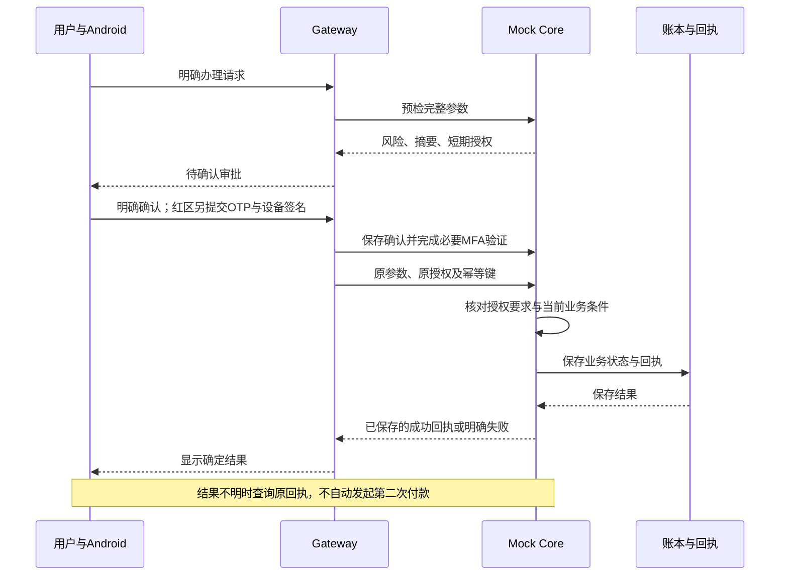

# 安言技术文档

作品名称：安言：安全可控的银行 AI 智能体。文档日期：2026-11-02。

本文可单独阅读，说明作品的需求、系统架构、业务链路、数据模型、验证范围和已知限制。正文包含架构图及必要的规则说明，不要求读者打开其他文档或源码包。Markdown 阶段保留随文架构图资源和办理时序图源，最终转为 PDF 时须将图表渲染并嵌入正文，单个 PDF 不再依赖这些源文件。全部账户、资金、产品、商户与履约结果均为虚构数据。

术语：Gateway 指对话网关；Mock Core（简称 Core）指模拟银行核心；OTP 指一次性验证码；MFA 指多因子验证；幂等指同一请求重复提交时不重复产生业务结果。

## 作品目标与实现范围

安言探索用自然语言串联银行查询与模拟办理，减少用户寻找业务入口、重复填写参数的操作。文字或语音只负责表达需求；资金操作仍需明确对象与金额、用户确认，以及业务要求的额外验证。

| 场景 | 当前实现 | 业务边界 |
| --- | --- | --- |
| 转账与资金安排 | 联系人解析、付款卡选择、小额与大额转账、预约、AA、资金预留 | 缺少对象、金额或执行时间时先澄清；预约创建不等于资金已转出 |
| 账单与账户查询 | 余额、流水、期间消费与分类分析，支持多目标取证计算 | 不能用支出合计重建完整历史资金来源；查询失败不解释为没有记录 |
| 理财 | 五类 25 款虚构产品、搜索筛选、净值与详情、风险档案、申购赎回 | 公开货架不等于本人持仓；申赎需适当性检查与红区授权 |
| 卡片 | 卡包、日额度、渠道开关、冻结解冻与挂失解挂 | 冻结针对单张卡，不是冻结整个账户；变更按业务重新授权 |
| 订阅 | 登记记录查询、取消与提醒，重复交易推断候选 | 订阅查询也需黄区确认；登记或推断不能证明真实商户合同与会员权益 |
| 生日联动 | 联系人生日、提醒及 Mock 订单草稿与办理 | 仅本机商户模拟，不提供真实配送、退款或履约保证 |

多轮讨论支持补充、暂停、更正、插问与恢复。模型识别到“想办理”不等于获得执行授权；“先问费用”与“现在办理”分别处理，停止讨论也不等于撤销已完成交易。

## 系统架构


图 1：系统架构。随文保留 SVG 及可编辑 Mermaid 图源，供最终 PDF 嵌入与排版使用。主要调用与数据写入方向如下：

```text
Android 客户端 ──文字／SSE──→ Gateway 对话网关
Gateway ←──理解／生成／核验──→ 模型服务
Gateway ──受限读取／审批办理──→ Core 模拟银行核心
Core ──持久提交──→ 签名账本、任务与操作回执

Android ──登录／设备／联系人──→ Core
Gateway ──保存对话与待审批──→ SQLite 等本机存储
Core ──保存──→ 设备公钥与核心审计
Gateway ──记录──→ 网关审计
运维面板 ──停服务／备份／离线校验──→ 账本维护
可选飞书私聊 ──固定只读通道──→ Core
```

模型只有受控的理解、规划和回答职责；普通用户操作由 Core 执行，运维维护另走管理权限路径。语音先转为用户可核对的草稿，不直接触发资金执行。

| 层次 | 技术与主要模块 | 职责与边界 |
| --- | --- | --- |
| Android 客户端 | Kotlin、Jetpack Compose、Keystore | 登录、文字与语音草稿、业务入口、审批摘要、明确确认、设备签名和结果核对；不能自行决定风险或改账本 |
| Agent Gateway | FastAPI、LangGraph 与结构化会话状态 | 管理同主体会话、讨论与审批句柄，编排理解、取证、计算、回答与核验 |
| 模型服务 | 可配置 DeepSeek；可选百炼语音转写 | 理解与规划、生成草稿及独立核验；不持有账本写工具，输出仍需程序校验 |
| Mock Core | FastAPI、独立授权和业务路由 | 会话与对象归属、风险、授权、业务条件、设备证明、幂等提交与核心回执 |
| 数据层 | 签名账本快照、SQLite 会话、审批存储、设备公钥、审计文件 | 单机保存、完整性校验与故障恢复；不提供多实例事务、高可用或生产银行清算 |
| 运维面板 | FastAPI 与浏览器界面 | 备份、配置演示账户、保存和恢复初始状态、服务控制；属于独立的高权限维护路径 |

本机 Core、Gateway、面板分别使用 `127.0.0.1:8000`、`:8100`、`:9100`。云端通过 Nginx HTTPS 转发 `/core/`、`/gateway/`、`/panel/`，后端仍回环监听。可选飞书使用固定只读接口与原生卡片，不复用 App 的完整生成核验链路，资金办理回到 App。

## 两条主要处理链路

### 查询与解释

1. Gateway 从有效会话取得主体，读取该主体的会话状态；模型理解本轮行为、问题目标、对象及讨论命令。
2. 程序检查能力与字段白名单，绑定原文及已核验对象。缺对象、多对象歧义或范围外请求分别澄清或说明，不用旧值猜测。
3. 只读规划器检索版本化规则，按目标读取本人事实。公开政策、用户自述、真实记录与失败信息分别保存来源。
4. 金额计算由程序执行，结果保留操作数及证据编号；最终答复只使用本轮有效证据。
5. 草稿先经过确定性检查，再独立核验事实支持、切题与逐项目标覆盖。在预算内补查或改写；仍有缺口则明确未完成，安全回退不能算自然回答全部通过。

该链路不能签发新的资金授权。订阅记录不在普通只读工具白名单中，需要另走原确认协议。

### 模拟办理



图 2：模拟办理时序。最终 PDF 中须显示渲染后的时序图。其流程为明确请求、预检、用户确认、必要强验证、提交原参数、核心校验、持久保存和回执返回；结果不明时查询原操作。

审批需要绑定原主体、业务、对象、金额和其他影响结果的参数。确认前不扣款，红区还要求演示 OTP 和登记设备签名；预检成功、动画结束或请求发出均不能显示为交易成功。

办理流程中的用户审核节点只表示用户确认，不代表真实银行坐席已接管。工单与人工处理入口属于 Mock 业务流程，不能用来宣称真实客服审核已完成。

## 讨论状态、审批状态与业务状态

| 状态对象 | 保存内容 | 可做与不可做 |
| --- | --- | --- |
| 讨论任务 | 业务、对象、缺失字段、暂停或待输入状态；同主体最多四项 | 可恢复或更正需求；不保存确认权限，不提供余额事实，不继承旧授权 |
| 当前查询目标 | 最多五项目标，分别保存行为、资源、字段、对象与证据要求 | 逐项标记已答、缺数据、待澄清、待确认、不支持或读取失败 |
| 待审批记录 | 不透明句柄、原参数、短期授权及有效期 | 只能由原主体确认、取消和提交；咨询插问不能悄悄改写原金额与收款人 |
| Core 业务状态与回执 | 余额、流水、任务、产品持仓及已提交操作结果 | 由 Core 校验和保存；已完成资金不能通过删除讨论或重置页面撤回 |

执行结果区分 `SUCCEEDED`、`PARTIAL_SUCCESS`、`NEEDS_INPUT` 等业务状态。HTTP 请求成功或会话一轮结束，不代表每项目标都已完成。

## 数据保存与一致性

| 数据 | 保存方式 | 重启与故障语义 |
| --- | --- | --- |
| 业务账本、任务与支持持久回执的幂等记录 | 配置 `BANK_LEDGER_STORE_PATH` 后保存完整快照 | 在同一临界区提交；写盘失败回滚，损坏快照拒绝加载并冻结写入。未配置路径时仅为内存演示 |
| 会话与待审批 | SQLite checkpoint 及独立审批存储 | 可保存对话或待核对状态；不代表 Core 旧会话与安全凭证重启后仍可执行 |
| 登录、短期授权及临时验证状态 | 进程内安全状态 | Core 重启后须重新登录，必要时重新预检与确认 |
| 设备公钥 | 可配置独立持久文件 | 校验完整性后加载；Android 私钥留在 Keystore，不作为场景数据导出 |
| 审计 | Core／Gateway 各自的脱敏事件与哈希链文件 | 可核对部分修改与重启历史；文件管理员仍可整体替换，缺少外部不可抵赖锚点 |

持久写入先形成临时文件，刷新并替换原文件，成功后才发布业务成功回执和相应成功审计。写盘失败恢复本次业务、任务及幂等缓存，已消费安全材料保持已消费，后续办理须重新确认。此方案依赖单进程锁与文件替换，不等同数据库事务或完整断电保证。

响应丢失时读取原操作回执，禁止自动改用新请求重复付款。联系人删除也先确认，再调用服务器；成功或只读核对后才更新列表，旧读取不能把删除项带回。

演示账户在创建或首次保存时保留初始状态。维护操作先停服务与备份，校验后保存、重载；单账户恢复不撤回已结算转账，不改动其他账户。维护路径与普通用户办理分开，保存前后核对数据和服务健康；更新或恢复后客户端重新登录。

## 核心规则与接口约定

### 权限分级

| 等级 | 典型范围 | 条件 |
| --- | --- | --- |
| GREEN | 本人余额、流水、卡片及普通政策解释 | 按资源核对会话与归属；解释本人实际状态仍需本人记录 |
| YELLOW | 小额转账、部分预约及资金安排、订阅查询／取消、关闭渠道 | 完整参数、服务端预检、用户明确确认及一次性授权 |
| RED | 累计大额转出、理财申赎、调额、开通渠道、冻结及挂失等 | 前述条件，加演示 OTP、登记设备签名及业务约束 |

转账基础等级按“当日已转出＋有效未完成转账安排＋本次金额”计算，累计不超过 1000 元为黄区，超过为红区；行为信号可升级风险。不能仅看本笔金额，也不能由模型和客户端降低等级。

授权绑定主体、原登录、业务、目标、金额、备注摘要、操作上下文、唯一编号及有效期。确认由 Core 记录，红区设备采用 ECDSA P-256 签名，挑战和验证凭据均绑定原授权并限制重放。演示验证码可由 App 获取，不是真实短信；公开演示口令与较宽松设备登记使其强度低于真实银行认证。

### 代表接口

| 接口 | 请求或处理内容 | 结果边界 |
| --- | --- | --- |
| `POST /api/v1/auth/login` | 登录虚构账户，获得会话 | 私有资源请求仍校验主体和归属，裸用户编号不能代替认证 |
| `POST /api/v1/agent/messages`、`POST /api/v1/agent/messages/stream` | 输入文字、会话编号及消息标识；后者返回 SSE 进度 | 进度不等于最终成功，回复保留逐项目标状态 |
| `POST /api/v1/agent/approvals/{approval_id}` | 对原主体的原审批确认或取消 | 不能借其他会话或更换参数执行 |
| `POST /api/v1/risk/precheck`、`POST /api/v1/risk/precheck/operation` | 预检转账或其他操作的完整参数 | 返回摘要和验证要求，不在预检时扣款 |
| `POST /api/v1/risk/confirm`、`POST /api/v1/risk/mfa/verify` | 保存确认，核对演示验证因子 | 客户端自报“已确认”不能替代服务端状态 |
| `POST /api/v1/transfers/execute`、`POST /api/v1/operations/execute` | 提交原授权、参数及幂等键 | 完成当前业务条件校验和持久提交后才返回成功 |

同一主体、同一端点下的幂等键绑定请求摘要：相同请求已完成则返回原结果，改变参数则冲突，处理中不重复记账。凭证单次性与幂等回执分别保护授权和重试，不能用新幂等键自动补做不确定的付款。

## 客户端与多通道实现

理财首页按活钱管理、稳健低波、稳健增值、稳中求进和进取投资展示 25 款虚构产品，沿用产品编号、风险等级与适当性规则。单一完整成功集合在聊天中去重；比较、混合查询、失败或不完整结果保留必要正文。详情页展示风险、期限、起购金额和申赎规则，申购参数回到聊天办理，不在浏览页直接扣款。

语音使用底部面板，长按采集、松开转写、上滑取消，波形来自实际 PCM。本机识别优先，缺少端侧能力时经用户同意使用云端转写；结果只填入草稿，用户核对后发送。取消使晚到结果失效，但不能撤回已上传音频。最长采集 20 秒；录音保存在内存中，页面离开前台后停止采集并使旧回调失效。语音识别不是付款授权。

联系人迁移只纠正原演示身份与关系，保留自定义内容和删除状态。办理历史两栏独立筛选；思考头像静止，旁边为原生 shaping 点阵轮廓动画。这些动画只表示界面状态，不作为付款或审批完成依据。

## 运行条件与数据配置

Python 支持 3.10–3.12；Android 使用 JDK 17/21、SDK API 37、Build Tools 36.0.0。先启动 Core，再启动 Gateway 和客户端；管理面板使用独立维护入口。模拟器通过 `10.0.2.2` 访问宿主机，本机服务只监听回环地址。云端由 Nginx 转发 HTTPS，演示 APK 需与服务器地址和项目 CA 匹配。

| 配置项 | 用途与示例状态 |
| --- | --- |
| `DEEPSEEK_API_KEY` | 可选模型服务凭据；不配置时只有规则与固定结果，复杂咨询不可等效演示 |
| `BANK_LLM_MODEL`、`BANK_MODEL_THINKING` | 默认示例为 `deepseek-flash`、`disabled`，更换推理配置需独立验收 |
| `DASHSCOPE_API_KEY` | 可选云端转写服务凭据，使用前仍需用户同意 |
| `BANK_AUTH_SECRET` | 保护授权和持久文件完整性的服务端随机密钥，不随材料分发 |
| `BANK_LEDGER_STORE_PATH` | 启用业务、任务和回执持久化；未配置时为内存演示 |
| `BANK_REQUIRE_SESSION` | 私有资源会话门禁，公开演示保持默认开启 |

真实配置、私钥、会话、设备记录和账本不随材料分发；公开 CA 证书可提供给演示客户端，CA 私钥不可分发。本地面板免令牌但限制回环 Host 和写操作确认头，公网面板要求管理令牌、HTTPS 和受限会话 Cookie。维护权限较高，不能当作普通业务权限。

## 已执行验证与适用范围

截至 2026-11-02 的记录如下。各行来自不同版本或专项，不相加为同一次验收；本文不把历史结果称为当前重新执行的成绩。

| 证据对象 | 已记录结果 | 范围与限制 |
| --- | --- | --- |
| 完整后端历史回归 | 3147 passed、1 skipped | 其中三项为当时新增目录交付测试；跳过项为历史扩展场景端点未提供 |
| 最终 shaping 客户端历史 JVM | 140 passed | 包含动画几何基准；不能代替设备或真实 ASR 验收 |
| 原业务设备专项 | 联系人和主题 24 项，理财 7 项，长按语音与交互 10 项；交互修正后另重跑 3 项 | 不同版本单独记录，不合计为最终版本全量；语音专项使用硬件与转写替身 |
| 目录整理工具专项 | 19 项通过 | 验证源码导出、文件保留、目录和链接，不证明模型质量 |
| 三份技术材料对应机制专项 | 237 项通过，1 条既有依赖弃用警告 | 覆盖计算、当前证据、讨论、授权、设备、持久化、结算、响应丢失与只读边界；使用隔离数据和受控替身 |

### 代表性检查

| 检查条件 | 必须观察到的结果 |
| --- | --- |
| 未确认或篡改金额、对象后提交 | 不扣款，拒绝原授权继续执行 |
| 错误设备、撤销设备或重放签名 | 红区验证失败，不能生成有效的新付款 |
| 同一幂等请求重试或成功响应丢失 | 回放或查询原回执，不重复记账 |
| 模拟写盘失败或加载损坏快照 | 前者回滚且不报成功，后者保留文件并冻结写入 |
| 跨午夜读取日累计 | 只返回当日投影，不因查询初始化或清空业务计数 |
| 读取失败、缺字段或截断集合 | 准确说明未知，不推断无记录，不编造全量合计 |

## 已知限制与后续验收

项目没有接入真实资金、短信或商户履约。同模型生成和核验可能发生相关错误，演示 OTP 与设备登记低于生产认证强度。单机账本不提供多实例事务、高可用或完整断电保证；表达式工作进程有资源限制，但没有独立文件系统和网络隔离。

最终 shaping 版本未重跑设备专项；真实 ASR、完整真机矩阵、飞书平台撤权、多成员覆盖，以及冻结版本的持续观察和重复任务验收仍未完成。安全回退、单元测试数量、构建通过和录制视频均不能替代这些证据。后台管理、第三方数据处理、日志与快照保护还需在生产化时单独完善。
