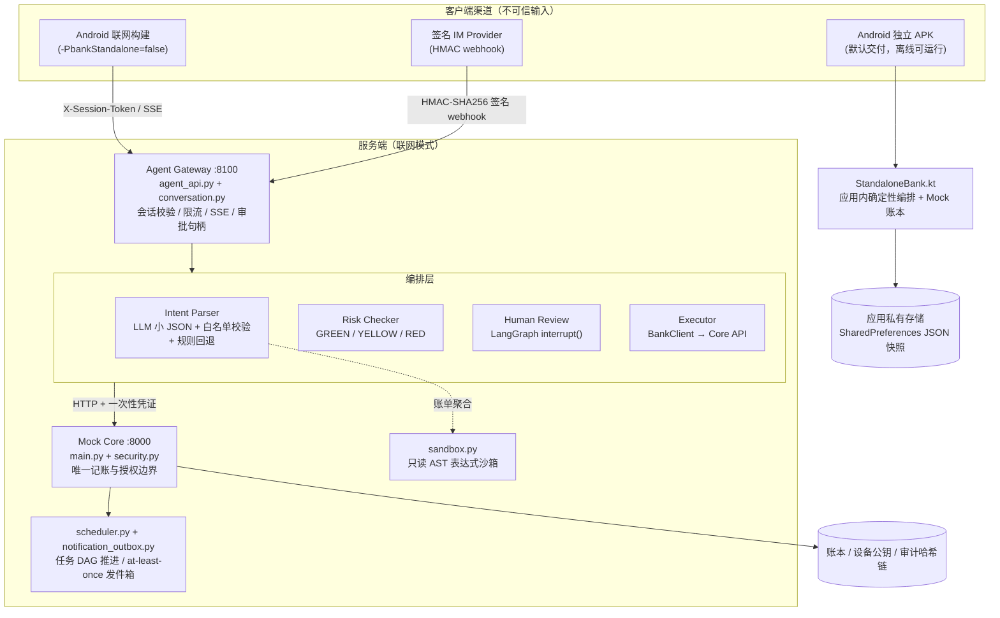
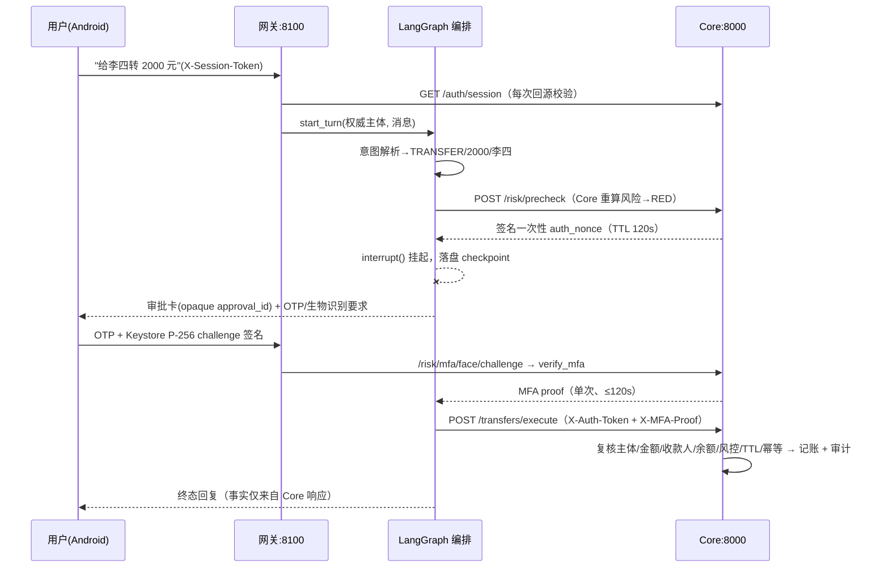

# 技术文档：系统架构、核心算法与安全设计

> 「安言」（AI Banking Agent）是一个自然语言银行助理沙箱：大模型负责理解与表达，安全策略与账本事实由服务端裁决。本文是面向评审的浓缩版技术文档；更细的专题文档见 [架构说明](architecture.md)、[安全自评](security-self-assessment.md) 与 [独立 APK 说明](standalone-apk.md)。

## 1. 系统架构

### 1.1 总体架构图



### 1.2 分层职责与信任边界

| 层 | 实现 | 职责 | 信任级别 |
| --- | --- | --- | --- |
| Android 独立版 | `StandaloneBank.kt` + Compose UI | 应用内 Mock 账户、确定性意图路由、审批卡、OTP、BiometricPrompt + Keystore P-256 验签 | 边界完整位于应用沙箱内 |
| Android 联网版 | Retrofit/OkHttp + SSE | 展示与确认采集；不持有服务端授权 nonce | 不可信输入 |
| IM 渠道 | `im_webhook.py` | provider 白名单、HMAC 验签、时间窗、事件号防重放、绑定码换身份 | 不可信输入 |
| 渠道网关 | `agent_api.py`、`conversation.py` | 回 Core 校验会话、每主体 60 req/min 限流、渠道命名空间隔离、审批句柄、checkpoint 持久化 | 半可信编排 |
| 编排层 | `agent.py`、`planner.py` | 意图解析、槽位回填、风险路由、LangGraph 中断恢复、任务 DAG 编译 | 半可信编排 |
| Core Banking | `main.py`、`security.py` | 唯一记账边界：登录会话、对象鉴权、预检、一次性凭证、设备验签、执行、审计、熔断、幂等 | **可信基座** |
| 分析沙箱 | `sandbox.py` | 只读 AST 白名单表达式，进程池 + 超时，失败降级并如实标注 `analysis_engine` | 受限隔离 |

关键设计原则：**Core 与模型物理分离**。`main.py` 不 import 任何 LangGraph/模型代码；Agent 文本不能构成授权，也不能作为交易成功证据；账户变更只发生在 Core 的事务边界内。

### 1.3 一次红区转账的完整链路



## 2. 核心算法说明

### 2.1 意图理解：约束生成 + 白名单校验 + 确定性回退

采用"**模型只出一个小 JSON，不调用任何函数**"的受控生成架构：

1. **约束生成**：`ChatOpenAI(model=deepseek-chat, temperature=0)` 输出形如 `{"intent": "...", "slots": {...}, "clarify": ...}` 的小 JSON（`agent.py._model_parse`）。提示词中枚举全部 25 个白名单意图与槽位 Schema。
2. **白名单校验**：`planner.validate_intent_payload` 校验 intent 枚举、金额为有限正数（拒绝 0/负数/NaN/Inf）、日期格式、目标存在性；任何校验失败进入澄清分支而非猜测执行。
3. **事实修正**：本地已验证事实永远压过模型输出——模型不能把查询改成写操作、不能发明收款人/卡号/持仓，只能改写措辞（`agent.py` 914–994）。
4. **规则回退**：`DEEPSEEK_API_KEY` 缺失或调用失败时，`MODEL_ENABLED=False`，整条链路降级为确定性规则解析器（正则 + 关键词 + 联系人表匹配），保证离线可演示、可回归测试。
5. **多轮上下文**：会话状态（上一收款人、上一金额、最近意图）保存在 LangGraph checkpoint 中，支持"再转一次""把它取消掉"等省略与回指；槽位缺失时生成针对性澄清话术而非默认值。

### 2.2 风险分级路由：三级权限 + 动态累计阈值

```
GREEN: 查询类（余额/账单/理财查询/订阅查询/卡片查询）        → 直接执行
YELLOW: 转账/预约/AA/锁资/订阅取消/开卡                      → 预检 + 明确确认 + 一次性授权 token
RED:   申购/赎回/调额/冻结/解冻/挂失/解挂/改密/欺诈争议      → YELLOW 全部 + OTP + 设备 P-256 签名
```

核心算法（`planner.risk_for_intent`）：转账类风险是**动态累计**的——

```python
total = Decimal(daily_total) + Decimal(amount)
return "YELLOW" if total <= Decimal("1000") else "RED"
```

即当日累计 ≤1000 元为黄区，超过即升红区。风险等级由 **Core 预检端点重算**，Agent/渠道传入的 `risk_level`、布尔确认值或文字说明都不能降低等级；`Decimal` 精确十进制避免浮点误差在阈值边界放行超额交易。

### 2.3 人在回路：LangGraph 中断/恢复与一次性凭证

编排图为固定五节点流水线 `intent_parser → risk_checker → human_review → executor → responder`：

- 黄/红区在 `human_review` 节点调用 `interrupt()` 挂起图执行，状态经 `SqliteSaver` 落盘（`agent_conversations.sqlite3`），进程重启后可恢复；
- Core 预检通过后签发 **HMAC 签名的一次性授权 nonce**（TTL 120s），绑定主体、会话指纹、操作、金额、对象与上下文摘要——篡改任一字段验签即失败；
- 审批句柄对客户端是不透明 `approval_id`，`auth_token` 永不序列化给渠道；审批 TTL 110s < nonce TTL 120s，保证网关不持有过期凭证；
- 恢复执行时经 `/risk/confirm`（黄区）或 `/risk/mfa/verify`（红区）消费 nonce，单次有效、用后即焚；`X-User-Confirmation` 等自报头仅作参考，服务端 `record.confirmed` 位只能由验证过签名 nonce 的确认端点置位。

### 2.4 跨场景任务编译：需求 → 依赖 DAG

`planner.build_task_plan` 把复合意图编译为确定性 DAG（非 LLM 生成）。以"检测到我爱人生日，当月锁定 1000 元活期，生日前 2 天订鲜花蛋糕"为例：

```
CROSS_SCENE_LOCK →
  validate_event (GREEN)
    └─> reserve_funds / LOCK_FUND (YELLOW, 补偿动作 UNLOCK_FUND)
          └─> schedule_orders / SCHEDULE_REMINDER (YELLOW)
```

每个任务携带风险级别、依赖列表与**补偿动作**；失败沿依赖逆序回滚。到期任务由 `POST /tasks/run-due` 显式推进（幂等键去重），预约转账与订单草稿到期只进入 `WAITING_USER` 等待用户再次授权，**绝不无感扣款**。

### 2.5 账单分析：沙箱聚合 + 规则异常识别 + 事实渲染

1. **时间过滤**：`filter_transactions` 按业务时区（Asia/Shanghai）计算日/月/上月/年边界，不信任模型生成的日期。
2. **沙箱聚合**：分类统计以白名单表达式在只读 AST 沙箱内执行：

   ```
   {"categories": group_spend(data,"category","amount"),
    "spent": spend_total(data,"amount"), "refunds": refund_total(data,"amount")}
   ```

   沙箱限制节点数/深度/整数字长/执行时长 1.5s，进程池隔离，失败降级为等价纯 Python 实现并在 `analysis_engine` 如实标注。
3. **异常交易识别**：确定性规则——深夜（23:00–6:00）单笔 ≥500 元、境外商户关键词、命中"可疑交易/盗刷"类目；退款单独立报，不计为异常。
4. **事实渲染**：`safe_analysis_text` 只用上述核验过的数字生成中文摘要；模型可以润色措辞，但不能发明流水号或金额。

### 2.6 幂等与并发正确性

- 资金类请求携带 `Idempotency-Key`，Core 以 `(actor, kind, key)` 幂等去重：并发重复请求至多记一笔账，后到者回放首次结果；
- 活跃签名 nonce 计入预检占用，防止两笔并发 600 元预检都显示余额充足；
- 网关 `BankClient` 对资金类请求**刻意不重试**（超时不重发），只读请求允许重试一次；
- 账本变更失败时按快照回滚；账本/审批/设备库支持 HMAC 完整性摘要落盘，篡改后拒绝载入并冻结写入。

### 2.7 Prompt 注入防御

- 静态模式库（角色扮演、"忽略之前规则"、要求输出系统提示/密钥、请求执行代码等）+ 控制字符/长度/Unicode 异常检测，命中即进入 `SECURITY_GUARD` 拒绝分支，不进入任何写工具；
- 即使注入文本骗过解析层，写操作仍需通过 Core 预检 + 一次性凭证 + （红区）OTP/设备签名——**注入最多得到一次澄清回复，无法直接造成资金变更**；
- IM webhook 校验原始 body 的 HMAC-SHA256、300s 时间窗与 `event_id` 重放表，事件内 `user_id` 一律忽略。

## 3. 安全设计文档

### 3.1 设备信任根（红区生物因子）

- Android 端 `DeviceKeyManager` 在 **Android Keystore** 生成 P-256 密钥对（优先 StrongBox，回退 TEE），私钥永不离开安全硬件；
- 服务端下发一次性 challenge，设备对规范串 `bank-agent-face-v1|challenge_id|user_id|auth_token_jti` 做 ECDSA 签名，装进 `v2:` 信封；
- 服务端 `security.verify_face_attestation` 用注册公钥验签：`face_verified=true` 自报、旧格式票据、错误设备、jti 不匹配、过期或重复 challenge 全部拒绝；
- 生物识别只证明"本人在场"，真正的授权证明是 Keystore 签名——Root 设备可以伪造弹窗，但伪造不了签名。

### 3.2 会话与凭证生命周期

| 凭证 | TTL | 单次性 | 绑定 |
| --- | --- | --- | --- |
| 登录会话 | 900s | 否 | argon2id 口令校验；登出即吊销并使在途授权失效 |
| 授权 nonce | 120s | 是 | 主体+会话指纹+操作+金额+对象+上下文摘要 |
| MFA proof | ≤120s | 是 | 父授权；OTP + 设备签名双因子 |
| IM 绑定码 | 300s | 是 | 已登录会话 ↔ provider 外部身份 |

### 3.3 纵深防御清单

1. **幻觉防护**：余额、流水号、持仓、任务状态只来自 Core 响应；校验失败进入"未完成"分支；流式接口单终态帧。
2. **注入防御**：静态模式库 + 白名单 Schema + 网关会话回源校验 + 凭证字段绑定。
3. **操作审计**：全事件 SHA-256 前项哈希链，按 `request_id` 聚合还原完整决策链，敏感字段脱敏。
4. **异常熔断**：授权失败滑动窗口计数锁定主体；大额/卡片/改密等组合行为加权计分（`BEHAVIOR_RISK_LOCK`）；锁定期间预检与执行双点拒绝。
5. **分析沙箱**：AST 白名单 + 进程隔离 + 超时，仅用于只读账单聚合。
6. **传输与响应**：`no-store`、`nosniff`、frame 限制、请求体大小上限；日志/错误/审计对凭证与卡号脱敏。

### 3.4 独立 APK 的安全边界

独立版把上述安全模型完整搬进应用沙箱：短时审批绑定主体/动作/金额、红区 challenge 由应用内登记的设备公钥 ECDSA 验签、审计记录前项哈希串联、消息幂等表防重放。局限：应用私有存储与本地哈希链不能替代服务端 HSM/WORM 审计；root 设备或清除数据可重置演示状态，因此独立模式仅用于离线演示。

完整安全分析（含威胁模型与五项机制实测）见 [安全自评报告](安全自评报告.md) 与 [security-self-assessment.md](security-self-assessment.md)。
