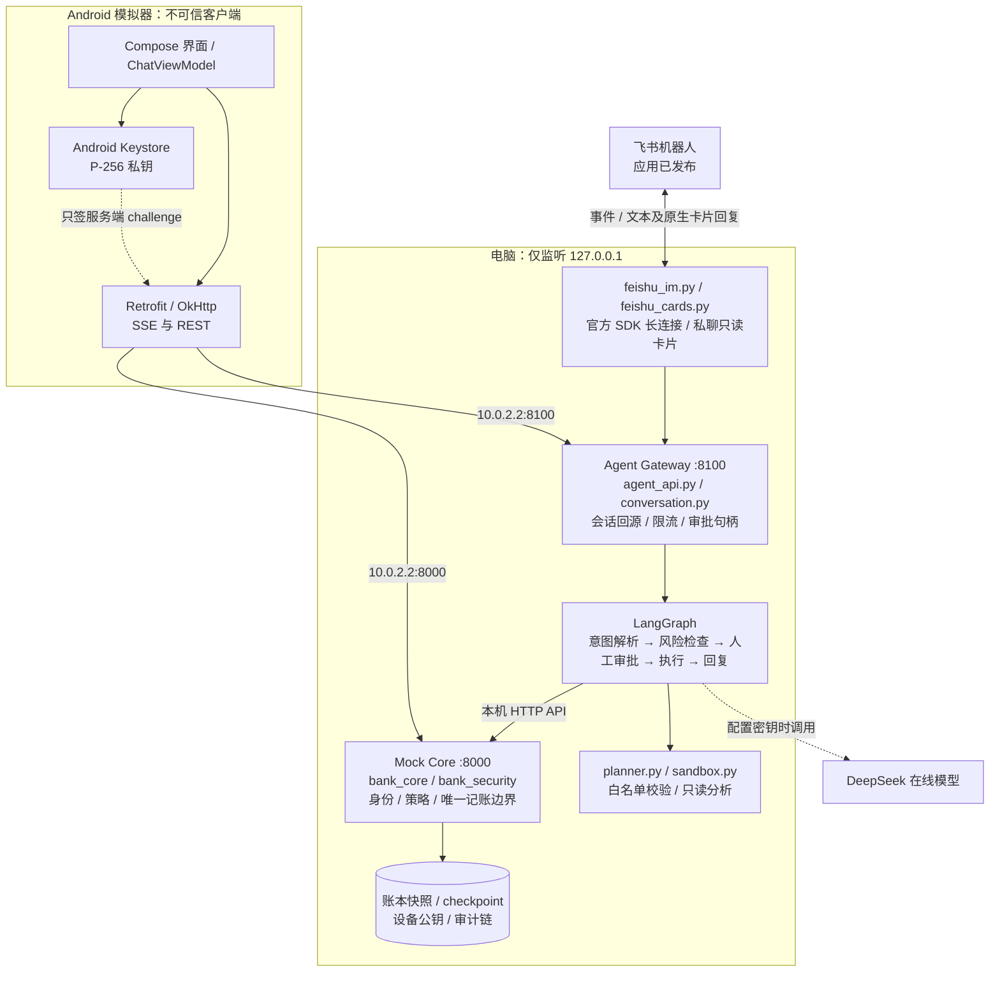
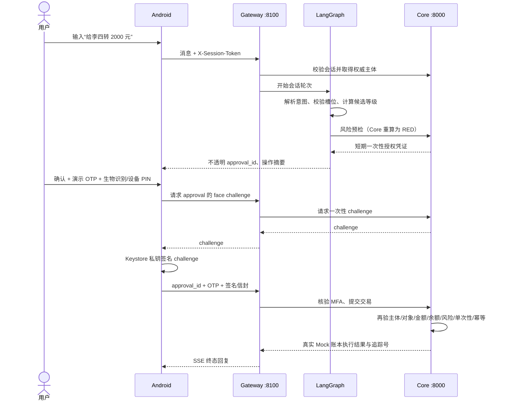

# 技术文档：架构、算法与安全设计

2026-10-15 补充：端侧语音、任务分支接管、一次性演示验证码、OS 资源限制与对比评测见[参赛完善与验收](参赛完善与验收-2026-10-15.md)。语音只回填文字；人工处理不会自动退款或恢复执行；验证码是本机演示投递，未接入真实短信。

本文对应“电脑本地后端 + Android 模拟器客户端 + 可选飞书私聊”这一运行形态。Core 与 Gateway 是两个本机 Python 进程，Android 模拟器通过 `10.0.2.2` 访问电脑回环地址。飞书长连接由 Gateway 主动发起。账户、流水、理财产品与交易均为 Mock 数据。

## 1. 系统架构图



| 层 | 主要代码 | 负责事项 | 信任边界 |
| --- | --- | --- | --- |
| Android | `android/app/src/main/` | 输入、展示、确认、设备私钥签名 | 客户端数据一律不作为授权事实 |
| Gateway | `agent_api.py`、`conversation.py` | 从会话得到主体、对话状态、SSE、审批句柄 | 不持有账本，不能自行降级风险 |
| 编排 | `agent.py`、`bank_agent/`、`planner.py` | 受约束意图解析、澄清、多轮上下文、任务计划 | 模型输出必须校验 |
| Core | `main.py`、`bank_core/`、`security.py`、`bank_security/` | 登录、预检、MFA、对象鉴权、余额变更、审计 | 唯一可信执行点 |
| 分析沙箱 | `sandbox.py` | 只读表达式分析、限制输入/时间/结果 | 不提供写账本工具 |
| 飞书私聊 | `feishu_im.py`、`feishu_cards.py` | 官方 SDK 长连接、绑定码、会话映射、事件去重、固定 Core GET 查询与只读消息卡片 | 用户已验证平台文本收发；卡片渲染待实测；IM 不调用变更编排 |

### 代码组织

Core、编排与安全边界各是一个包，入口文件只负责装配或重新导出：

| 包 | 模块 | 职责 |
| --- | --- | --- |
| `bank_core` | `ledger`、`cards`、`wealth_data`、`contacts` | 虚构账本与各领域集合及规则；集合经显式注册表参与事务快照与落盘 |
| | `payments`、`operations` | 收款人解析、日累计、卡限额与交易渠道；通用操作的风险表、签名上下文与目标校验 |
| | `undo` | 可撤销规则与撤销执行（预约、AA、资金锁定），任务页取消、解除锁定与对话撤销共用 |
| | `access`、`idempotency`、`persistence`、`http_edge` | 调用方身份与安全失败记账、幂等、账本落盘、会话门禁/限流/请求体上限 |
| | `routes/accounts`、`contacts`、`wealth`、`subscriptions`、`cards` | 绿区读取与资料类接口 |
| | `routes/approvals`、`sessions`、`devices` | 风险预检、确认、MFA，登录会话，设备登记 |
| | `routes/execution`、`tasks`、`monitoring` | 黄红区执行闸门，任务中心与人工接管，健康、安全事件与审计 |
| `bank_agent` | `runtime` | 配置、单轮会话凭证、模型客户端与 Core 传输；`_http`/`llm` 是唯一替换点；`speech_asr.py` 为云端语音识别转发 |
| | `extraction`、`parsing`、`dialogue`、`risk_quiz` | 文本槽位、规则与受约束模型解析、多轮上下文与复合请求、风险测评问卷 |
| | `nodes/intent`、`risk`、`executor`、`responder` | 五个图节点：意图（含复合流程续接）、风险预检与人工审批、执行、核验与回复 |
| | `settlement`、`verification`、`rendering`、`graph` | 写操作计划记账与补偿、Core 回执核验、客户文案、图连线 |
| | `conversation_base`、`approval_store`、`conversation_turns`、`conversation_approvals` | 会话服务的共用定义、待审批记录与落盘、对话轮次与审批处理（由 `conversation.py` 组合） |
| `bank_planning` | `intents`、`plans`、`bill_analysis` | 意图白名单、风险分级与校验；任务计划；账单分析与沙箱聚合（Core 与 Gateway 共用，`planner.py` 重新导出） |
| `bank_security` | `config`、`errors`、`tokens` | 加载 `.env` 与安全配置、共享状态锁，安全异常，HMAC 签名凭证 |
| | `sanitize`、`audit` | 输入清洗、提示词注入检测与脱敏；审计哈希链、分服务审计文件（导入时回放）与请求追踪 |
| | `circuit` | 连续失败熔断与行为组合风控规则 |
| | `sessions`、`passwords` | 会话签发、续期、绑定与吊销；argon2id 口令 |
| | `authorization`、`mfa` | 预检授权凭证、确认与取消、执行闸门；人脸挑战、设备签名、验证码与 `verify_mfa` |
| | `devices`、`store_integrity` | 设备信任根与设备库落盘（导入时加载）；落盘文件完整性摘要 |
| | `health`、`reset` | 安全健康摘要；测试用状态重置 |

`main.py` 不导入 LangGraph 或模型；交易成功消息只能基于 Core 执行响应生成。账户状态的可选落盘由 Core 单进程负责，Gateway checkpoint 与待审批句柄另行存储。未配置持久化路径时，相关状态在进程重启后重置为演示种子。所有私有 Core `/api/v1/` 读写接口默认要求有效会话；登录和健康检查是明确的引导例外。

## 2. 关键数据流



## 3. 核心算法说明

### 3.1 意图理解与澄清

配置 `DEEPSEEK_API_KEY` 时，`bank_agent/parsing.py` 使用低温度模型生成小型意图 JSON；模型不能直接调用任意银行函数。`planner.validate_intent_payload` 逐字段校验白名单意图、金额、日期和目标。已由 Core 或联系人表验证的事实优先于模型提取结果；缺少必要槽位时进入澄清，不替用户猜收款人或金额。

未配置密钥或模型调用失败时，系统转入规则解析。多轮状态由 LangGraph checkpoint 保存，使“再转一次”“把它取消掉”等回指先解析到具体对象，再按新操作重新预检与授权。规则回退可保证本机演示，理解能力与在线模型可能不同。

### 3.2 风险分级与金额边界

`planner.py` 将意图归入 GREEN（查询）、YELLOW（需确认的变更，以及按赛题要求需确认的订阅查询）、RED（需强认证的变更）；Core 的预检端点对风险**重新计算**。对转账类操作，核心边界是：

```text
本次后当日累计 = Decimal(当日已转金额) + Decimal(本次金额)
累计 ≤ 1000 元 → YELLOW；累计 > 1000 元 → RED
```

使用十进制运算避免二进制浮点在阈值边界的误差。任意由客户端、模型或 Gateway 自报的风险级别不能降低 Core 判定。零、负数、非有限金额及超限值在预检或执行处拒绝。

### 3.3 人在回路与防重放

LangGraph 固定流程为 `intent_parser → risk_checker → human_review → executor → responder`。

意图识别采用“规则优先、模型补充”：先做注入检查，再由本地规则解析；规则能完整、无歧义地识别单一意图时直接采用（快速路径，不调用模型）；否则在配置了 `DEEPSEEK_API_KEY` 时调用 DeepSeek 抽取意图，结果再经规则约束（金额、日期只取规则从原文抽出的值，模型只能补充意图分类和原文里出现的对象），未配置密钥时只用规则。缺少的信息进入“待补充”状态，下一句只回答缺项（如“李四”“1000”）时并回原任务；预检因收款人或金额被拒时只清空出错的那一项，其余保留，换人或改金额即可继续同一笔办理；先说收款人时会通过只读接口 `/api/v1/payees/check` 当场核对（本人、不存在、重名）。

输入框上方的“猜你想问”不使用固定规则：回复中给出的示例说法（“可以说“…””“例如：…”）由网关提取，随本轮回复立即显示；回复到达后 Android 再异步请求 `GET /api/v1/agent/conversations/{conversation_id}/suggestions`，由模型根据本轮对话预测最多 3 条下一句；网关过滤审批类用语、未出现过的金额/手机号/收款人以及本行未提供的业务，审批或风险测评进行中不生成。接口先返回回复中的示例，再补充模型预测；只配置规则模式时只返回示例，没有示例则不显示。等待审批时只显示取消、修改、更换对象三项。YELLOW/RED 到 `human_review` 中断，等待用户决策。Core 预检生成绑定主体、操作、金额、对象及上下文的 HMAC 授权凭证；Gateway 只把不透明 `approval_id` 发到 Android，服务端保留真正的授权材料。审批句柄默认 110 秒，授权凭证默认 120 秒。恢复执行时 Core 消费凭证，检查 TTL、单次性与幂等键；旧审批、改动金额或换人使用均失败。

### 3.4 跨场景任务与分析

`planner.build_task_plan` 将复合需求编译为带依赖的确定性 DAG；失败时按补偿步骤处理。预约转账和本机模拟商户订单到期后只进入 `WAITING_USER`，须再次人工确认。鲜花与蛋糕由本机白名单商品目录报价；订单预检绑定商品、金额和锁资编号，执行时重新核对并从虚构账本扣款，生成 `MOCK` 回执。这里没有真实外部商户履约。AA 只发起收款请求，各参与人以自己的会话确认普通转账，Core 根据 `AA:<split_id>` 备注核对份额并更新状态。账单聚合以受控数据源运行；`sandbox.py` 只允许白名单 AST 表达式并限制执行时间、输入和结果大小。隔离进程不可用时，模型生成的表达式默认拒绝执行；内建确定性账单聚合可继续运行。

订阅识别按同一商户、同一金额分组，以至少两笔已存在账本扣费的间隔识别周、月或年周期，返回含流水证据的 `CANDIDATE`。候选项不等于已登记代扣合同，不能直接取消；取消接口只接受 Core 中已有的有效订阅。

## 4. 安全设计

1. **身份与对象**：Android 登录取得会话令牌；Gateway 每次回 Core 解析主体。默认配置下 Core 所有私有读写接口要求会话，并校验账户、卡片、联系人等对象归属。
2. **分层授权**：GREEN 在身份及对象校验后查询；YELLOW 需用户确认和一次性授权；RED 叠加演示 OTP 与登记设备的 P-256 签名。Core 在执行前复核全部关键字段。
3. **设备与本地凭据**：Android Keystore 的 P-256 私钥要求系统强生物识别或设备凭据解锁后才能签名，Core 只存公钥；签名绑定服务端一次性 challenge。Android 会话和对话缓存以 Keystore AES-GCM 封存。设备撤销后旧签名失效。
4. **输入隔离**：模型输出视为不可信数据；意图白名单、槽位校验、提示注入检测、只读分析沙箱共同限制模型影响范围。模型文字不能构成确认或交易凭证。
5. **审计与恢复**：授权、拒绝、执行和设备事件写入哈希链；Core 与 Gateway 各写一个审计文件（默认在仓库外的用户数据目录），避免两条链交错；审计文件启动时只回放可验证前缀。Gateway 与飞书拦截的提示词注入经 `/api/v1/security/signals` 按会话主体计入 Core 熔断。账本/设备快照验证失败时拒载并冻结覆盖，避免损坏状态被静默重置。
6. **本机网络**：Core/Gateway 监听 `127.0.0.1`；模拟器使用 `10.0.2.2` 映射。Android 网络安全配置仅为模拟器回环地址允许明文 HTTP。若换成非本机环境，必须重新设计 TLS、身份与访问控制。

## 5. 验证入口与范围

- 后端：`python -m pytest -q --cov`（分支覆盖率，CI 低于 82% 即失败，报告写入任务摘要）与 `python -m mypy`（覆盖 `bank_*` 包与入口模块）；安全边界在 `tests/test_security_*.py`、`tests/test_device_trust.py`、`tests/test_concurrency.py`。
- Android：`:app:testDebugUnitTest`、`:app:assembleDebugAndroidTest`；模拟器运行 `:app:connectedDebugAndroidTest`。
- 端到端：`scripts/agent_gateway_e2e.py` 检查分级授权、审计链和审批防重放。逐项步骤见[测试用例](测试用例.md)。

实现仅用于单机 Mock 演示。生产化差距、剩余风险和缓解顺序见[安全自评报告](安全自评报告.md)。
