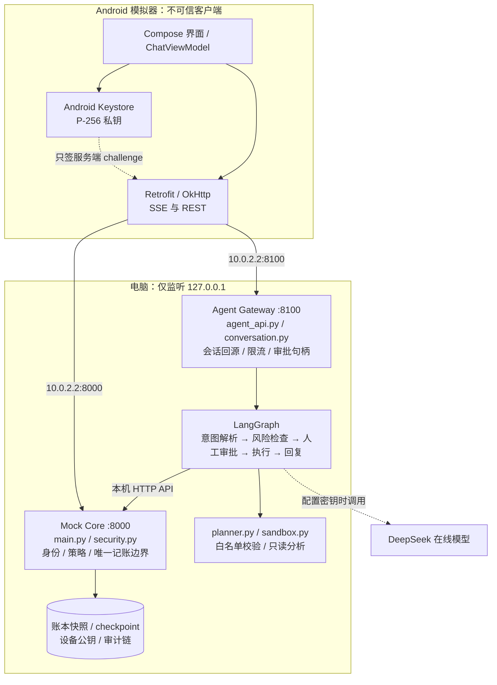
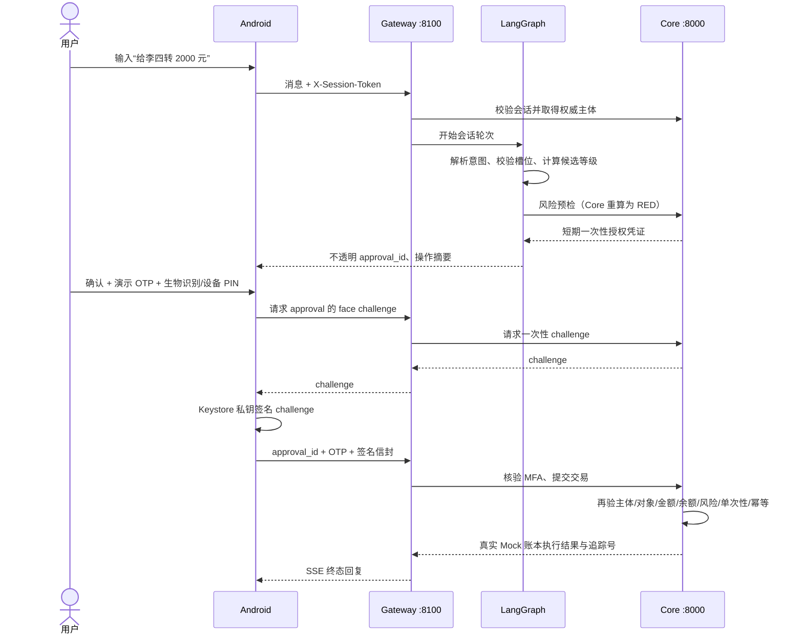

# 技术文档：架构、算法与安全设计

本文对应“电脑本地后端 + Android 模拟器客户端”这一运行形态。Core 与 Gateway 是两个本机 Python 进程，Android 模拟器通过 `10.0.2.2` 访问电脑回环地址。账户、流水、理财产品与交易均为 Mock 数据。

## 1. 系统架构图



| 层 | 主要代码 | 负责事项 | 信任边界 |
| --- | --- | --- | --- |
| Android | `android/app/src/main/` | 输入、展示、确认、设备私钥签名 | 客户端数据一律不作为授权事实 |
| Gateway | `agent_api.py`、`conversation.py` | 从会话得到主体、对话状态、SSE、审批句柄 | 不持有账本，不能自行降级风险 |
| 编排 | `agent.py`、`planner.py` | 受约束意图解析、澄清、多轮上下文、任务计划 | 模型输出必须校验 |
| Core | `main.py`、`security.py` | 登录、预检、MFA、对象鉴权、余额变更、审计 | 唯一可信执行点 |
| 分析沙箱 | `sandbox.py` | 只读表达式分析、限制输入/时间/结果 | 不提供写账本工具 |

`main.py` 不导入 LangGraph 或模型；交易成功消息只能基于 Core 执行响应生成。账户状态的可选落盘由 Core 单进程负责，Gateway checkpoint 与待审批句柄另行存储。未配置持久化路径时，相关状态在进程重启后重置为演示种子。

## 2. 关键数据流



## 3. 核心算法说明

### 3.1 意图理解与澄清

配置 `DEEPSEEK_API_KEY` 时，`agent.py` 使用低温度模型生成小型意图 JSON；模型不能直接调用任意银行函数。`planner.validate_intent_payload` 逐字段校验白名单意图、金额、日期和目标。已由 Core 或联系人表验证的事实优先于模型提取结果；缺少必要槽位时进入澄清，不替用户猜收款人或金额。

未配置密钥或模型调用失败时，系统转入规则解析。多轮状态由 LangGraph checkpoint 保存，使“再转一次”“把它取消掉”等回指先解析到具体对象，再按新操作重新预检与授权。规则回退可保证本机演示，理解能力与在线模型可能不同。

### 3.2 风险分级与金额边界

`planner.py` 将意图归入 GREEN（查询）、YELLOW（需确认的变更）、RED（需强认证的变更）；Core 的预检端点对风险**重新计算**。对转账类操作，核心边界是：

```text
本次后当日累计 = Decimal(当日已转金额) + Decimal(本次金额)
累计 ≤ 1000 元 → YELLOW；累计 > 1000 元 → RED
```

使用十进制运算避免二进制浮点在阈值边界的误差。任意由客户端、模型或 Gateway 自报的风险级别不能降低 Core 判定。零、负数、非有限金额及超限值在预检或执行处拒绝。

### 3.3 人在回路与防重放

LangGraph 固定流程为 `intent_parser → risk_checker → human_review → executor → responder`。YELLOW/RED 到 `human_review` 中断，等待用户决策。Core 预检生成绑定主体、操作、金额、对象及上下文的 HMAC 授权凭证；Gateway 只把不透明 `approval_id` 发到 Android，服务端保留真正的授权材料。审批句柄默认 110 秒，授权凭证默认 120 秒。恢复执行时 Core 消费凭证，检查 TTL、单次性与幂等键；旧审批、改动金额或换人使用均失败。

### 3.4 跨场景任务与分析

`planner.build_task_plan` 将复合需求编译为带依赖的确定性 DAG；失败时按补偿步骤处理。预约转账、商户订单草稿到期后只进入 `WAITING_USER`，须再次人工确认，不自动扣款。账单聚合以受控数据源运行；`sandbox.py` 只允许白名单 AST 表达式并限制执行时间、输入和结果大小，失败时报告降级结果。

## 4. 安全设计

1. **身份与对象**：Android 登录取得会话令牌；Gateway 每次回 Core 解析主体。默认配置下 Core 写接口要求会话，并校验账户、卡片、联系人等对象归属。部分直接读 API 仍兼容裸 `X-User-Id`，详见安全自评 R11。
2. **分层授权**：GREEN 在身份及对象校验后查询；YELLOW 需用户确认和一次性授权；RED 叠加演示 OTP 与登记设备的 P-256 签名。Core 在执行前复核全部关键字段。
3. **设备与本地凭据**：Android Keystore 保存私钥，Core 只存公钥；签名绑定服务端一次性 challenge。Android 会话和对话缓存以 Keystore AES-GCM 封存。设备撤销后旧签名失效。
4. **输入隔离**：模型输出视为不可信数据；意图白名单、槽位校验、提示注入检测、只读分析沙箱共同限制模型影响范围。模型文字不能构成确认或交易凭证。
5. **审计与恢复**：授权、拒绝、执行和设备事件写入哈希链；审计文件启动时只回放可验证前缀。账本/设备快照验证失败时拒载并冻结覆盖，避免损坏状态被静默重置。
6. **本机网络**：Core/Gateway 监听 `127.0.0.1`；模拟器使用 `10.0.2.2` 映射。Android 网络安全配置仅为模拟器回环地址允许明文 HTTP。若换成非本机环境，必须重新设计 TLS、身份与访问控制。

## 5. 验证入口与范围

- 后端：`python -m pytest -q`；安全边界在 `tests/test_security_*.py`、`tests/test_device_trust.py`、`tests/test_concurrency.py`。
- Android：`:app:testDebugUnitTest`、`:app:assembleDebugAndroidTest`；模拟器运行 `:app:connectedDebugAndroidTest`。
- 端到端：`scripts/agent_gateway_e2e.py` 检查分级授权、审计链和审批防重放。逐项步骤见[测试用例](测试用例.md)。

实现仅用于单机 Mock 演示。生产化差距、剩余风险和缓解顺序见[安全自评报告](安全自评报告.md)。
