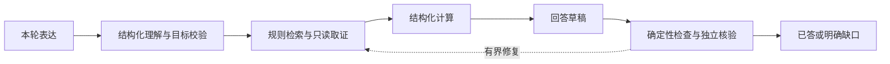
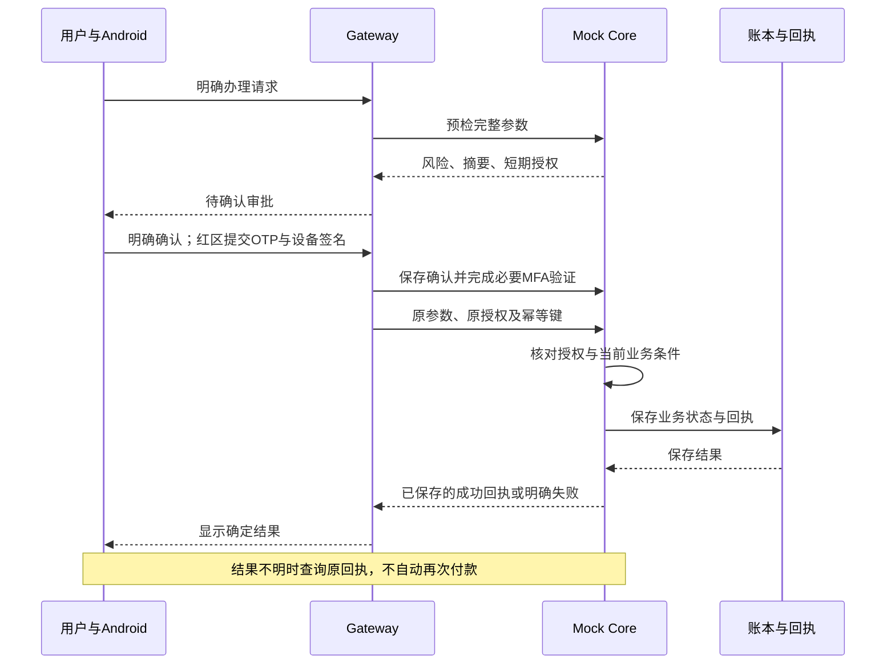

# 系统设计

安言是一套以自然语言为入口的银行 AI 智能体演示系统。本文说明组件、数据与端到端流程；账户、资金、产品、商户和履约结果全部为虚构数据。

Gateway 指对话网关，Core 指独立 Mock 银行核心；DAG 是描述任务依赖的有向无环图，MFA 是多因子验证，OTP 是一次性验证码，幂等表示重复提交同一请求不会产生第二笔业务结果。

## 设计目标

用户先表达目标，系统再澄清对象、核对条件并决定下一步。模型可以规划，但不能凭自然语言承诺取得执行权限。查询以当前证据为依据；写操作以服务端授权为前提；成功以持久化回执为准。

| 业务域 | 实现范围 | 边界 |
| --- | --- | --- |
| 转账与资金安排 | 联系人、多卡、转账、预约、AA 与资金预留 | 缺对象或金额先补问；预约创建不等于已转出 |
| 账户与账单 | 余额、流水、期间统计、分类与可疑交易核对 | 查询失败不等于没有记录；消费不能重建完整历史余额 |
| 理财 | 五类 25 款虚构产品、筛选、详情、测评与申赎 | 货架不是本人持仓；申赎受适当性与授权约束 |
| 卡片 | 卡包、额度、渠道、冻结与挂失 | 卡片状态与账户状态分开，变更后重新检查授权 |
| 订阅 | 登记记录、取消、提醒与重复交易候选 | 查询也需确认；不能证明真实商户合同状态 |
| 生日安排 | 联系人生日、锁资、提醒、Mock 订单草稿 | 不接入真实鲜花、蛋糕配送或退款 |

## 组件与信任边界

图 1：系统架构。模型处理语言和计划，Core 独立控制业务执行，运维操作使用单独的管理权限。

| 组件 | 技术与入口 | 职责 |
| --- | --- | --- |
| Android | Kotlin、Jetpack Compose、Keystore | 登录、对话、语音草稿、确认、设备签名、结果显示 |
| Gateway | FastAPI、LangGraph；`agent_api.py`、`bank_agent/` | 主体绑定、理解、任务状态、取证、生成与核验 |
| Core | FastAPI；`main.py`、`bank_core/` | 身份、对象归属、风险、授权、业务条件、账本与回执 |
| 模型服务 | 可配置 DeepSeek，语音可选 DashScope | 理解、取证规划、草稿和独立核验；不持有账本写工具 |
| 持久化 | 签名账本快照、SQLite 会话、审批、设备公钥与审计文件 | 单机数据与恢复，不提供分布式事务或银行清算 |
| 运维台 | `deploy/panel/` 与本地启动器 | 服务观察、演示账户配置、初始状态、备份和恢复 |

本机默认监听 Core 8000、Gateway 8100、面板 9100。服务器通过 HTTPS `/core/`、`/gateway/`、`/panel/` 转发，后端仍回环监听。飞书是可选的绑定后只读入口，不复用 App 完整生成核验链，也不执行资金业务。

## 查询与解释

1. 从有效会话确定主体，只读取该主体的上下文。
2. 归一化最多五项目标，校验行为、资源、字段和对象。歧义先澄清，不从旧话题猜金额或对象。
3. 检索同版本规则，通过固定只读工具取得本人当前记录。政策、本人事实、用户自述和读取失败分别保存来源。
4. 程序计算金额并保存操作数、字段和证据编号。
5. 草稿经程序检查和独立语义核验，按逐项目标返回已答、缺数据、待澄清、待确认、不支持或工具失败。预算耗尽后保留缺口。

订阅记录不在普通咨询免确认工具内，仍需原黄区流程。读取失败不应生成“没有订阅”之类的否定事实。

## 模拟办理

图 2：模拟办理时序。确认前不扣款，预检、动画或 HTTP 响应结束都不能代替成功回执。强验证针对具体审批；改收款人、金额、卡片或其他关键参数需要新的预检。

## 三类状态分开管理

| 对象 | 保存内容 | 不能赋予的能力 |
| --- | --- | --- |
| 讨论任务 | 同主体最多四项未完成意向、对象、缺槽与暂停状态 | 不是账户事实，不继承确认或 OTP |
| 待审批 | 不透明句柄、原参数、短期授权、有效期 | 不能跨主体、改参数、过期后继续使用 |
| 业务与回执 | 余额、流水、持仓、任务及已提交结果 | 不能通过删除会话、取消讨论或回退 DAG 撤销已完成资金 |

LangGraph 主流程为 `intent_parser → risk_checker → human_review / executor → responder`，复合任务经 `workflow_next` 推进。依赖节点只有在前置节点 `SUCCEEDED` 后才可继续。用户确认节点和 Mock 工单不代表真实坐席已经接管。

## 风险与提交契约

绿色为普通查询；黄色包括日累计不超过 1,000 元的小额转账和订阅查询、取消；红色包括超额转账、挂失、申购等。Core 按当前状态计算风险，转账累计考虑待执行授权，不能靠拆单规避升级。

授权绑定主体、会话、操作、对象、金额分值、备注与上下文摘要、有效期和唯一编号。Core 保存确认，核对必要 OTP 和登记设备签名，并在提交前再次检查业务条件。查看完整虚构卡号是单独的会话加密码验证路径，不等同资金业务 MFA。

账本写入在锁内执行，保存业务与幂等回执后才返回成功。写盘失败返回 503 并回滚本次内存业务和回执；加载签名快照失败时冻结写操作并保留原文件。这是单机故障保护，不是跨进程、多节点或所有断电场景的事务保证。

## 运行与观察

本地启动器将代码、配置与运行数据分离；云端由 systemd 管理，Nginx 提供 HTTPS。Core 与 Gateway 使用关联请求标识记录决策事件和结果，不公开模型私有思维链。审计文件具有哈希链，但管理员仍能整体替换文件与密钥。

语音先进入草稿；云端回退需同意。理财公开目录和本人持仓分别读取。飞书依附有效 App 会话，资金操作返回 App。运维账户管理仅适用于演示环境，执行备份、停止服务、校验、写入和重启流程。

## 验证与限制

系统分别使用后端回归、Android JVM 与设备测试、多轮联网任务和故障测试核对不同边界。构建通过不代表设备验证完成，单轮成功不代表长期稳定。模拟用户和核验器可能共享模型偏差。

当前不提供真实银行对接、生产认证、操作系统级代码隔离、多实例高可用或真实商户履约。表达式子进程、异常熔断和提示词防御降低部分风险，不能替代网络隔离、密钥托管、安全评估与部署运维。
