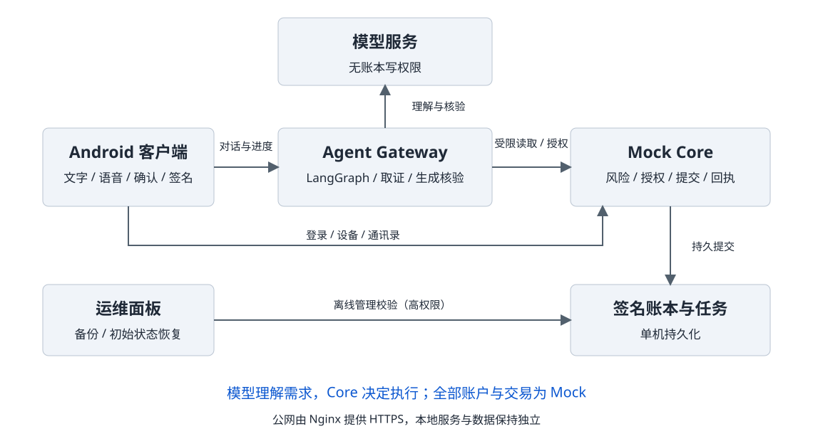
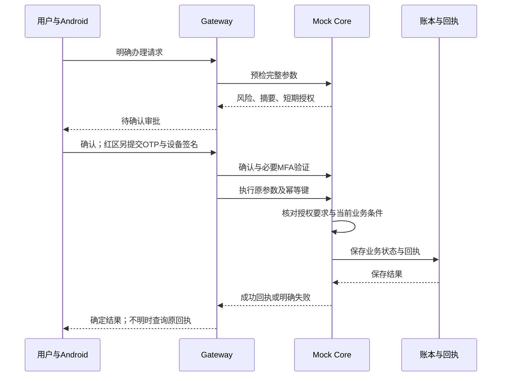

# 安言技术文档

作品名称：安言：安全可控的银行 AI 智能体。文档日期：2026-11-02。

本文说明作品的需求、系统架构、业务链路、数据模型和验证依据。实现核对以仓库源码为准，实际部署和各版本测试结果见[验证记录](验证记录.md)。全部账户、资金、产品、商户与履约结果均为虚构数据。

## 作品目标与实现范围

安言探索用自然语言串联银行查询与模拟办理，减少用户寻找业务入口、重复填写参数的操作。文字或语音只负责表达需求；资金操作仍需明确对象与金额、用户确认，以及业务要求的额外验证。

| 场景 | 当前实现 | 业务边界 |
| --- | --- | --- |
| 转账与资金安排 | 联系人解析、付款卡选择、小额与大额转账、预约、AA、资金预留 | 缺少对象、金额或执行时间时先澄清；预约创建不等于资金已转出 |
| 账单与账户查询 | 余额、流水、期间消费与分类分析，支持多目标取证计算 | 不能用支出合计重建完整历史资金来源；查询失败不解释为没有记录 |
| 理财 | 五类 25 款虚构产品、搜索筛选、净值与详情、风险档案、申购赎回 | 公开货架不等于本人持仓；申赎需适当性检查与红区授权 |
| 卡片 | 卡包、日额度、渠道开关、冻结解冻与挂失解挂 | 冻结针对单张卡，不是冻结整个账户；变更按业务重新授权 |
| 订阅 | 登记记录查询、取消与提醒，重复交易推断候选 | 订阅查询也需黄区确认；登记或推断不能证明真实商户合同与会员权益 |
| 生日联动 | 联系人生日、提醒及 Mock 订单草稿与办理 | 仅本机商户模拟，不提供真实配送、退款或履约保证 |

多轮讨论支持补充、暂停、更正、插问与恢复。模型识别到“想办理”不等于获得执行授权；“先问费用”与“现在办理”分别处理，停止讨论也不等于撤销已完成交易。

## 系统架构

可编辑图源为 `assets/系统架构图.mmd`。

| 层次 | 技术与主要模块 | 职责与边界 |
| --- | --- | --- |
| Android 客户端 | Kotlin、Jetpack Compose、Keystore | 登录、文字与语音草稿、业务入口、审批摘要、明确确认、设备签名和结果核对；不能自行决定风险或改账本 |
| Agent Gateway | FastAPI、LangGraph；`conversation.py`、`bank_agent/` | 管理同主体会话、讨论与审批句柄，编排理解、取证、计算、回答与核验 |
| 模型服务 | 可配置 DeepSeek；可选百炼语音转写 | 理解与规划、生成草稿及独立核验；不持有账本写工具，输出仍需程序校验 |
| Mock Core | FastAPI；`bank_core/`、`bank_security/` | 会话与对象归属、风险、授权、业务条件、设备证明、幂等提交与核心回执 |
| 数据层 | 签名账本快照、SQLite 会话、审批存储、设备公钥、审计文件 | 单机保存、完整性校验与故障恢复；不提供多实例事务、高可用或生产银行清算 |
| 运维面板 | `deploy/panel/` | 备份、配置演示账户、保存和恢复初始状态、服务控制；属于独立的高权限维护路径 |

本机 Core、Gateway、面板分别使用 `127.0.0.1:8000`、`:8100`、`:9100`。云端通过 Nginx HTTPS 转发 `/core/`、`/gateway/`、`/panel/`，后端仍回环监听。可选飞书使用固定只读接口与原生卡片，不复用 App 的完整生成核验链路，资金办理回到 App。

## 两条主要处理链路

### 查询与解释

1. Gateway 从有效会话取得主体，读取该主体的会话状态；模型理解本轮行为、问题目标、对象及讨论命令。
2. 程序检查能力与字段白名单，绑定原文及已核验对象。缺对象、多对象歧义或范围外请求分别澄清或说明，不用旧值猜测。
3. 只读规划器检索版本化规则，按目标读取本人事实。公开政策、用户自述、真实记录与失败信息分别保存来源。
4. 金额计算由程序执行，结果保留操作数及证据编号；最终答复只使用本轮有效证据。
5. 草稿先经过确定性检查，再独立核验事实支持、切题与逐项目标覆盖。在预算内补查或改写；仍有缺口则明确未完成，安全回退不能算自然回答全部通过。

该链路不能签发新的资金授权。订阅记录不在普通只读工具白名单中，需要另走原确认协议。

### 模拟办理

审批需要绑定原主体、业务、对象、金额和其他影响结果的参数。确认前不扣款，红区还要求演示 OTP 和登记设备签名；预检成功、动画结束或请求发出均不能显示为交易成功。

`human_review` 是图中的用户确认节点，不代表真实银行坐席已接管。工单与人工处理入口属于 Mock 业务流程，不能用来宣称真实客服审核已完成。

## 讨论状态、审批状态与业务状态

| 状态对象 | 保存内容 | 可做与不可做 |
| --- | --- | --- |
| 讨论任务 | 业务、对象、缺失字段、暂停或待输入状态；同主体最多四项 | 可恢复或更正需求；不保存确认权限，不提供余额事实，不继承旧授权 |
| 当前查询目标 | 最多五项目标，分别保存行为、资源、字段、对象与证据要求 | 逐项标记已答、缺数据、待澄清、待确认、不支持或读取失败 |
| 待审批记录 | 不透明句柄、原参数、短期授权及有效期 | 只能由原主体确认、取消和提交；咨询插问不能悄悄改写原金额与收款人 |
| Core 业务状态与回执 | 余额、流水、任务、产品持仓及已提交操作结果 | 由 Core 校验和保存；已完成资金不能通过删除讨论或重置页面撤回 |

执行结果区分 `SUCCEEDED`、`PARTIAL_SUCCESS`、`NEEDS_INPUT` 等业务状态。HTTP 请求成功或会话一轮结束，不代表每项目标都已完成。

## 数据保存与一致性

| 数据 | 保存方式 | 重启与故障语义 |
| --- | --- | --- |
| 业务账本、任务与支持持久回执的幂等记录 | 配置 `BANK_LEDGER_STORE_PATH` 后保存完整快照 | 在同一临界区提交；写盘失败回滚，损坏快照拒绝加载并冻结写入。未配置路径时仅为内存演示 |
| 会话与待审批 | SQLite checkpoint 及独立审批存储 | 可保存对话或待核对状态；不代表 Core 旧会话与安全凭证重启后仍可执行 |
| 登录、短期授权及临时验证状态 | 进程内安全状态 | Core 重启后须重新登录，必要时重新预检与确认 |
| 设备公钥 | 可配置独立持久文件 | 校验完整性后加载；Android 私钥留在 Keystore，不作为场景数据导出 |
| 审计 | Core／Gateway 各自的脱敏事件与哈希链文件 | 可核对部分修改与重启历史；文件管理员仍可整体替换，缺少外部不可抵赖锚点 |

持久写入先形成临时文件，刷新并替换原文件，成功后才发布业务成功回执和相应成功审计。写盘失败恢复本次业务、任务及幂等缓存，已消费安全材料保持已消费，后续办理须重新确认。此方案依赖单进程锁与文件替换，不等同数据库事务或完整断电保证。

响应丢失时读取原操作回执，禁止自动改用新请求重复付款。联系人删除也先确认，再调用服务器；成功或只读核对后才更新列表，旧读取不能把删除项带回。

演示账户在创建或首次保存时保留初始状态。维护操作先停服务与备份，校验后保存、重载；单账户恢复不撤回已结算转账，不改动其他账户。详情见[部署说明](../deploy/README.md)。

## 接口与源码定位

以下是核对链路的代表入口，完整参数以源码定义及运行服务的 API 文档为准：

| 接口或模块 | 用途 |
| --- | --- |
| `POST /api/v1/auth/login` | Core 登录；私有资源请求使用有效会话，裸用户编号不能代替认证 |
| `POST /api/v1/agent/messages`、`/messages/stream` | Gateway 普通与 SSE 会话入口；进度事件不等于最终成功 |
| `POST /api/v1/agent/approvals/{approval_id}` | 解析原主体的审批决定；红区经对应 OTP／challenge 接口获取演示验证材料 |
| `POST /api/v1/risk/precheck`、`/precheck/operation` | Core 预检转账及其他操作 |
| `POST /api/v1/risk/confirm`、`/risk/mfa/verify` | 服务端记录确认、验证强因子 |
| `POST /api/v1/transfers/execute`、`/operations/execute` | 核心执行及回执；重试受幂等键、请求摘要和单次授权共同约束 |
| [图与状态](../bank_agent/graph.py)、[讨论任务](../bank_agent/dialogue_state.py) | 图节点、路由与讨论状态 |
| [查询协议](../bank_planning/requests.py)、[证据会话](../bank_agent/evidence_session.py)、[计算](../bank_agent/computations.py) | 目标约束、共享预算、来源与操作数 |
| [授权](../bank_security/authorization.py)、[幂等](../bank_core/idempotency.py)、[持久化](../bank_core/persistence.py) | 执行控制和提交语义 |

## 客户端与多通道实现

理财首页按活钱管理、稳健低波、稳健增值、稳中求进和进取投资展示 25 款虚构产品，沿用产品编号、风险等级与适当性规则。单一完整成功集合在聊天中去重；比较、混合查询、失败或不完整结果保留必要正文。见[理财界面](理财界面.md)。

语音使用底部面板，长按采集、松开转写、上滑取消，波形来自实际 PCM。本机识别优先，缺少端侧能力时经用户同意使用云端转写；结果只填入草稿，用户核对后发送。取消使晚到结果失效，但不能撤回已上传音频。见[语音输入](语音输入界面.md)。

联系人迁移只纠正原演示身份与关系，保留自定义内容和删除状态。办理历史两栏独立筛选；思考头像静止，旁边为原生 shaping 点阵轮廓动画。见[交互细节](交互细节.md)。

## 运行、验证与已知限制

Python 支持 3.10–3.12；Android 使用 JDK 17/21、SDK API 37、Build Tools 36.0.0，具体依赖以仓库配置为准。本机入口为 `start-local-panel.bat`、`start-emulator.bat`，完整步骤见[本地开发](本地开发.md)。公网演示 APK 绑定 HTTPS 地址与项目 CA，真实配置与私钥不随源码交付。

最近一次完整后端历史记录为 3147 passed、1 skipped；最终 shaping 客户端历史 JVM 记录为 140 passed。随后目录整理工具专项为 19 项通过。它们属于不同范围，不能相加；shaping 最终版本未重跑设备专项。本次文档完善不改变历史成绩，相关专项及执行日期见[验证记录](验证记录.md)。

项目没有接入真实资金、短信与商户履约；同模型生成和核验可能发生相关错误，演示设备登记与验证码也低于生产认证强度。尚需补充真实 ASR、完整真机、飞书平台撤权和冻结版本的持续观察与重复任务验收。机制与风险分别见[核心算法](核心算法说明.md)、[安全设计](安全设计文档.md)、[安全自评](安全自评报告.md)及[稳定验收标准](稳定验收标准.md)。
