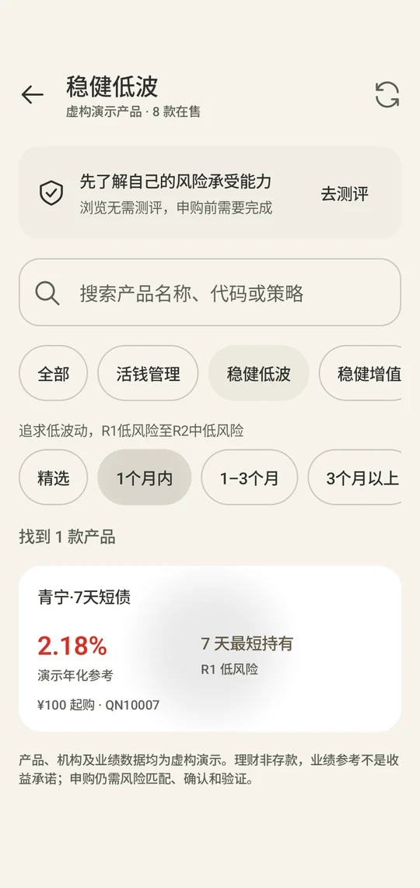

# 理财频道

理财频道提供公开虚构产品的浏览、筛选和详情，聊天承接解释与明确办理。所有机构、经理、净值和业绩为演示数据，不能作为投资建议或收益承诺。

## 产品组织

| 分类 | 风险范围 | 数量 | 浏览方式 |
| --- | --- | --- | --- |
| 活钱管理 | R1 低风险 | 4 | 横向产品卡片 |
| 稳健低波 | R1–R2 | 5 | 卡片与持有期限筛选 |
| 稳健增值 | 以 R2 为主 | 5 | 列表与期限筛选 |
| 稳中求进 | 以 R3 为主 | 5 | 多资产、打新、量化等策略筛选 |
| 进取投资 | R3–R5 | 6 | 列表与风险筛选 |

合计 25 款；原有五款产品编号保留。栏目名不改变产品等级，R2 仍为“中低风险”，R3 为“中风险”。公开目录不证明本人持有这些产品。

首页展示持仓本金与展开入口、风险档案、搜索和分类；完整列表支持名称、代码与策略搜索。详情展示净值、历史业绩、配置、费用和申赎条件。申购把明确产品与金额带回聊天，Core 再检查测评、适当性、余额、确认和授权，详情页不直接扣款。

## 数值与缺失数据

R1 / R2 使用“演示年化参考”，R3–R5 使用“近1年涨跌幅（演示）”。没有数据时显示“—”，不补零；正负值采用语义色。风险、期限、起购金额和费用应能直接查看。净值日期随银行演示日期投影，收益计算保持同一时间范围。

风险问卷由用户作答，模型不能代填或伪造已经完成的测评。低风险分类不代表保本，适当性匹配也不是收益保证。

## 聊天去重

成功且字段完整的单一产品集合显示简短引导和分类卡片，不逐项重复相同正文；完整持仓集合同理。比较、重点解释、混合业务、失败或不完整数据仍保留文字。待确认、需输入和待核对回执不得渲染为正常产品成功卡片。保存的聊天再次打开也遵守相同规则。

## 数据与测试入口

[`wealth_catalogue.py`](../bank_core/wealth_catalogue.py)提供货架与名称解析，[`wealth_data.py`](../bank_core/wealth_data.py)提供详情与日期投影。新增分组字段不删除原 API 字段，重载目录不重置个人余额、持仓或账户初始状态。Android `WealthMarketplaceModel` 处理分组、筛选与结构化展示。

后端回归包括 `tests/test_wealth_market_data.py`、`tests/test_computation_evidence.py`；Android 包括 `WealthMarketplaceTest`、`DisplayTextTest`、`WealthMarketplaceUiTest`、`WealthPresentationUiTest`。设备用例核对筛选、深色大字体、单次展示和详情点击，不执行真实支付。[测试与范围](测试用例.md)
