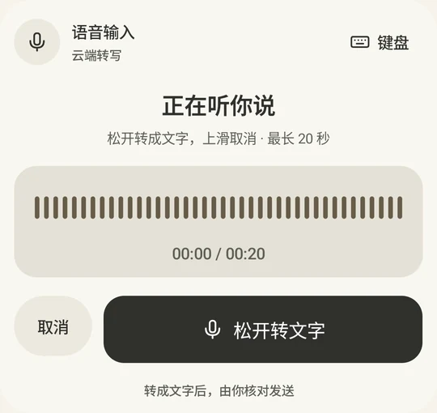
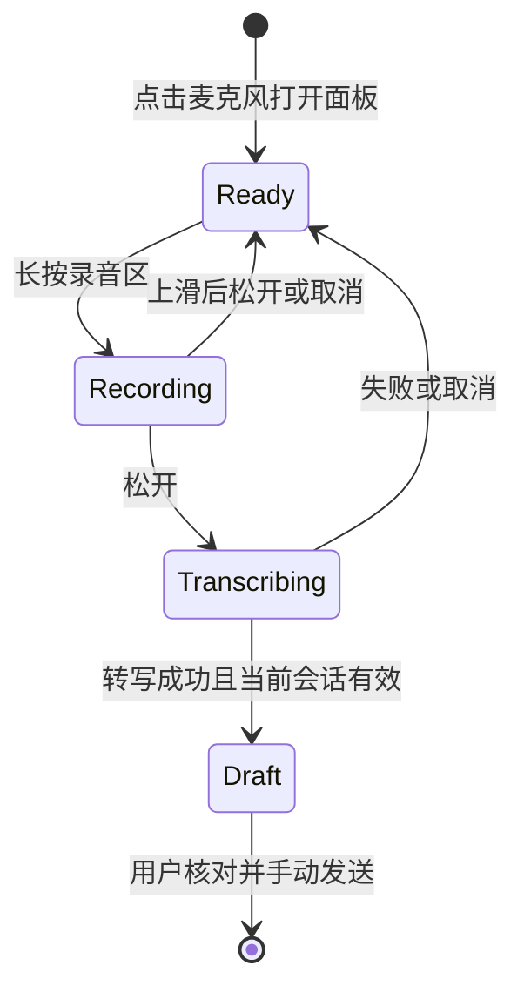

# 语音输入

语音是文字草稿的输入方式，不是免确认的业务通道。当前交互为**长按采集、松开转写、上滑取消**，不使用“点击开始，再点击完成”的旧流程。

## 状态与手势

打开面板不会自动录音。上滑约 96 dp 进入取消区域，松开后放弃该段；重新长按创建新的采集，不复用旧识别任务。单段最长约 20 秒，转写等待约 35 秒，超时提供重试机会。

“取消”、切换键盘、返回、离开页面或应用进入后台，都使当前采集或转写失效。异步回调必须核对会话代次，上一段迟到结果不能填进下一段草稿。转写失败保留用户原有输入，不自动重发原音频。

## 端侧优先与云端回退

优先尝试设备可用的端侧识别。端侧能力因系统、语言和安装的识别服务而异；不可用时，经用户同意才向后端发送录音进行云端转写。后端使用可配置的 DashScope ASR，默认值见[配置样例](../.env.example)。不在 APK 内放供应商密钥。

云端录音会离开设备，不能以“本地部署后端”暗示全链路离线。麦克风拒绝、无识别服务、断网、服务错误和空结果均应明确显示；用户仍可使用键盘。中间文本如可用只作预览，不是最终指令。

## 核对与验证

转写文字只进入草稿，用户核对姓名、金额后手动发送，后续仍遵守查询、确认和强验证协议。不能把识别成功或草稿生成显示为办理成功。

回归应覆盖：无权限打开、首次同意、长按松开、上滑取消、取消后开始新段、转写中离开页面、后台恢复、延迟结果、空文本和大字体。Android 状态测试和设备手势测试分别运行，构建测试 APK 不代表设备交互已验收。[测试用例](测试用例.md)
