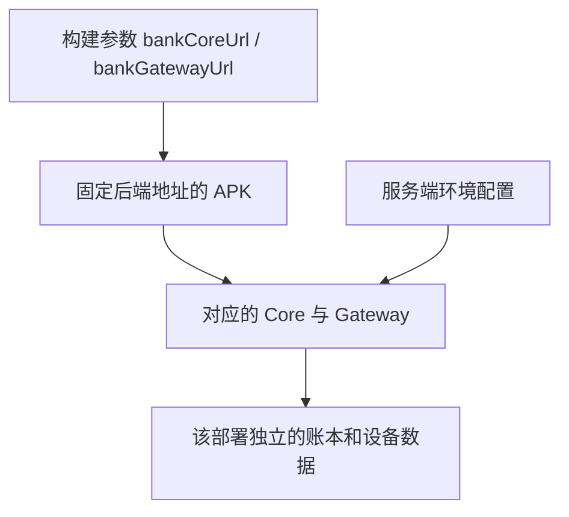

# 运行与部署

安言的源码可运行在本地电脑，也可部署到自己的服务器。两种方式使用同一套 Core 和 Gateway，数据、配置和客户端地址分别管理。本文帮助选择路径和排查连接问题。

## 选择运行方式

| | 本地电脑 | 自有服务器 |
| --- | --- | --- |
| 适合 | 开发、隔离演示、改代码 | 远程体验、长时间演示、小规模联调 |
| 后端入口 | Core 8000、Gateway 8100，仅回环 | Nginx 443，反代 `/core/` 与 `/gateway/` |
| 管理面板 | `http://127.0.0.1:9100` | HTTPS `/panel/`，独立访问令牌 |
| 配置 | 启动器数据目录的 `local.env` | `/etc/anyan/anyan.env` |
| 数据 | 本地独立目录 | `/var/lib/anyan` |
| 客户端 | 预构建本地 APK，或模拟器 / USB 定向构建 | 按自己的 HTTPS 地址与 CA 构建 |
| 操作步骤 | [本地开发](本地开发.md) | [服务器部署](../deploy/README.md) |

公开源码不携带作者的 API Key，不保证某个作者云端实例或旧 APK 长期可用。请为自己的部署配置模型服务。安装现成 APK 前，应从提供者确认地址、来源提交、签名及服务可用范围。

[本地版 Release](https://github.com/Zagadka-3906/ai-banking-agent/releases/tag/v2.0.0-beta.1) 提供模拟器与 USB 两个 APK、中文运行指南、SHA-256 和来源清单。两包只连接本机后端，需要使用者自己的模型 Key，不会自动连接作者云端。GitHub 自动提供该标签的源码归档，完整安装步骤见附件 `LOCAL-SETUP.md`。

## 构建地址与配置分层

App 没有运行时服务器地址切换入口。启动另一套后端、修改 `.env` 或连接同一 Wi-Fi，不会改变已安装 APK 的地址；切换需要重新构建和安装对应 APK。

模型密钥只配置在后端。手机不接收 DeepSeek Key、面板令牌或服务器 SSH 身份。更换服务器地址或项目 CA 后需要重新构建客户端。

## 本机启动器的配置生效规则

启动器第一次复制仓库 `.env` 到独立目录的 `local.env`，以后沿用该副本。修改模型、端口或持久化配置前，先从 `status` 和启动输出核对正在运行的实例与数据目录。保存 `local.env` 后重启相关服务。

默认 Core 8000、Gateway 8100、面板 9100、控制端口 19111。不能用按端口结束进程的方式“修复”冲突；先确定进程归属，再正常停止原实例。

## 账户、验证与数据

- 初始演示登录：`user_zhang`、`user_li`、`user_wife` / `Bank@2026`，面板可修改虚构账户。
- 安全查看完整虚构卡号：演示密码 `24681012`。连续错误会限次锁定，成功显示后会自动隐藏。
- 红区：先登记设备，使用设备屏幕锁与签名；演示 OTP 由 App 获取，不是真实短信。
- Core 重启后重新登录；飞书绑定依赖有效 App 会话，需要重新绑定。
- 不同部署的余额、订阅、待办和审批不自动同步。修改和重置账户后也应重新登录核对。

已完成的跨账户转账不因单账户恢复初始状态而撤销。恢复演示场景需要先确认范围并保留备份，不能将重置当作现实资金冲正。

## 常见问题

| 现象 | 优先检查 |
| --- | --- |
| 服务健康但对话不能完整回答 | 当前实例的模型 Key、额度、模型名称和网络；健康接口不证明模型调用成功 |
| 改了 `.env` 没变化 | 是否应改启动器数据目录内的 `local.env`；是否重启了实际实例 |
| 模拟器连接不上 | 构建是否使用 `10.0.2.2`；宿主服务是否启动；端口是否被别的实例占用 |
| USB 手机连接不上 | APK 是否使用 `127.0.0.1`；`adb reverse` 是否建立；是否选中了正确设备 |
| 云端证书错误 | 地址、APK 内 CA 与服务器证书是否匹配；不要关闭 TLS 校验绕过 |
| 只有固定回答、模型理解很弱 | 未配置模型或处于降级路径，不能当作完整 LLM 体验 |
| 写入返回 503 | 检查磁盘、权限与 `ledger_persistence`；保留原文件，不自动重复付款 |
| 旧提案无法继续执行 | 会话、参数、有效期或业务状态已变，重新读取并发起新提案 |

## 更新流程

先验证并提交源码，再更新自己的服务器或重新构建 App。GitHub push 不自动发布服务、更新证书或替换已安装 APK。保留数据库、账本、设备密钥和模型配置；部署后重新检查健康、登录、查询、确认、回执与失败路径。

实际验证范围见[验证记录](验证记录.md)，可复现业务路径见[测试用例](测试用例.md)。
