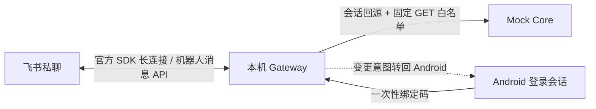

# 飞书机器人接入与配置

**2026-10-15 本轮平台状态：** 用户实发“本轮验收”后无回复，SDK 获取租户访问令牌时返回平台策略拒绝 `21001`；只读令牌探针也返回 21001，未取得令牌。需应用管理员或飞书支持处理访问策略后重验。历史文本收发证据保留，不代表当前仍可用；本轮卡片渲染、绑定/分类查询、撤权等未通过平台验收。可运行 `scripts/diagnose_feishu_access.py` 获取不含密钥的诊断，详见[参赛验收](参赛完善与验收-2026-10-15.md)。

本项目使用飞书官方 Python SDK 的 WebSocket 长连接，由电脑本机 Gateway 主动连接飞书；无需公网回调地址。接收 `im.message.receive_v1`，仅处理用户与机器人的**私聊文本**，通过官方 `im.v1.message.create` 发送回复。仓库已实现 SDK 适配、一次性绑定、会话校验和只读查询。用户已发布自建应用，并以截图证明真实平台的私聊文本收发；**原生卡片代码通过本机测试，平台渲染仍需重新发送查询验收**。App ID 与 App Secret 只放在本机 `.env`，不提交仓库。

## 在飞书开放平台创建应用

1. 登录[飞书开放平台](https://open.feishu.cn/)，进入**开发者后台**，创建**企业自建应用**，填写名称“安言银行智能体（演示）”等信息。长连接模式适用于企业自建应用。
2. 在**凭证与基础信息**复制 `App ID`；仅在本机保存 `App Secret`，不要粘贴到聊天、截图、仓库或演示视频。
3. 在**添加应用能力**中启用**机器人**。
4. 在**权限管理**申请最小应用权限：`im:message.p2p_msg:readonly`（接收发给机器人的私聊消息）和 `im:message:send_as_bot`（机器人发送消息）。不申请群消息、以用户身份发送消息、通讯录、云文档或审批权限。
5. 在电脑安装 `requirements-feishu.txt`，设置 `.env`，启动 Core 和 Gateway。确认 Gateway 日志没有连接错误。然后在应用**事件与回调 → 事件配置**把订阅方式设为**使用长连接接收事件**。平台保存设置时可能要求长连接已经在线。
6. 添加**接收消息 v2.0**事件 `im.message.receive_v1`，应用身份订阅。创建应用版本，设定可用范围为演示账号，提交发布并按企业策略完成管理员审核。应用权限或事件变更后须重新发布才可能生效。

官方参考：[Python SDK 仓库](https://github.com/larksuite/oapi-sdk-python)、[发送消息 API](https://open.feishu.cn/document/server-docs/im-v1/message/create)、[飞书机器人能力说明](https://www.feishu.cn/content/383321056779)。开放平台页面字段随版本可能变化，以控制台实际提示为准。

## 本机安装与启动

在仓库根目录运行：

```powershell
.\.venv\Scripts\python.exe -m pip install -r requirements-feishu.txt
if (-not (Test-Path .env)) { Copy-Item .env.example .env }
```

在 `.env` 中填入以下三项：

```dotenv
BANK_FEISHU_ENABLED=1
FEISHU_APP_ID=cli_你的应用ID
FEISHU_APP_SECRET=仅在本机填写真实AppSecret
```

然后执行 `start-emulator.bat`；也可在两个 PowerShell 窗口运行：

```powershell
.\.venv\Scripts\python.exe -m uvicorn main:app --host 127.0.0.1 --port 8000
.\.venv\Scripts\python.exe -m uvicorn agent_api:app --host 127.0.0.1 --port 8100
```

不要用 `--workers` 或 `--reload` 启动 Gateway：绑定码与飞书用户映射存放在单进程内存，多进程会让事件和登录请求落到不同实例。`GET http://127.0.0.1:8100/api/v1/im/feishu/status` 返回 `enabled` 和本机监听线程状态；`listener_started` 仅表示线程已启动，**不能证明飞书已建立连接**。长连接需要电脑能够访问飞书开放平台。Core 和 Gateway 仍只监听 `127.0.0.1`。

## 用户绑定与演示

1. Android 模拟器登录虚构银行账户，点击聊天页右上角**设备管理**，在“飞书私聊查询”卡片点击**获取绑定码**。绑定码 5 分钟有效，只显示在本次面板中。
2. 在飞书中找到刚发布的机器人，进入**私聊**，发送 `/绑定 <绑定码>`（中间一个空格）。机器人回复“绑定成功”。不要在群聊输入绑定码。
3. 发送“查余额”“查看本月账单”“分析上月消费”“查看卡片”“查看我的订阅”或“有哪些理财产品”，应收到来自本机 Core 的原生消息卡片：余额突出可用金额，账单按条目和分类展示，理财展示产品、风险、基准与起购条件。发送“转账 300 元”会显示回 Android 办理的提示卡片。所有飞书卡片均没有交易操作按钮；飞书消息不能完成确认或付款。
4. 在飞书发送 `/解绑`，或在 Android 面板点击**解除飞书绑定**。银行会话过期或 Gateway 重启后需重新绑定。

分类查询可说“查看本月餐饮账单”“分析上月交通支出”；当前支持餐饮（含吃饭、伙食）、购物、交通（含打车、通勤）和退款。日期与分类一起传给 Core，流水和统计使用相同筛选条件，卡片显示时间及类别；没有匹配记录时显示空结果。未指定分类仍查询全部类别。多分类、排除分类及无法支持的日期／分类条件会提示回 App 核对，不会悄悄改成全量账单。Core 的 `transactions` 和 `bill-analysis` 查询接口均接受可选的 `category` 参数，按已记录类别精确匹配。

如需命令行复核绑定码 API，可用已登录取得的 `session_token` 调用 `POST http://127.0.0.1:8100/api/v1/im/feishu/binding-code`，请求头为 `X-Session-Token`。不要在命令行历史或演示录屏中展示真实令牌和绑定码。

## 安全边界与联调检查



飞书事件由官方 SDK 长连接鉴权；代码同时核对应用 ID、私聊类型、用户发送者、事件时间与事件编号。重复或过期事件不处理。绑定键取飞书 `open_id`，银行主体仅由 Core 验证的会话得出；飞书文本不会被当作银行身份、审批、OTP 或设备签名。消息正文与 App Secret 不写入审计。处理事件先入有界队列，再异步调用 Core 与发送 API，以满足飞书的短时事件确认要求。队列满时回调失败，由平台重推；单机重启会丢失队列中的消息和绑定。

本机测试见 `tests/test_feishu_im.py`。用户截图已验证私聊绑定后的余额、账单、理财文本回发，以及变更请求转回 Android。代码更新并重启 Gateway 后绑定会丢失，需重新获取绑定码。仍需手工验收卡片渲染、群聊无回复、重复事件只回一次、错误绑定码、会话过期、Android 解绑、飞书应用撤权和离线恢复，并将记录填入 `验证记录.md`。
