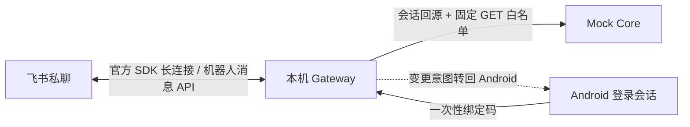

# 飞书机器人接入与配置

**2026-10-15 最新平台状态：** 用户创建企业后，新建并发布企业自建机器人「安言银行智能体（企业验收）」1.0.0，保留原应用。新应用租户令牌接口 HTTP 200 / code 0，平台长连接验证显示“连接成功”。真实私聊的纯文本、紫色原生卡片均发送成功，监听收到同一参与者的“验收通过”；用户确认中文和换行正常。随后从普通 Android Debug 客户端实际登录、获取一次性绑定码，用户确认绑定、余额和本月餐饮账单查询正常。各项业务验收范围见[验证记录](验证记录.md)。旧应用的 21001 根因仍未取得平台确认，不能把新应用可用写成旧应用策略已解除。

## 本轮企业发布配置

- 应用为已启用、已发布的 1.0.0；可用范围只包含本轮企业测试成员，未开放外部私聊或外部群共享。其他体验人员须先加入同一企业并纳入应用可用范围。
- 机器人能力已启用；应用身份权限仅为 `im:message.p2p_msg:readonly`、`im:message:send_as_bot`。使用长连接接收应用身份事件 `im.message.receive_v1`，这些配置已随版本发布。
- 本机 `.env` 已切换到新应用，旧配置在本机忽略目录私密备份。App Secret、令牌、绑定码、成员标识和原始运行日志均不入库；没有删除或重置旧应用。
- 独立消息验收结束后，再运行标准单进程 Core / Gateway，避免同一应用的两个长连接实例争抢事件。独立消息验收的 `complete: true` 只覆盖文本、卡片发送及人眼确认，账户绑定和查询另验。

## 21001：管理员排查与恢复验收

以下保留旧应用的故障排查记录和再次发生时的处理步骤，不表示新企业应用仍被拒绝。2026-10-15 追加排查中，用户曾确认**有企业管理后台，在应用管理中能找到机器人，App ID 与本机配置一致**，随后实际访问管理后台提示无权限或没有企业，用户新建企业后完成上面的新应用发布。对旧应用分别使用环境代理配置、忽略环境代理的独立直连会话，官方租户令牌接口均返回 HTTP 200 / `21001`，未获得令牌。拒绝发生在业务消息发送之前；更换卡片 JSON、重发聊天消息不能解决这一阶段的问题。网络对照只缩小排查范围，不能证明所有中间网络因素均已排除。

进一步核对本次错误提示为：`Access denied due to platform policy. If you have questions, contact customer support for help.` 这是平台明确要求联系支持，**不等同于已证明企业管理员配置错误**。因此基础配置自检之外，管理员应优先提交平台支持工单；不能承诺靠某个后台开关解除。探针将这一已知报文精确映射为 `policy_hint: contact_platform_support`，不回显原始消息。只有平台返回另一条明确要求联系管理员的已知报文时，才标记 `contact_administrator`；不能仅凭错误码推断两者相同。

目前没有取得该企业的策略命中记录，**尚不能确定是哪条规则，也不能保证修改下表任一项就能消除 21001**。以下把应具备的消息接入配置与需要平台定位的拒绝分开处理；不要为了测试关闭企业全局安全策略。

### 管理员逐项核对

在[飞书管理后台](https://www.feishu.cn/admin)和[开放平台开发者后台](https://open.feishu.cn/app)选择同一企业、同一 App ID。菜单名称可能随企业版本不同；缺少菜单时由超级管理员或具有相应权限的管理员检查。

| 入口 | 应达到的配置 / 操作 | 与本次故障的关系 |
| --- | --- | --- |
| 企业管理后台 → 工作台 → 应用管理 → 当前应用 | 应用为**启用**；可用范围包含本轮测试成员，成员没有同时落入禁用范围 | 基础使用条件。若已满足则保留；不能据此宣称 21001 已修复 |
| 开放平台 → 添加应用能力 / 应用功能 → 机器人 | 已启用机器人能力；应用类型为企业自建应用 | 本项目使用自建应用令牌接口和官方 SDK 长连接 |
| 开放平台 → 权限管理 → 应用身份权限 | 已开通并审批 `im:message.p2p_msg:readonly`（读取用户发给机器人的单聊消息）、`im:message:send_as_bot`（以应用身份发消息） | 令牌恢复后收发文本和卡片需要。不是已确认的 21001 原因；无需追加通讯录、云文档、全量群消息权限 |
| 开放平台 → 事件与回调 → 事件配置 | 订阅方式为**使用长连接接收事件**，订阅**接收消息 v2.0** `im.message.receive_v1` | 恢复后接收用户私聊需要；保存长连接配置时可能要求本机监听已在线 |
| 开放平台 → 版本管理与发布 | 上述权限、能力、事件和可用范围包含在**审核通过、已发布**的当前版本中；有待审核变更则完成审核发布 | 防止只保存草稿而线上配置未生效 |
| 企业管理后台 → 安全合规 → 策略中心 → 策略管理；或访问安全 → 访问策略管理（如企业已开通） | 检查本次请求是否有对应拒绝记录，核对规则的主体、资源、动作、条件及生效范围；**只有明确命中本应用/本轮合法访问时**，由管理员审批针对性调整或例外 | 官方文档说明这些入口可配置访问条件，但没有公开证据证明本次令牌拒绝一定来自它们。找不到命中记录就交飞书支持定位，不要凭空创建放行规则 |

其中“启用且测试成员在可用范围”可这样操作：电脑端打开企业管理后台，切换至当前 App ID 所属企业，进入「工作台 → 应用管理」搜索并打开机器人；应用状态应为「已启用」或启用开关已打开，若为「已停用」则执行启用并保存。在详情的「可用范围／可用性」找到配置或编辑入口，添加实际发消息的企业成员（或确认该成员已包含在选中的部门中），保存后重新查看；如另有禁用成员/范围，确认该成员未被禁用。只增加本轮测试人员，无需为了验收选择全员。测试人员在客户端也要切换至同一企业身份，不能仅凭手机号或显示名相同判断。

若企业后台只显示范围而不提供编辑入口，由应用开发者在开放平台「版本管理与发布 → 创建版本」配置可用范围、保存并申请发布，再由企业管理员审核；确认最终状态为已发布。看到「停用」这个操作按钮通常表示当前应用已经启用，不要误点；以页面明确的状态为准。官方路径参考：[启用/停用开关](https://www.feishu.cn/content/134621645470)、[版本中的可用范围与发布审核](https://www.feishu.cn/content/7322412222340825091)。这些操作只确认基础可用条件，不能据此宣布平台 21001 已恢复。

开放平台「安全设置 → IP 白名单」与企业「网络围栏」是不同功能。本次没有证据指向某条白名单；不要把 `0.0.0.0/0`、内网地址或任意代理 IP 填进去试错，也不要把客户端登录/文件访问策略直接当成应用令牌策略。若支持或调用日志明确指出来源 IP 拒绝，再按该功能要求配置本机服务实际使用的受控公网出口。

后台配置已正确但仍返回 21001 时，由管理员在开放平台服务端调用日志（如可见）检索下面诊断报告中的 Log ID / Request ID；没有记录或看不到具体策略时，从开放平台的技术支持入口提交工单，要求查询**租户令牌接口命中的策略与规则 ID、规则归属、可调整入口及恢复条件**。不能假定“重置 Secret”“企业认证”“付费升级”或换 SDK 就能解除拒绝。

### 生成脱敏诊断与支持工单

```powershell
.\.venv\Scripts\python.exe scripts/diagnose_feishu_access.py --compare-network --output build/feishu-21001-20261015/diagnostic.json
```

报告只保留检查时间、HTTP 状态、业务码、固定分类、已知报文对应的处理提示及经过格式校验的平台 Log ID / Request ID；不输出 App Secret、租户令牌、代理地址、响应原文或 SDK 异常。未恢复时退出码为 2，恢复后为 0。直连对照只作用于该次独立 HTTP 会话，不修改系统代理或应用配置。报告属于本机运行证据，不入库。

管理员可将以下内容与该 JSON 一并提交给飞书支持；App ID 由管理员从后台填写，不提供 App Secret：

> 企业自建机器人应用在 `POST /open-apis/auth/v3/tenant_access_token/internal` 获取租户令牌时返回 HTTP 200 / code 21001，提示 Access denied due to platform policy，要求联系 customer support。企业管理后台能找到该应用，App ID 已与本机配置核对一致。环境网络及独立直连均复现，尚未获得 token，因此未进入消息发送阶段。请按附件检查时间、Log ID / Request ID 查询拒绝的具体策略、规则 ID 及归属，明确管理员应修改的配置；若属平台级限制，请说明恢复条件。应用状态、已发布版本、权限和可用范围按实际检查结果另附，不将未检查项填写为通过。

### 恢复后跑文本与原生卡片验收

本脚本是**独立的、明确授权的验收监听**。同一 App ID 不要同时运行正式 Gateway 飞书监听或另一个验收监听，以免事件由其他长连接实例消费。若当前 Gateway 正在办理其他用户业务，不要为本验收擅自停服务；选择独立测试窗口。Core 无需启动，本轮不绑定、不查账户、不办理资金业务。

```powershell
$feishuRunStamp = Get-Date -Format yyyyMMdd-HHmmss
.\.venv\Scripts\python.exe scripts/feishu_acceptance.py --output-dir "build/feishu-acceptance-$feishuRunStamp" --wait-for-access-seconds 3600 --poll-seconds 30 --duration-seconds 900
```

先每 30 秒检查一次令牌访问，最多等待一小时；访问成功后才开启最长 15 分钟的消息验收窗口。`awaiting_access` 不代表连接成功，`listener_started` 也只代表线程启动。等待期间不必反复发送私聊，看到 `listener_started` 后再发新消息。

1. 测试成员给已发布机器人私聊发送**本轮验收**。
2. 应收到两条回复：一条纯文本、一张紫色标题的原生卡片。分别检查中文、换行、标题和正文；本轮没有交易按钮或账户信息。
3. 两条都收到且显示正确，回复**验收通过**；否则回复**验收失败**。重复事件只处理一次，不同参与者的确认不能替代，旧轮次的确认不能完成新轮次。
4. `acceptance.json` 分别记录文本发送、卡片发送、人眼确认；`summary.json` 只有在两项发送均成功、实际收到参与者的通过回复、且没有连接/处理异常时才为 `complete: true`。没有人工回复、任一发送失败或只拿到令牌，都不能算通过。未恢复退出码为 2；超时或验收未通过为 3；完整通过才为 0。每次使用新的输出目录，保留既有证据。

账户绑定、账单分类传递、解绑/撤权及会话过期仍按下方业务清单另验，不由这一轮消息测试代替。本轮新企业应用的消息与卡片已经按以上流程通过，旧应用的拒绝记录单独保留。

官方核对来源（检索日期 2026-10-15）：[管理员登录与切换企业](https://www.feishu.cn/hc/zh-CN/articles/876813189909)、[应用启用/停用入口](https://www.feishu.cn/content/134621645470)、[访问策略与网络围栏入口](https://www.feishu.cn/hc/zh-CN/articles/807018538338)、[自建应用获取租户令牌](https://open.feishu.cn/document/server-docs/authentication-management/access-token/tenant_access_token_internal)、[接收消息](https://open.feishu.cn/document/server-docs/im-v1/message/events/receive)、[发送消息](https://open.feishu.cn/document/server-docs/im-v1/message/create)。文档对后台路径和接入要求的说明，不等于平台已确认本次具体根因。

本项目使用飞书官方 Python SDK 的 WebSocket 长连接，由电脑本机 Gateway 主动连接飞书；无需公网回调地址。接收 `im.message.receive_v1`，仅处理用户与机器人的**私聊文本**，通过官方 `im.v1.message.create` 发送回复。仓库已实现 SDK 适配、一次性绑定、会话校验和只读查询。本轮新企业应用已验证真实文本与原生卡片渲染，账户业务结果按[验证记录](验证记录.md)逐项记录。App ID 与 App Secret 只放在本机 `.env`，不提交仓库。

## 在飞书开放平台创建应用

1. 登录[飞书开放平台](https://open.feishu.cn/)，进入**开发者后台**，创建**企业自建应用**，填写名称“安言银行智能体（演示）”等信息。长连接模式适用于企业自建应用。
2. 在**凭证与基础信息**复制 `App ID`；仅在本机保存 `App Secret`，不要粘贴到聊天、截图、仓库或演示视频。
3. 在**添加应用能力**中启用**机器人**。
4. 在**权限管理**申请最小应用权限：`im:message.p2p_msg:readonly`（接收发给机器人的私聊消息）和 `im:message:send_as_bot`（机器人发送消息）。不申请群消息、以用户身份发送消息、通讯录、云文档或审批权限。
5. 在电脑安装 `requirements-feishu.txt`，设置 `.env`，启动 Core 和 Gateway。确认 Gateway 日志没有连接错误。然后在应用**事件与回调 → 事件配置**把订阅方式设为**使用长连接接收事件**。平台保存设置时可能要求长连接已经在线。
6. 添加**接收消息 v2.0**事件 `im.message.receive_v1`，应用身份订阅。创建应用版本，设定可用范围为演示账号，提交发布并按企业策略完成管理员审核。应用权限或事件变更后须重新发布才可能生效。

官方参考：[Python SDK 仓库](https://github.com/larksuite/oapi-sdk-python)、[发送消息 API](https://open.feishu.cn/document/server-docs/im-v1/message/create)、[飞书机器人能力说明](https://www.feishu.cn/content/383321056779)。开放平台页面字段随版本可能变化，以控制台实际提示为准。

## 本机安装与启动

在仓库根目录运行：

```powershell
.\.venv\Scripts\python.exe -m pip install -r requirements-feishu.txt
if (-not (Test-Path .env)) { Copy-Item .env.example .env }
```

在 `.env` 中填入以下三项：

```dotenv
BANK_FEISHU_ENABLED=1
FEISHU_APP_ID=cli_你的应用ID
FEISHU_APP_SECRET=仅在本机填写真实AppSecret
```

然后执行 `start-emulator.bat`；也可在两个 PowerShell 窗口运行：

```powershell
.\.venv\Scripts\python.exe -m uvicorn main:app --host 127.0.0.1 --port 8000
.\.venv\Scripts\python.exe -m uvicorn agent_api:app --host 127.0.0.1 --port 8100
```

不要用 `--workers` 或 `--reload` 启动 Gateway：绑定码与飞书用户映射存放在单进程内存，多进程会让事件和登录请求落到不同实例。`GET http://127.0.0.1:8100/api/v1/im/feishu/status` 返回 `enabled`、本机长连接状态 `state`、该状态已持续的秒数 `state_seconds` 和最近一次失败 `last_failure`（只含阶段、数字错误码和类别，不含 SDK 原文）。`state` 依次可能为：`checking_access` / `access_failed`（检查租户令牌，失败时每 30 秒重试）、`connecting`、`connected`（SDK 实际建立 WebSocket 后才出现）、`reconnecting`（连接断开，SDK 正在自动重连）、`listener_failed`（平台拒绝连接或 SDK 放弃重连）和 `disabled`。`listener_failed` 后 Gateway 会等 30 秒，重新检查令牌并新建长连接客户端，无需重启；同一失败只记一次审计。重试只针对连接，不会重放银行查询或已尝试发送的回复。`connected` 只证明长连接已建立，平台是否投递事件、卡片能否发送仍以实际私聊验收为准。长连接需要电脑能够访问飞书开放平台。Core 和 Gateway 仍只监听 `127.0.0.1`。

## 用户绑定与演示

1. Android 模拟器登录虚构银行账户，点击聊天页右上角**设备管理**，在“飞书私聊查询”卡片点击**获取绑定码**。绑定码 5 分钟有效，只显示在本次面板中。
2. 在飞书中找到刚发布的机器人，进入**私聊**，发送 `/绑定 <绑定码>`（中间一个空格）。机器人回复“绑定成功”。不要在群聊输入绑定码。
3. 发送“查余额”“查看本月账单”“分析上月消费”“查看卡片”或“有哪些理财产品”，应收到来自本机 Core 的原生消息卡片：余额突出可用金额，账单按条目和分类展示，理财展示产品、风险、基准与起购条件。发送“转账 300 元”或“查看我的订阅”会显示回 Android 办理的提示卡片；订阅查询属于黄区，需在 App 确认。所有飞书卡片均没有交易操作按钮；飞书消息不能完成确认或付款。
4. 在飞书发送 `/解绑`，或在 Android 面板点击**解除飞书绑定**。绑定会话会在到期前自动续期，App 退出登录即失效；会话已过期且未能续期，或 Gateway 重启后需重新绑定。

分类查询可说“查看本月餐饮账单”“分析上月交通支出”；当前支持餐饮（含吃饭、伙食）、购物、交通（含打车、通勤）和退款。日期与分类一起传给 Core，流水和统计使用相同筛选条件，卡片显示时间及类别；没有匹配记录时显示空结果。未指定分类仍查询全部类别。多分类、排除分类及无法支持的日期／分类条件会提示回 App 核对，不会悄悄改成全量账单。Core 的 `transactions` 和 `bill-analysis` 查询接口均接受可选的 `category` 参数，按已记录类别精确匹配。

如需命令行复核绑定码 API，可用已登录取得的 `session_token` 调用 `POST http://127.0.0.1:8100/api/v1/im/feishu/binding-code`，请求头为 `X-Session-Token`。不要在命令行历史或演示录屏中展示真实令牌和绑定码。

## 安全边界与联调检查



飞书事件由官方 SDK 长连接鉴权；代码同时核对应用 ID、私聊类型、用户发送者、事件时间与事件编号。重复或过期事件不处理。绑定键取飞书 `open_id`，银行主体仅由 Core 验证的会话得出；飞书文本不会被当作银行身份、审批、OTP 或设备签名。消息正文与 App Secret 不写入审计。处理事件先入有界队列，再异步调用 Core 与发送 API，以满足飞书的短时事件确认要求。队列满时回调失败，由平台重推；单机重启会丢失队列中的消息和绑定。

本机测试见 `tests/test_feishu_im.py`、`tests/test_feishu_bill_filters.py`、`tests/test_feishu_access.py` 和 `tests/test_feishu_acceptance.py`。本轮已通过的真实平台项目及剩余项目以[验证记录](验证记录.md)为准，不把单元测试当作平台实测。代码更新并重启 Gateway 后绑定会丢失，需重新获取绑定码。
