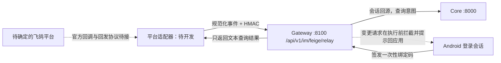

# 飞鸽 IM 渠道接入状态

本仓库已实现**本机规范化中继边界** `feige_relay.py`，尚未连接真实飞鸽服务商。名称“飞鸽 IM”至少对应[抖店飞鸽客服](https://im.jinritemai.com/pc_seller/main/data/customerService)和[独立的 Feige IM 产品](https://www.feige.im/)；两者的身份、事件、签名和发消息接口不同。必须确定目标平台、取得其官方文档与测试应用后，才能实现并验收最后一段适配器。当前状态不能写成“已上线飞鸽渠道”。

## 已实现的本机契约

启用本机中继须设置至少 32 字节随机值的 `BANK_FEIGE_RELAY_SECRET`。若未设置，接口返回 503。`POST /api/v1/im/feige/binding-code` 仅接受有效的 `X-Session-Token`，签发 5 分钟绑定码。可信平台适配器将已核验的 IM 用户标识作为 `subject`，用签名 `bind` 事件交换绑定码。该映射保存在 Gateway 内存中，不持久保存明文 IM 标识；银行会话过期后必须在 Android 中重新登录、重新绑定。`DELETE /api/v1/im/feige/binding?subject=...` 可由同一银行主体解除绑定。

本机验证可先向 Core `/api/v1/auth/login` 以虚构账户登录，再用返回的 `session_token` 请求 Gateway `/api/v1/im/feige/binding-code`。保管好会话令牌和绑定码，切勿写入视频、日志或仓库。`tests/test_feige_relay.py` 模拟签名中继；真实飞鸽消息中的绑定操作必须由目标平台适配器完成。

中继事件采用 UTF-8 JSON：`{"kind":"bind","subject":"平台用户标识","binding_code":"..."}` 或 `{"kind":"message","subject":"平台用户标识","text":"查余额"}`。适配器应在发送前校验平台原始签名，建立稳定的 `subject` 与唯一消息编号。向 Gateway 发送以下头：

| 头 | 内容 |
| --- | --- |
| `X-Feige-Timestamp` | 当前 Unix 秒时间戳 |
| `X-Feige-Event-Id` | 平台消息的唯一编号，重投应复用 |
| `X-Feige-Signature` | `HMAC-SHA256(secret, timestamp + "." + event_id + "." + 原始请求体字节)` 的小写十六进制 |

Gateway 在 5 分钟时间窗内拒绝重复编号。只有完成绑定、会话仍有效的主体可查询。本机规则解析把少量查询意图映射到固定 Core `GET` 白名单；此路径不调用模型或可执行变更的对话编排器，因此即使文本被错误分类也只能读取允许的资源。其他意图在任何 Core 写请求之前被拦截，提示到 Android 应用重新发起。IM 不接受确认、OTP、设备签名或审批 ID，也不执行转账、挂失、申购等写操作。中继响应中的 `reply` 是规范化文本，**平台适配器必须调用目标平台官方发消息 API 才能真正回发给用户**。

## 接通真实平台尚需完成

1. 确认具体产品和应用类型，取得官方入站事件、签名算法、出站消息 API、权限包、速率限制与测试环境资料。
2. 在单独的适配器中实现平台签名校验、事件规范化、官方发消息调用、平台重试幂等与平台授权失效处理。禁止把平台用户 ID 当成银行用户 ID。
3. 若回调要求公网 URL，采用经批准的 TLS 入口并隔离本机 Core；当前 `127.0.0.1` 部署不能直接接收互联网回调。
4. 用真实平台测试应用完成“绑定、查询回发、解绑、重复/伪造事件、过期银行会话、变更请求转应用”的端到端验收，再更新 README 和演示材料。

本机边界的自动化用例见 `tests/test_feige_relay.py`。平台适配器和真实平台联调尚无测试记录。
